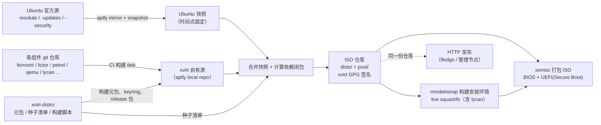
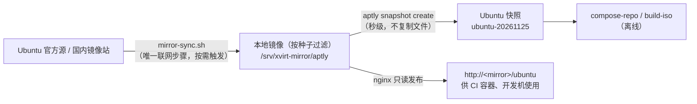

# xvirt 安装 ISO 重构：按包安装，同一 ISO 兼作升级源（设计稿）

> 状态：**初稿已定**（v1.0，2026-11-26，后续微调；决策见 §13）。本稿只管 **ISO 结构、构建与安装**；升级流程另立方案（§10）。
> 涉及仓库：`lycan`（安装器）、`build-deb` / `xvirt/build-deb-xvirt`（打包）、`fledge`（PXE）、Cairn CI 流水线（`PIPE-FS-*`）、新建 `xvirt-distro`（发行版清单）。
> 一句话：仿照 RHEL 的 Anaconda 模式——ISO 本身就是一个**带签名的完整 apt 仓库**，安装器用 `mmdebstrap + apt` 从这个仓库把系统装到硬盘上（内核也是一个 deb）；这样同一个 ISO（或经 HTTP 发布的同一仓库）在结构上就能作为升级源，具体升级流程见单独方案。

---

## 1. 背景与现状

### 1.1 现在的 ISO 是怎么装系统的

现有 lycan ISO 基于 `ubuntu-26.04.1-live-server-amd64.iso` 改造（`lycan/scripts/build-iso.sh`）：

1. 引导 Ubuntu 的 casper Live 环境，lycan 注入在 `.installer` squashfs 层里，并屏蔽 subiquity。
2. lycan 把 `ubuntu-server-minimal` + `ubuntu-server` 两层 squashfs 用 overlay 叠起来，**整棵目录树复制到目标盘**（`_extract_base_system`）。
3. 用 ISO 里的离线 bundle（`build-offline-bundle.sh` 收集的依赖闭包，约 290 个 deb）通过 apt 安装 xvirt / qemu 等。
4. 重新生成 initramfs、安装 grub、写入 `/etc/xvirt/role.conf` 等首次启动配置。

### 1.2 存在的问题

| 问题 | 说明 |
|---|---|
| **不能作为升级源** | 基础系统和内核以镜像形式存在，ISO 里没有对应的 deb，`apt` 无法从 ISO 升级它们 |
| **依赖 Ubuntu Live ISO 的内部结构** | 分层 casper、overlay whiteout、subiquity/snapd 抢 tty1、casper 拦截重启、cloud-init、live initrd 导致的 kernel panic 等一系列问题，都来自"借用别人的 Live 盘" |
| **目标系统内容不受控** | 装进去的是 Ubuntu 预先做好的 server 镜像（含 snapd、cloud-init 等不需要的东西），再逐项禁用 |
| **按角色出多个 ISO** | standalone / management / compute 各一个 ISO（每个约 3.0G），bundle 按角色过滤 |
| **版本号不能比较大小** | xvirt deb 用 `0.0.1+git<hash>`，哈希不单调，apt 无法正确判断新旧 |

### 1.3 RHEL 的做法（参照对象）

- Anaconda 同样先引导 `vmlinuz + initrd`，再挂载 `LiveOS/squashfs.img`（install.img）作为安装环境运行。**"Live 启动安装环境"这一点两者没有区别。**
- 区别在于**目标根文件系统怎么来**：Anaconda 用 dnf 从 ISO 上的 BaseOS/AppStream 仓库安装 RPM（内核也是 RPM），因此 DVD 本身就是一个完整仓库，可以直接用于 `dnf upgrade`。
- Debian 系的对应物是 debian-installer（debootstrap + apt），Ubuntu 20.04 之前的 alternate ISO 也是这样；20.04 以后 Ubuntu 才改成 subiquity/curtin 复制镜像。

---

## 2. 目标与非目标

### 2.1 目标

1. **一个 ISO 覆盖全部角色**：所有角色装同一套全栈包（`xvirt-meta`），角色在安装时选择（或由应答文件指定）并写入 `/etc/xvirt/role.conf`，首次启动由 `xvirt-init` 按角色启用服务——与现有模型一致，保留"改 role.conf 后重跑 xvirt-init 切换角色"的能力（§5.1）。
2. **ISO 是完整、自洽、带签名的 apt 仓库**：目标系统上每个已安装的包（含内核、grub、shim）都能在 ISO 的 `pool/` 中找到。
3. **按包安装**：目标系统由 `mmdebstrap` + `apt` 从 ISO 仓库装出，dpkg 状态从一开始就是干净一致的。
4. **ISO 在结构上可作为升级源**：仓库自洽、带签名、包版本可比较大小（§6.1），目标系统写好（默认禁用的）apt 源模板。怎么用它升级由升级方案决定（§10）。
5. **完全离线**：安装和升级都不需要访问外网；**ISO 构建也不访问外网**，只读本地镜像源（§4.1）。
6. **可复现**：每个 ISO 对应 `xvirt-distro` 仓库的一个 commit + 一个 Ubuntu 快照时间点 + 一组 xvirt 包版本。
7. **保留 lycan 现有能力**：TUI 向导、应答文件、网络/磁盘/账号配置、PXE（fledge）流程不变。

### 2.2 非目标（本期不做）

- 不自建完整的 Ubuntu 镜像站，也不重新编译 Ubuntu 的包。
- **升级流程不在本稿**：`xvirt-upgrade`、界面升级（含 REQ-OPS-001 的可升级包与变更说明）、集群滚动升级、升级中不中断虚拟机等，另立升级方案（§10 列出移交事项）。
- **不做升级回滚**：不做 A/B 分区、ostree、LVM/btrfs 快照等回滚机制（§10.2）。
- **不支持已部署的老节点**：用"复制镜像"方式装出的现有节点不迁移、不能用新 ISO 升级，只支持新方案安装的节点。
- 不改变 xvirt 各组件本身的功能。

---

## 3. 总体方案



关键点：

- **只有两类上游**：Ubuntu 快照（基础包）和 xvirt 自有源（自研和第三方包）。
- **git 里只放源码和清单，不放 deb**。deb 是 CI 产物，进 apt 仓库。
- **安装环境和目标系统用同一个 pool 构建**，版本天然一致。
- ISO 仓库发布到 HTTP 后，就是 PXE 安装源和在线升级源。

---

## 4. 软件源体系

### 4.1 本地 Ubuntu 镜像源与快照（构建不依赖网络，镜像尽可能小）

**原则一：同步和构建分开。** 只有"镜像同步"这一步访问外网；ISO 构建、CI 打包、闭包计算、mmdebstrap 全部只读本地镜像，构建机可以完全断网。

**原则二：镜像只包含需要的包（已拍板）。** 不做全量镜像，只同步 `xvirt-distro` 种子及其依赖闭包。



- **工具**：aptly。它把下载的 deb 统一存放在自己的 pool 里（按内容去重），快照和发布只是元数据和硬链接，打快照、合并、过滤、发布都在本地完成，速度快。
- **镜像范围**：`resolute`、`resolute-updates`、`resolute-security` 三个 pocket，`main`、`restricted`、`universe` 三个组件，只要 amd64、不要源码包。
- **按种子过滤**：过滤条件 = `xvirt-distro` 中**所有种子的并集**：
  - 运行时：`base` + `platform` + `installer-env`（决定 ISO 内容）；
  - 构建期：`build-deps`（CI 编译各组件所需的构建依赖，只进镜像，不进 ISO）。
  - **不跟随 Recommends / Suggests**；`a | b` 形式的可选依赖由 apt 按首选项解析，与目标系统的安装策略一致（§7.6）。
  - `Priority: required` 自动加入；xvirt 包（`xvirt-meta` 等）的 Ubuntu 依赖通过临时加入 xvirt 自有源解析，xvirt 包本身不进 Ubuntu 镜像。
- **闭包用 apt 解析，不用 aptly 的 `-filter-with-deps`**（已实现，`xvirt-distro/mirror/mirror-sync.sh` + `resolve.py`）：aptly 的 `-filter-with-deps` 只在**当前 mirror 内**解析依赖，`-updates` / `-security` 中的包往往依赖 release pocket 里的包，单独过滤会漏。因此：
  1. 在临时 apt 根目录中读取上游三个 pocket 的索引（校验 Ubuntu 签名），对每组种子 `apt-get -s install --no-install-recommends`，apt 把三个 pocket 当整体解析，结果就是目标系统真正会装的包；
  2. 黑名单检查（命中即失败并打印依赖来源）；
  3. 三个 aptly mirror 的 filter 都设为闭包中的**精确包名列表**（不再展开依赖），`mirror update` 只下载这些包；
  4. 各 pocket 打快照，`snapshot merge -latest` 合成带日期的快照（如 `ubuntu-20261126`）；
  5. 发布后再用只指向本地发布目录的 apt 把各组种子重新解析一遍（自检），通过才切换 `current`。
  不需要不动点迭代。实测（2026-11-26，种子初版）：Ubuntu 包名 1126 个，镜像约 1400 个文件、2.2 GiB；运行时部分单版本约 1.1 GiB，其中 `linux-firmware` 各子包合计约 660 MiB。
- **代价**：种子里新增一个包时，需要先跑一次 `mirror-sync.sh`（联网）再构建。compose-repo 发现缺包时直接报错并提示"请先同步镜像"，不会悄悄联网。
- **上游地址可配置**：默认用国内镜像站（如 `mirrors.aliyun.com/ubuntu`）加快同步，仍校验 Ubuntu 官方签名（aptly mirror 校验上游 `Release.gpg`，构建机需导入 Ubuntu archive keyring）。
- **同步时机**：
  - 出现需要处理的 Ubuntu 安全公告时（§7.5）；
  - `xvirt-distro` 种子变更时；
  - 准备发布新功能版之前。
  不设每天定时全量同步。构建只引用快照名，同一快照多次构建结果一致。
- **快照保留**：正式发布引用过的快照永久保留（写进 `build-manifest.json`，便于重建和追溯）；其余快照保留最近 N 个，定期 `aptly db cleanup` 回收空间。
- **本地发布**：本地镜像同时用 nginx 只读发布，CI 构建容器（`ferrostack-ci-builder`）和开发机的 apt 源都指向它，替代直接访问公网，也加快 `package-deb` 阶段安装构建依赖的速度。
- **体积**：按种子过滤后预计只有几 GB（主要是内核、固件、各 pocket 中同一包的多个版本），首次同步时实测。存放在 `/srv/xvirt-mirror`（aptly rootDir），与构建临时目录分开。
- **与现有离线源的关系**：Cairn CI 现在通过主机卷 `shared-artifacts:/local-apt-repo`（只读）给构建容器提供 Ubuntu 离线源、`apt-repo:/aptout` 存放 xvirt deb。新方案中 `/local-apt-repo` 改为挂载本地镜像的发布目录（或直接指向 nginx 发布的同一份数据），P0 完成后旧的离线源停止更新；`/aptout` 演进为 `xvirt-dev` 仓库的发布端点（§4.2）。
- **非 apt 依赖同样离线**：cargo / npm / Go 依赖现在靠 CI 缓存卷（`cargo:` / `npm:`）和锁文件（各 Rust 仓已提交 `Cargo.lock`）。缓存为空时也必须能断网构建，因此：Rust 用 `cargo vendor` 或内部 crates 镜像（由镜像同步步骤一并更新），npm 用内部 registry 镜像或提交的离线缓存，Go 用 `vendor/` 或内部 `GOPROXY`（现有 xvirt-tools 构建已是 `GOPROXY=off`）。具体选型在 P0 定，原则与 apt 一致：只有同步步骤联网。

### 4.2 xvirt 自有源

- aptly local repo，分两个通道：
  - `xvirt-dev`：CI 每次合入后构建的包，用于日常 ISO / 冒烟测试；
  - `xvirt-<major>`（如 `xvirt-1`）：正式发布的包，只追加不覆盖。
- 内容：xvirt 平台包（`xvirt-ferrovirt`、`xvirt-lictor`、`xvirt-hyper-agent`、`xvirt-petrel`、`xvirt-concilium`、`xvirt-client`、`xvirt-init` …）、定制 QEMU（`qemu-kvm-xvirt`，build-deb 产出）、`lycan`、元包、`xvirt-archive-keyring`、`xvirt-release`，以及 Ubuntu 中没有、需要自行打包的第三方软件。
- 现有的 Cairn CI 主机卷 `apt-repo:/aptout`（`PIPE-FS-DEB-XVIRT` 的产物目录）演进为该仓库的一个发布端点。

### 4.3 ISO 仓库（合并后的产物）

- **发布 distribution 按大版本（已拍板）**：`xvirt-1` 覆盖 1.x 的全部功能版、补丁版和 Ubuntu 更新版。同一大版本内任何一个更新的 ISO 都可以直接作为升级源；跨大版本（如 1.x → 2.x）怎么切换 suite 由升级方案定义（§10）。
- `aptly snapshot merge` 合并 Ubuntu 快照与 xvirt 快照；xvirt 包与 Ubuntu 包同名时，以 xvirt 为准（merge 时 xvirt 快照放在后面，或用版本号/epoch 保证更高）。
- `aptly snapshot filter -with-deps` 按种子计算闭包，生成 ISO 快照（如 `iso-1.0.0`）。**只放需要的依赖包**：只包含 `Priority: required`、运行时种子及其 Depends/Pre-Depends 闭包，不含 Recommends、不含 `Priority: important/standard` 的包（§7.6）。
- `aptly publish snapshot -skip-signing` 输出 `dists/` + `pool/`，然后把 `Release` 送到签名服务签名（§4.4），再放进 ISO 根目录。
- 发布参数：`-distribution=xvirt-1 -component=main -architectures=amd64`，`-label=xvirt -origin=xvirt`。

> 依赖闭包示意（种子以 `xvirt-distro` 为准）：
>
> ```bash
> aptly snapshot merge -latest all-1.0.0 ubuntu-20261125 xvirt-1-20261125
> aptly snapshot filter -with-deps all-1.0.0 iso-1.0.0 \
>   'Priority (required) | xvirt-meta | xvirt-installer-env'
> aptly publish snapshot -skip-signing -distribution=xvirt-1 iso-1.0.0 iso
> # 再调用签名服务生成 InRelease / Release.gpg（§4.4）
> ```

### 4.4 签名密钥与签名服务（cairn.xve-vt.com）

**已拍板：签名私钥放在 `cairn.xve-vt.com` 上。** 构建机上不放私钥，通过签名服务远程签名。

- **两把密钥**：`xvirt-release`（正式通道）和 `xvirt-dev`（dev 通道），分开生成、分开使用。建议 ed25519，或兼容性更好的 RSA4096。
- **签名服务 `xvirt-signer`**（部署在 cairn.xve-vt.com）：
  - 私钥由该主机上的 gpg-agent 持有，私钥文件和口令不出这台机器；口令通过 systemd credential 提供，不写进配置文件；
  - HTTPS 接口：`POST /sign`，提交 apt `Release` 文件，返回 `InRelease`（clearsign）和 `Release.gpg`（分离签名）；
  - 认证：CI 使用专用 token（或 mTLS 客户端证书），按通道授权——dev token 只能用 dev 密钥；**正式密钥只允许发布流水线调用，打 tag 的构建自动放行（已拍板）**，不需要人工逐次确认：
    - 发布 tag 打在 `xvirt-distro` 上，格式 `v<X.Y.Z>` 或 `v<X.Y.Z>-u<YYYYMMDD>`（Ubuntu 更新版）；git 服务器上把 `v*` 设为**受保护 tag**，只有发布负责人能创建，且不能移动或删除；
    - **放行判断在签名服务一侧做，不信任流水线**：请求必须带 tag 名和 commit；签名服务自己向 git 服务器（kairos）查询该 tag 确实是受保护 tag、确实指向这个 commit，并读取该 commit 的 `VERSION` 与 tag 一致；再核对 Release 里的 `Suite` 与 tag 的大版本一致（`v1.*` 只能签 `xvirt-1`）。任一项不符即拒绝。这样即使正式 token 泄露，也只能签已经受保护 tag 认可的版本；
    - 正式 token 只注入由受保护 tag 触发的构建。Cairn CI 是否支持按 ref 限定密钥注入需在 P0 确认；不支持时先补这项能力，在此之前正式签名由发布负责人手动触发；
    - 每次正式签名自动在 Cairn 记录一条通知（tag、构建 ID、Release sha256），事后可追溯；
  - 校验输入：只接受格式正确的 apt Release 文件，且 `Origin: xvirt`、`Suite` 必须在允许列表内，拒绝签任意内容；
  - 审计：记录每次签名的时间、调用方、构建 ID、Release 文件 sha256、使用的密钥；
  - 备份：私钥离线加密备份两份，存放在 cairn.xve-vt.com 以外的地方；主机上的密钥目录单独用户、最小权限。后续可迁到 YubiKey / HSM，接口不变。
- **构建侧流程**：`aptly publish -skip-signing` → 调用 `xvirt-signer` → 写入 `InRelease` / `Release.gpg` → 构建机用公钥 `gpgv` 本地验证 → 再继续构建安装环境和 ISO。签名这一步只访问 cairn.xve-vt.com，不访问任何软件源，因此仍符合"构建不依赖网络源"。在 CI 中，构建容器以 `--network none` 运行，签名步骤在容器外由流水线执行。
- 公钥打包为 `xvirt-archive-keyring`，安装到 `/usr/share/keyrings/xvirt-archive-keyring.pgp`；dev 构建的 ISO 中 keyring 包同时含 dev 公钥，正式 ISO 只含正式公钥。目标系统的 apt 源用 `Signed-By:` 指向该文件。
- 密钥轮换：keyring 包可同时携带新旧两把公钥，过渡一个大版本。
- **与现有签名方案的迁移**：2026-11-23 落地的方案是构建机上持久的单密钥 `/data/xvirt-gpg`（Cairn CI 缓存卷 `xvirt-gpg:/xvirt-gpg`）+ `sign-apt-repo.sh`。迁移步骤：
  1. P0 部署 `xvirt-signer` 后，`sign-apt-repo.sh` 改为调用签名服务（保留本地 gpg 路径仅供无网开发调试，CI 中禁用）；
  2. 删除 `PIPE-FS-ISO-LYCAN` / `PIPE-FS-RELEASE-ALL` 中"找不到密钥就 `XVIRT_GPG_GENERATE=1` 临时生成"的逻辑——**临时密钥签出的 ISO 无法被任何节点信任，必须直接失败**（这一条不必等 P0，可先改）；
  3. 构建机上的 `/data/xvirt-gpg` 私钥在切换后销毁或离线归档；它签过的 ISO 只用于测试，新方案不支持老节点（§2.2），不需要过渡 keyring。

---

## 5. `xvirt-distro` 清单仓库

新建 git 仓库 `xvirt-distro`，描述"一个 xvirt 发行版由什么组成"，作用类似 Fedora 的 comps + kickstart、Ubuntu 的 germinate seeds。

```text
xvirt-distro/
├── VERSION                     # 产品版本，如 1.0.0
├── distro.yaml                 # Ubuntu 快照名、xvirt 通道、发布 distribution 名、签名密钥 ID
├── seeds/
│   ├── base.txt                # 基础系统：linux-image-generic、grub、shim、openssh-server、chrony … → xvirt-base 元包
│   ├── platform.txt            # 平台全栈（所有角色相同）→ xvirt-meta 元包
│   ├── installer-env.txt       # 安装环境：lycan、mmdebstrap、parted、mdadm、lvm2、ethtool、xfsprogs …
│   ├── build-deps.txt          # CI 编译各组件的构建依赖：只进本地镜像，不进 ISO
│   └── blacklist.txt           # 禁止进入系统的包：snapd、cloud-init、ubuntu-advantage-tools …
├── debian/                     # 元包 / xvirt-release / xvirt-archive-keyring 的打包描述
├── keys/                       # 发布公钥（私钥在 cairn.xve-vt.com，不进仓库）
├── mirror/
│   └── mirror-sync.sh          # 本地镜像同步（按种子过滤 + 不动点迭代，§4.1）
├── iso/
│   ├── grub/                   # grub.cfg 模板（BIOS + UEFI 共用）
│   ├── isolinux 或 eltorito/   # BIOS 引导相关
│   └── build-iso.sh            # ISO 组装脚本（§7）
├── installer-env/
│   └── hooks/                  # 安装环境 squashfs 的定制钩子（自动登录 tty1 启动 lycan 等）
└── tests/                      # 依赖闭包检查、版本单调检查
```

### 5.1 元包

**角色模型（已拍板）：沿用现有的"全栈一个元包 + 首启按角色启用"。** 不按角色拆元包、不做角色间互斥。

| 元包 | 依赖（示意） |
|---|---|
| `xvirt-base` | `linux-image-generic`、`grub-efi-amd64-signed`、`shim-signed`、`grub-pc-bin`、`openssh-server`、`chrony`、`xvirt-archive-keyring`、`xvirt-release`、常用运维工具；`Conflicts: snapd, cloud-init` |
| `xvirt-meta`（已有，扩展） | `xvirt-base` + 现有 `xvirt-meta` 的全部依赖：`xvirt-init`、`xvirt-lictor`、`xvirt-hyper-agent`、`xvirt-ferrovirt`、`xvirt-petrel`、`xvirt-fulmar`、`xvirt-kestrel`、`xvirt-dcui`、`xvirt-concilium`、`xvirt-client`、`xvirt-guest-tools`，定制 QEMU 的二进制包（`qemu-system-x86`、`qemu-utils`、`qemu-block-extra`、`qemu-system-modules-spice`、`qemu-system-modules-opengl`，epoch 2），以及现在由 ISO 流水线 `EXTRA_PKGS` 额外塞进闭包的包（`openvswitch-switch`、`nginx`、`mariadb-server`、`avahi-daemon`、`libnss-mdns`、`ufw`、`xfsprogs`、`gdisk`、`novnc`、`chrony`、`ethtool` …）一律改为显式 Depends |
| `xvirt-installer-env` | 仅用于构建安装环境，不装到目标系统 |

- 所有角色装的包完全相同；角色只体现在 `/etc/xvirt/role.conf`，由 `xvirt-init` 首次启动时启用对应服务（REQ-INS-027）。改角色仍是"改 role.conf → 重跑 xvirt-init"，不需要增删包。
- 现在 `xvirt-meta` 的 `Recommends: xvirt-fledge, novnc, chrony`：目标系统不装 Recommends（§7.6），需要的改成 Depends（`novnc`、`chrony`）；`xvirt-fledge` 只在管理节点按需安装，作为普通包放进 ISO 仓库（写进 `platform.txt`），不由元包拉入。
- 代价：管理节点也装了 qemu / petrel 等用不到的包，多占约几百 MB 磁盘，换来单一组合、测试矩阵最小。
- **元包依赖写版本下限**（例如 `xvirt-ferrovirt (>= 1.0.0)`），保证组件成套。

### 5.2 `xvirt-release` 包

- 安装 `/etc/xvirt-release`（产品名、版本、构建 ID、Ubuntu 快照名），以及 `/etc/os-release` 的 xvirt 扩展字段（`VARIANT=` / `VARIANT_ID=`），**不替换 Ubuntu 的 os-release**。
- 安装 apt 源模板（§9.1）和 apt pin（§9.2）。

---

## 6. 包与版本规范

### 6.1 版本号

| 场景 | 格式 | 示例 |
|---|---|---|
| 正式发布 | `<X.Y.Z>-<rev>` | `1.0.0-1` |
| 正式发布前的开发构建 | `<X.Y.Z>~dev<YYYYMMDDHHMM>.g<hash>-1` | `1.0.0~dev202611252230.g3d9d55d-1` |
| 发布后的补丁构建 | `<X.Y.Z>-<rev>` 中 rev 递增，或升 Z | `1.0.0-2` / `1.0.1-1` |

- `~` 在 dpkg 中排序低于任何字符，所以 `1.0.0~dev… < 1.0.0-1`，开发版天然低于正式版。
- **发布后立即抬高开发基线**：`1.0.0` 正式发布的同时，`xvirt-distro` 的开发基线改为下一个版本（`1.1.0~dev…` 或 `1.0.1~dev…`），否则发布后的开发构建 `1.0.0~dev…` 会低于已发布的 `1.0.0-1`。CI 的版本单调检查会拦住漏改。
- **时间戳放在哈希前面**，保证按构建顺序单调递增。时间戳取 **CI 构建时间**（不取 commit 时间：rebase / 多分支下 commit 时间不单调）。同一 commit 重新构建会得到更高的版本号，这是有意的；"可复现"指的是用同一快照重建 ISO（§2.1），deb 一旦进入快照就不再重建。
- **哈希取各组件自己仓库的 commit**（ferrovirt 用 ferrovirt 的、petrel 用 petrel 的）。现在所有 xvirt 包都用 xvirt 仓的 SHA，导致组件代码变了版本号却没变、装新包时 dpkg 报 "downgrading"。xvirt-distro 自己的包用 xvirt-distro 的 commit。
- 取消现有的 `0.0.1+git<hash>`，新方案从 `1.0.0` 起。老节点不在支持范围内（§2.2），无需用 epoch 兼容旧版本号。
- 定制 QEMU 继续沿用 `qemu-kvm-xvirt` 的 epoch 2，但 Debian revision 部分同样改为带时间戳的递增格式。
- CI 增加**版本单调检查**：同名包的新版本必须 `dpkg --compare-versions new gt old`。

### 6.2 maintainer 脚本规范

升级能否顺利，主要取决于各 deb 的 maintainer 脚本。要求：

1. `postinst configure` 必须**幂等**，能在首次安装和升级两种情况下重复执行。
2. 配置文件：用户可修改的放 `conffiles`（dpkg 会提示/保留用户修改）；由程序管理的配置在 postinst 里做迁移，不放 conffiles。
3. 数据库 schema 迁移：沿用 ferrovirt 启动时的 `schema_fix` 机制（ferrovirt_fixup 表记录已做过的修正），postinst 只负责重启服务；迁移必须向前兼容，不允许破坏性 DDL 在同一版本内既改又删。
4. 服务：用 `dh_installsystemd`；对正在运行 VM 的服务**不能因为重启而杀掉虚拟机**。lictor / hyper-agent 已是 `KillMode=process`（重启后重新接管已运行的 qemu）。qemu 包本身、openvswitch、存储守护进程在升级时的处理属于升级方案（§10）。
5. 在 chroot 中执行时（安装阶段）不得启动服务；靠 `policy-rc.d` 返回 101 + 检测 `systemd` 是否在运行来判断。
6. 首次启动才能做的事（读硬件、建网桥、初始化数据库等）继续交给 `xvirt-init.service`，不要放进 postinst。

---

## 7. ISO 结构与构建

### 7.1 ISO 目录结构

```text
/
├── .disk/info                       # 产品名 + 版本 + 构建 ID
├── xvirt/
│   ├── build-manifest.json          # xvirt-distro commit、Ubuntu 快照名、全部包及版本、sha256
│   ├── answers/                     # 内置应答模板（standalone / management / compute）
│   └── xvirt-archive-keyring.pgp    # 公钥（供人工校验 ISO 仓库签名）
├── dists/xvirt-1/                 # apt 仓库元数据（InRelease / Release.gpg / Packages）
├── pool/main/...                    # 全部 deb：内核、基础系统、xvirt 组件
├── live/
│   ├── vmlinuz                      # 安装环境内核（与 pool 中 linux-image 同一版本）
│   ├── initrd.img
│   └── filesystem.squashfs          # 安装环境根文件系统（含 lycan）
├── boot/grub/                       # grub.cfg、BIOS 用 grub 模块
└── EFI/boot/                        # bootx64.efi(shim)、grubx64.efi(签名 grub)、efiboot.img
```

体积目标：**ISO ≤ 1 GB**（三个角色合一；现在单角色 ISO 约 3.0G）。P2 实测后校准，体积控制措施见 §7.6。

### 7.2 安装环境（Live runtime）

- 用 `mmdebstrap` 从**同一个 ISO 仓库**构建：`mmdebstrap --variant=minbase --include=xvirt-installer-env resolute ...`（`xvirt-installer-env` 依赖 `live-boot`、`linux-image-generic`、lycan 及分区工具），压成 `live/filesystem.squashfs`。
- 引导方式（**已拍板**）：Ubuntu 内核 + `initramfs-tools` + **Debian 的 `live-boot`**（内核参数 `boot=live`），不再使用 casper。支持 `toram`（整个安装环境读入内存，安装过程中可以拔掉 U 盘/虚拟光驱）；PXE 时用 `fetch=http://…/live/filesystem.squashfs`。
- `live-boot` 在 Ubuntu 的 universe 中提供，包含在本地镜像内；P2 阶段首先验证它与 resolute 的内核、initramfs-tools 能正常配合，如有问题以补丁包形式放进 xvirt 自有源。
- 安装环境中 tty1 自动登录并启动 lycan；`systemd.mask` subiquity 之类的补丁全部不再需要。
- 救援 SSH、"Rescue & Hardware Diagnostics Shell" 引导项沿用现有设计。**救援凭据的注入**：仍由 `build-iso.sh --rescue-ssh-key / --rescue-password-hash` 在构建时写入安装环境 squashfs（默认关闭救援 SSH，与现状一致）；CI 继续从构建机 ISO 目录读 `lycan-rescue.pub`。不放进 ISO 根目录的明文文件，避免 ISO 被拷走后泄露。

### 7.3 引导与 Secure Boot

- **UEFI**：使用 pool 中 Ubuntu 签名的 `shim-signed` 和 `grub-efi-amd64-signed`，内核也是 Canonical 签名的，因此 Secure Boot 开启时无需自有签名密钥。注意 Ubuntu 签名 grub 的配置查找路径（`/EFI/ubuntu/` 及 ISO 内 `/boot/grub/`）要和现有 lycan ISO 的做法保持一致。
- **BIOS**：`grub-pc-bin` 生成 El Torito 引导映像，xorriso 构建 hybrid ISO（可直接 `dd` 到 U 盘）。
- **定制 QEMU、自研内核模块**：都是用户态包或 DKMS 包时不影响 Secure Boot；如以后需要自编内核，再考虑 MOK 签名。

### 7.4 构建步骤（`xvirt-distro/iso/build-iso.sh`）

0. **离线前提**：构建全程只访问本地 aptly（Ubuntu 快照 + xvirt 自有源），不配置任何网络源；CI 中构建容器以 `--network none` 运行作为强制检查。
1. 读取 `distro.yaml` 与 `VERSION`，确定 Ubuntu 快照、xvirt 通道。
2. 构建 xvirt-distro 自己的包（元包、`xvirt-release`、`xvirt-archive-keyring`），加入 xvirt 自有源。
3. aptly：合并快照 → 按种子过滤闭包 → `publish -skip-signing` 到 `staging/iso-root/` → 调用 cairn.xve-vt.com 上的 `xvirt-signer` 签名（dev 或正式密钥，§4.4）→ 本地 `gpgv` 验证。
4. **闭包自检**：在干净 chroot 中，只使用 `file:` 指向 staging 仓库，分别 `apt-get install -s --no-install-recommends` `xvirt-meta` 和 `xvirt-installer-env`，任何缺包即失败；检查 `blacklist.txt` 中的包没有进入闭包；**体积检查**：输出最大的 20 个包和 ISO 总大小，超出预算即失败（§7.6）。
5. mmdebstrap 构建安装环境：**先**完整安装（含 `linux-firmware`）并生成 `initrd.img`，让 initramfs-tools 把早期驱动需要的固件打进 initrd；**再**删除 `/usr/lib/firmware` 下的文件（dpkg 登记保留）；最后压成 squashfs，提取同版本 `vmlinuz` / `initrd.img`（§7.6）。
6. 生成 grub 配置（交互安装、自动应答 × 三种角色、救援 shell）。默认项为交互安装；需要无人值守默认启动的场景（如 CI）由构建参数指定默认角色项和超时，替代现在按角色出 ISO 的 `--role`。
7. 生成 `xvirt/build-manifest.json` 与 `.disk/info`。
8. xorriso 打包 hybrid ISO（BIOS + UEFI），输出 `xvirt-<version>-amd64.iso` 及 sha256。
9. 同时把 `staging/iso-root/{dists,pool}` 发布到内部 HTTP 仓库（供 PXE 和在线升级）。

整个构建可以在现有 `ferrostack-ci-builder:26.04.1` 容器中运行（需要额外安装 aptly、mmdebstrap、live-boot 相关工具，aptly rootDir 以只读方式挂入），不再依赖 `ubuntu-26.04.1-live-server-amd64.iso`。

### 7.5 ISO 类型与版本

| 类型 | 内容变化 | ISO 版本示例 | 发布 distribution |
|---|---|---|---|
| 功能版 | xvirt 包更新（可同时更新 Ubuntu 快照） | `1.1.0` | `xvirt-1` |
| 补丁版 | 个别 xvirt 包修复 | `1.1.1` | `xvirt-1` |
| **Ubuntu 更新版**（已拍板） | **只换 Ubuntu 快照**，xvirt 包与所基于版本完全相同 | `1.1.1-u20261215` | `xvirt-1` |

Ubuntu 更新版的出法：

**触发条件（已拍板）：有安全公告时再出**，不按固定周期出。

1. **公告监测**：`usn-watch` 定时任务（只拉取元数据，很小）读取 Ubuntu 安全公告（USN）/ OVAL 数据中 resolute 的条目，与**仍在支持期内的已发布 ISO** 的 `build-manifest.json` 做比对：公告涉及的包在我们的闭包里，才算命中。
2. **命中后通知**：在 Cairn 中自动建 issue（含 USN 编号、CVE、涉及的包及版本、受影响的 ISO 版本），由负责人判断是否出更新版（例如内核、openssh、openssl、glibc 等高危公告一般要出）。
3. **出更新版**：先 `mirror-sync.sh` 同步本地镜像并打新快照；`xvirt-distro` 中只修改 `distro.yaml` 的 Ubuntu 快照名，xvirt 通道仍指向原正式版的 xvirt 快照，**不重新构建任何 xvirt 组件包**。唯一例外是 xvirt-distro 自己产出的包：`xvirt-release` 记录了 ISO 版本和 `UBUNTU_SNAPSHOT`，必须重建，版本号写成 `<X.Y.Z>-<rev>+u<YYYYMMDD>`（如 `1.1.1-1+u20261215`，dpkg 排序高于 `1.1.1-1`）；元包内容不变则不重建。
4. **出给哪个版本**：每个大版本只给**最新功能版**出 Ubuntu 更新版。这意味着停留在旧功能版的节点要拿到 Ubuntu 安全补丁，必须连功能一起升——这是对外的发布策略，交由升级方案和发布说明明确（§10）。
5. 走同样的 compose-repo / build-iso / 冒烟测试流程。
6. `xvirt-release` 的 `/etc/xvirt-release` 增加 `UBUNTU_SNAPSHOT=` 字段，便于看出节点当前所在的快照。

### 7.6 体积控制（ISO 只包含需要的依赖包）

**已拍板：ISO 只包含需要的依赖包。** 措施：

| 措施 | 说明 |
|---|---|
| 不跟随 Recommends / Suggests | 镜像、ISO 闭包、目标系统三处一致：闭包只跟 Depends / Pre-Depends；lycan 装包加 `--no-install-recommends`；`xvirt-release` 安装 `/etc/apt/apt.conf.d/90xvirt-no-recommends`（`APT::Install-Recommends "false"`），保证以后升级时也不会去找 ISO 里没有的推荐包 |
| 不纳入 important / standard 优先级 | 只包含 `Priority: required`（mmdebstrap `minbase`）+ 种子里显式列出的包；需要的工具（如 `less`、`vim-tiny`、`iproute2`、`pciutils`）在 `base.txt` 中逐个列出 |
| 内核只装 `linux-image-generic` | 不装 `linux-generic` 带来的 headers；没有 DKMS 需求时不需要编译环境 |
| 黑名单 | `blacklist.txt`：snapd、cloud-init、ubuntu-advantage-tools、ubuntu-pro-client、landscape、motd-news、popularity-contest、apport、文档类包等；闭包里出现即构建失败，并打印是谁依赖进来的 |
| 安装环境瘦身 | squashfs 用 xz 压缩；`dpkg path-exclude` 去掉 `/usr/share/doc`、`man`、`info`，locale 只保留 `zh_CN`、`en_US`；不保留 apt 缓存和列表 |
| **固件不重复存放（已拍板，必须做）** | `linux-firmware` 是体积最大的单项之一，ISO 里只保留 pool 中的那一份 deb，安装环境 squashfs 不含固件。具体做法见下文 |
| 体积预算检查 | CI 每次构建输出最大的 20 个包、各部分体积（pool / squashfs / 引导），超出预算（初定 1 GB）即失败，防止体积悄悄变大 |

**固件去重的做法**

1. **构建时**：安装环境照常安装 `linux-firmware`（保证 dpkg 依赖满足），**先生成 initrd**（第 3 点需要固件文件在场），**再删除** `/usr/lib/firmware` 下的文件，squashfs 中只剩包登记信息。注意不能一开始就用 `dpkg path-exclude` 不落地固件，否则 initramfs-tools 生成 initrd 时找不到固件可打包。
2. **光盘 / U 盘 / BMC 虚拟光驱启动时**：安装环境里的 `xvirt-firmware-unpack.service` 排在 `systemd-udev-trigger.service` **之前**运行：
   - 从 live 介质（`/run/live/medium`）的 pool 中找到 `linux-firmware_*.deb`（版本由构建时写入的清单指定，与 squashfs 中登记的版本一致）；
   - 把其中的 `/usr/lib/firmware` 解包到 tmpfs，并挂到安装环境的 `/usr/lib/firmware`；
   - 之后 udev 冷插拔加载网卡、HBA 等驱动时就能找到固件。
   - **BMC 虚拟光驱读速往往只有每秒几 MB**，读几百 MB 的固件 deb 可能让启动多等几分钟。P2 必须在至少一种 BMC 虚拟光驱上实测；若不可接受，改为 `toram` 时一并读入内存，或把固件拆成按厂商的子集按需解包。
3. **PXE 启动时**：不在用户态联网下载（udev 之前网络是否可用不可靠，而网卡驱动本身可能就在等固件）。改由 **fledge 在服务端**把同一个 `linux-firmware` deb 解成 `live/firmware.cpio`（或 squashfs 附加层），iPXE 作为第二个 initrd 与 `initrd.img` 一起下发，内核启动时直接展开；这个文件只存在于 fledge 的 HTTP 目录，不进 ISO，ISO 体积不受影响。
4. **initramfs 阶段的驱动**：在切换到真正的根之前加载的驱动（读 ISO 的存储驱动、PXE 时取 squashfs 用的网卡驱动）用不上 tmpfs 里的固件。由 `initramfs-tools` 按 `MODULES=netboot` 自动把**这些驱动用到的少量固件**打进 initrd（前提是第 1 点的顺序），这部分重复只有几 MB，可以接受。
5. **兜底**：解包失败时不阻止启动，lycan 在网卡/磁盘列表中标出"固件缺失"的设备，并在日志中给出原因。
6. **内存开销**：解包后的固件放在内存里，大约几百 MB；安装环境本来就要求 ≥4 GB 内存，可以接受。
7. **目标系统不受影响**：目标系统按正常方式安装 `linux-firmware` deb，固件落在硬盘上。

> 同样的思路可以用于 `linux-modules-extra`（内核扩展模块，在 pool 与 squashfs 中也是重复的），但模块在 initramfs 和 udev 阶段都要用，处理更复杂。先做固件，模块是否去重看 P2 的实测体积再定。

> 注意：不装 Recommends 后，有些包的常用功能可能缺失（例如某些服务依赖的辅助工具只在 Recommends 里）。各角色需要的这类包要显式加进种子，靠离线冒烟测试和物理机测试发现遗漏。

---

## 8. lycan 改动

交互界面、应答文件、网络、磁盘、账号相关代码**基本不动**，主要改动在 `steps/install.py` 的"装系统"部分。

### 8.1 新的安装流程

| 阶段 | 内容 |
|---|---|
| 1. 准备磁盘 | 不变：`_release_disk`、分区（ef02 / ESP / swap / root …）、mkfs、挂载到 `/target` |
| 2. 定位安装源 | 光盘/U 盘：挂载 ISO 到 `/run/xvirt/media`；PXE：使用 `lycan.repo=http://…` 或 fledge 下发的 URL |
| 3. 装基础系统 | `mmdebstrap --variant=minbase --include=xvirt-base --aptopt='Dir::Etc::TrustedParts "/run/xvirt/keyrings"' resolute /target "deb [signed-by=…] file:/run/xvirt/media xvirt-1 main"` |
| 4. 装平台 | chroot 中 `apt-get install -y --no-install-recommends xvirt-meta`（所有角色相同；角色来自向导或应答文件，只写进第 5 步的 `role.conf`） |
| 5. 系统配置 | 不变：fstab、hostname、netplan、账号/SSH 密钥、时区、键盘、`/etc/xvirt/role.conf`、`default-bridge.conf` |
| 6. 引导 | `update-initramfs -c -k all`（目标系统用的是 `linux-image-generic` 自带的普通 initramfs，不再有 live initrd 混入的问题，`MODULES=most` 可保留为保险）、`grub-install`（BIOS + UEFI）、`update-grub` |
| 7. apt 源落盘 | 写入目标系统的 `xvirt.sources`（§9.1），默认指向本地 ISO 挂载点 / 管理节点仓库，不指向 Ubuntu 公网 |
| 8. 收尾 | 卸载、同步、按应答 `reboot` |

### 8.2 安装速度

- 用 `dpkg --force-unsafe-io`（安装阶段可接受；结束时统一 `sync`）和 `eatmydata` 减少 fsync。
- 预计在 SSD 上 3~6 分钟完成装包，比复制镜像慢几分钟，可以接受。
- 进度：apt 用 `-o APT::Status-Fd=<fd>` 输出机器可读进度，lycan 映射到现有 8 阶段进度条和 fledge 回调（`callback_url`）。

### 8.3 可以删掉的 workaround

以下针对 casper / Ubuntu Live 盘的特殊处理在新方案下不再需要：

- overlay 挂载分层 squashfs 再复制（`_target_layer_chain` / `_extract_base_system`）；
- 屏蔽 subiquity（build 期 symlink + `systemd.mask=` 内核参数）；
- 绕过 casper 的"请移除安装介质"（强制 `reboot -f`）；
- 禁用 cloud-init（不再安装，blacklist 中禁止）；
- 删除 `file:/cdrom` 旧源、修 chroot `resolv.conf`；
- live initrd 混入目标系统导致的 kernel panic。

### 8.4 兼容

- 应答文件格式不变；新增可选字段 `repo:`（覆盖安装源 URL）。
- 内核参数新增 `lycan.repo=`；其余 `lycan.*` 参数保持不变。
- 旧的 per-role ISO 构建脚本保留一个版本周期后移除。

### 8.5 PXE（fledge）

- fledge 发布与 ISO 完全相同的 `dists/` + `pool/` + `live/`，外加服务端生成的 `live/firmware.cpio`（§7.6）。iPXE 加载 `live/vmlinuz` + `initrd.img` + `firmware.cpio`，`boot=live fetch=` 拉 `filesystem.squashfs`，`lycan.repo=` 指向 HTTP 仓库。替换现在的 `boot=casper url=<整个 ISO>`（fledge.py 中四处）。
- PXE 安装出的节点与光盘安装出的节点，包组合完全一致。
- **网络依赖变化**：现在 casper 把整个 ISO 下载进内存，之后不再需要网络；新方案在第 3、4 步装包期间要持续访问 HTTP 仓库，安装过程中管理网络必须一直可用（风险见 §14）。lycan 对仓库访问失败要重试并给出明确错误，不能留下半装的系统却报成功。

---

## 9. 目标系统上的 apt 配置

### 9.1 源

`/etc/apt/sources.list.d/xvirt.sources`（deb822 格式，由 lycan 写入，模板来自 `xvirt-release`）：

```text
Types: deb
URIs: file:/run/xvirt/upgrade-media
Suites: xvirt-1
Components: main
Signed-By: /usr/share/keyrings/xvirt-archive-keyring.pgp
Enabled: no
```

- 平时**不启用**任何源（离线节点不应该在 `apt update` 时报错）；由升级流程临时启用（§10）。
- **默认不允许接入 Ubuntu 公网源（已拍板）**：lycan 不写入 `ubuntu.sources`，安装界面和管理界面都不提供该选项；Ubuntu 的安全更新只通过 xvirt 的 Ubuntu 更新版 ISO 获得（§7.5）。
- 管理员手工加其他源的节点不在支持范围内，具体检查由升级方案定义。

### 9.2 Pin

`xvirt-release` 安装 `/etc/apt/preferences.d/xvirt`，让 `Origin: xvirt` 的源优先级高于其他源，避免节点误接 Ubuntu 公网源后 Ubuntu 的同名包覆盖 xvirt 包（例如 qemu）。

---

## 10. 升级（另立方案）

**已拍板：升级流程另立方案，本稿不展开。** 本稿先保证安装；升级场景多、对 ISO 结构影响小，单独设计。REQ-OPS-001（展示可升级包与变更说明）等升级需求一并在升级方案中处理。

### 10.1 本稿为升级提供的基础

- ISO 本身是自洽、带签名的 apt 仓库（§4.3），按大版本发布 distribution（`xvirt-1`），同一大版本内任何一个更新的 ISO 在结构上都能作为升级源；
- 包版本号可比较大小且单调（§6.1），CI 有版本单调检查；
- 目标系统已装好 keyring、默认禁用的 `xvirt.sources` 模板和 pin（§9）；
- `xvirt/build-manifest.json` 记录全部包及版本，可用于升级预检和安全公告比对；
- maintainer 脚本按 §6.2 要求幂等、chroot 中不启服务、首启工作交给 `xvirt-init`；
- 安装后保留上一个内核的常规做法（grub 可选旧内核）。

### 10.2 移交给升级方案的事项

以下内容在本稿评审中提出，留给升级方案：

1. **升级入口**：`xvirt-upgrade` 命令行（`--iso` / `--media` / `--repo` / `--check`）、Web 界面上传 ISO 升级、可升级包列表与变更说明的来源（REQ-OPS-001）。
2. **不中断虚拟机**：lictor / hyper-agent 已是 `KillMode=process`；另需处理——
   - 定制 QEMU 包升级后，运行中的 VM 再按需加载 block / spice / opengl 模块会失败（Ubuntu 用 `/run/qemu/<版本>` 保留旧模块，自编 QEMU 包要沿用）；
   - `openvswitch-switch` 升级会重启 ovs-vswitchd，租户网络中断；
   - petrel / fulmard / concilium 升级重启对存储的影响；
   - 单机没有迁移目标，运行中的 VM 怎么处理。
3. **集群滚动升级与版本兼容**：先管理节点后计算节点、维护模式迁移 VM；已拍板的"兼容多个版本、至少 4 个功能版、支持跨版本直接升级"（§13.1 第 4、8 项）作为升级方案的输入。
4. **老 ISO 装出的包在新闭包里消失**：新 ISO 闭包只按当前种子计算，旧 ISO 装过、新种子去掉的包在 `full-upgrade` 时可能被删除或卡依赖。建议 compose-repo 增加静态检查：用兼容窗口内各旧 ISO 的 `build-manifest` 构造 dpkg 状态做 `apt-get -s full-upgrade`，比完整升级测试便宜。
5. **安全补丁发布策略**：Ubuntu 更新版只给最新功能版出（§7.5），停留在旧功能版的节点要拿安全补丁必须连功能一起升；需在发布说明中明确。
6. **升级预检、日志、备份**：空间检查、`apt-get -s` 模拟不删关键包、非 xvirt 源告警、升级前备份 `/etc/xvirt` 和管理数据库。
7. **回滚**：已拍板本期不做（§13.1 第 2 项），升级方案沿用该结论（REQ-OPS-004 仍是 draft）。
8. **CI `test-upgrade`**：跨版本升级、管理节点 HTTP 仓库升级计算节点、混合版本集群。

---

## 11. CI 流水线改造

CI 现在跑在 Cairn CI 上（构建容器 `ferrostack-ci-builder:26.04.1`，已是 `network: none`），与本稿相关的流水线：

| 现有流水线 | 现状 | 改造 |
|---|---|---|
| `PIPE-FS-DEB-XVIRT` | 打平台 deb，参数 `ONLY_PKGS`、`XVIRT_VERSION`（默认 `0.0.1`）；产物写主机卷 `apt-repo:/aptout`；签名用缓存卷 `xvirt-gpg:/xvirt-gpg` 中的本地密钥 | 版本号改为 §6.1 格式（各组件取自己仓库的 hash，去掉 `XVIRT_VERSION` 参数，基线由 `xvirt-distro` 的 `VERSION` 决定）；产物发布到 aptly 的 `xvirt-dev` 仓库；签名改调 `xvirt-signer` |
| `PIPE-FS-DEB-QEMU` | 打定制 QEMU（epoch 2） | Debian revision 改为带时间戳的递增格式；产物进 `xvirt-dev` |
| `PIPE-FS-ISO-LYCAN` | 参数 `ROLE`、`BUNDLE_MODE`（full-offline / pool-only / base-os）、`SRC_ISO`；读 `iso-base:/iso` 中的 Ubuntu Live ISO，用 `ferrostack-offline-bundle.sh` + `EXTRA_PKGS` 收集闭包；找不到密钥时临时生成 | 改为调用 `xvirt-distro/iso/build-iso.sh`，只出一个 ISO；删除 `BUNDLE_MODE`、`SRC_ISO`、`EXTRA_PKGS`（并入 `xvirt-meta` 依赖）和 `iso-base` 卷；`ROLE` 改为"默认引导项"（可空 = 交互安装）；**临时生成密钥的逻辑立即删除，无密钥直接失败**（§4.4） |
| `PIPE-FS-RELEASE-ALL` | 全栈编译 + 签名仓库 + ISO 一键构建 | 拆成 `package-deb → compose-repo → build-iso` 三步，参数同上 |
| `PIPE-FS-AUTOTEST-LYCAN` / `PIPE-FS-AUTOTEST-DEPLOY-P0` | 安装器校验、安装部署 P0 端到端 | 同一 ISO 分别以三种角色自动安装，仍验证完全离线；见 §12 P5 用例迁移 |

新增：

| 任务 | 说明 |
|---|---|
| `mirror-sync`（独立任务，不在流水线内） | 唯一联网的步骤：`mirror-sync.sh` 按种子过滤同步 + 打日期快照（同时更新 cargo / npm / Go 依赖镜像，§4.1）；由安全公告、种子变更或发布前手工触发；失败不影响构建（继续用上一个快照） |
| `usn-watch`（定时任务） | 比对 Ubuntu 安全公告与已发布 ISO 的包清单，命中时在 Cairn 建 issue（§7.5） |
| `compose-repo` | 只读本地 aptly：合并 Ubuntu 快照 + xvirt 快照 → 按种子过滤 → 签名发布；执行闭包自检和版本单调检查 |

主机卷变化：`shared-artifacts:/local-apt-repo` 改为本地镜像的发布目录（§4.1）；新增 aptly rootDir 只读卷；`iso-base` 不再需要。

---

## 12. 实施阶段

| 阶段 | 内容 | 产出 / 验收 |
|---|---|---|
| P0 基础设施 | 搭 aptly；整理种子（含 `build-deps`），用 `mirror-sync.sh` 按种子同步本地镜像并打快照；cargo / npm / Go 离线依赖方案；nginx 发布本地镜像，CI 容器改用本地源；在 cairn.xve-vt.com 生成正式 / dev 两把密钥并部署 `xvirt-signer`（含服务端 tag 校验）；确认 Cairn CI 按 ref 限定密钥注入；建 `xvirt-dev` 仓库 | 断网状态下能 compose 出合并仓库，并经签名服务签名、本地验证通过 |
| P1 包规范 | 各组件版本号改为 §6.1；检查 maintainer 脚本是否符合 §6.2；建 `xvirt-distro`，产出 `xvirt-base`、扩展后的 `xvirt-meta`、`xvirt-release`、`xvirt-archive-keyring` | 在干净 chroot 中只用合并仓库就能装出 `xvirt-meta`，三种角色首启正常 |
| P2 ISO 与安装环境 | mmdebstrap 构建安装环境（initrd 先于删固件）；固件去重；`build-iso.sh`；BIOS + UEFI（含 Secure Boot）引导；BMC 虚拟光驱实测 | ISO 在 nested KVM 和至少一种 BMC 虚拟光驱上能启动 lycan，体积预算实测 |
| P3 lycan 改造 | §8 的安装流程；删除 casper workaround；进度上报 | 三种角色离线自动安装通过 nested 冒烟，以及至少一台物理机（NVMe）安装 |
| P4 PXE | fledge 适配（`boot=live fetch=`、服务端生成 `firmware.cpio`、`lycan.repo=`） | PXE 三种角色安装通过 |
| P5 收尾 | Cairn CI 流水线切换（§11）；旧 per-role ISO 下线；**测试用例迁移**：现有基于旧 ISO 结构的用例（REQ-INS-001 双模式引导、002 全离线闭包、021 PXE、032 ISO 自动构建等）逐条改写；文档 | 安装部署相关用例在新 ISO 上全绿 |

升级相关的实施阶段在升级方案中规划。

---

## 13. 决策记录与待定事项

### 13.1 已拍板

| # | 日期 | 事项 | 结论 | 见 |
|---|---|---|---|---|
| 1 | 11-25 | 安装环境引导框架 | 改用 **Debian live-boot**，不再用 casper | §7.2 |
| 2 | 11-25 | 升级回滚 | **本期不考虑** | §2.2、§10.2 |
| 3 | 11-25 | 已部署的老节点 | **只支持新方案安装的节点**，不考虑老环境迁移 | §2.2 |
| 4 | 11-25 | 集群版本兼容 | **兼容多个版本**（不止 N-1），支持跨版本直接升级（移交升级方案） | §10.2 |
| 5 | 11-25 | Ubuntu 快照更新 | 出**只更新 Ubuntu 快照的 ISO**，xvirt 组件包不变（`xvirt-release` 除外） | §7.5 |
| 6 | 11-25 | 构建用的软件源 | **不依赖网络源**：先把网络源同步为本地镜像，构建只读本地镜像 | §4.1 |
| 7 | 11-25 | 发布 distribution | **按大版本**：`xvirt-1`、`xvirt-2` … | §4.3 |
| 8 | 11-25 | 兼容窗口 | 管理节点**至少兼容 4 个功能版**的计算节点（移交升级方案） | §10.2 |
| 9 | 11-25 | Ubuntu 更新版节奏 | **有安全公告时再出**，不按固定周期 | §7.5 |
| 10 | 11-25 | 本地镜像范围 | **尽可能小**，只同步种子及其依赖闭包 | §4.1 |
| 11 | 11-25 | ISO 内容 | **只包含需要的依赖包**，不含 Recommends 等 | §7.6 |
| 12 | 11-25 | 签名私钥 | 放在 **cairn.xve-vt.com**，以签名服务方式提供 | §4.4 |
| 13 | 11-25 | Ubuntu 公网源 | **默认不允许**，界面不提供该选项 | §9.1 |
| 14 | 11-25 | 固件重复 | **必须优化掉**：ISO 只保留 pool 中的 `linux-firmware`，安装环境启动时解包到内存；PXE 由 fledge 服务端生成固件层 | §7.6 |
| 15 | 11-25 | 正式密钥签名 | 受保护 tag 触发的发布构建**自动放行**，放行判断由签名服务向 git 服务器核实 | §4.4 |
| 16 | 11-26 | 角色模型 | **沿用全栈 `xvirt-meta` + 首启按角色启用**，不按角色拆元包、不互斥 | §5.1 |
| 17 | 11-26 | 升级 | **另立方案**；本稿只管 ISO 结构、构建与安装；REQ-OPS-001 等随升级方案处理 | §10 |
| 18 | 11-26 | 本稿状态 | **初稿定稿**（v1.0），后续微调 | — |

### 13.2 仍待定

1. **体积预算**：初定 ISO ≤ 1 GB，P2 实测后确认。
2. **内核扩展模块是否去重**：`linux-modules-extra` 是否像固件一样去重，看 P2 实测体积再定（§7.6）。
3. **签名服务的隔离方式**：cairn.xve-vt.com 上 `xvirt-signer` 与 Cairn 服务本身如何隔离（独立系统用户，还是独立容器），实施 P0 时确定。
4. **Cairn CI 按 ref 限定密钥注入**：是否已支持，P0 确认（§4.4）。
5. **cargo / npm / Go 离线依赖的具体方式**：vendor 还是内部镜像，P0 确定（§4.1）。

---

## 14. 风险

| 风险 | 影响 | 缓解 |
|---|---|---|
| 依赖闭包遗漏（例如虚拟包、可选依赖、硬件固件） | 离线安装失败 | 闭包自检（§7.4 第 4 步）；离线冒烟；物理机验证 `linux-firmware` 等 |
| 同名包版本号无法正确比较 | 装到旧包、dpkg 报降级 | §6.1 版本规范（各组件取自己仓库 hash）+ CI 版本单调检查 |
| Secure Boot 下引导失败 | 部分物理机无法启动 ISO | 只使用 Ubuntu 签名的 shim / grub / kernel；物理机矩阵测试 |
| 装包速度慢于复制镜像 | 安装时间多几分钟 | unsafe-io / eatmydata；接受 |
| 镜像按种子过滤后，加包要先联网同步 | 新增依赖时多一步操作 | compose-repo 缺包时明确报错并提示同步；`mirror-sync.sh` 不动点迭代保证 updates/security 的新依赖不遗漏 |
| 安全公告漏看或响应慢 | 节点长期带着已知漏洞 | `usn-watch` 自动比对并在 Cairn 建 issue；同步失败告警；构建继续使用上一个快照，不阻塞出包 |
| 不装 Recommends 导致功能缺失 | 某些服务的辅助功能不可用 | 需要的包显式写进种子 / `xvirt-meta` Depends；离线冒烟与物理机测试 |
| 签名私钥所在主机被攻破，或有人滥用 tag 自动放行 | 攻击者可签发恶意仓库 | 私钥只在 cairn.xve-vt.com、最小权限、审计日志、输入校验；放行由签名服务向 git 服务器核实受保护 tag；正式 token 只注入 tag 构建；每次正式签名在 Cairn 留记录；离线备份以便吊销轮换；后续迁 HSM |
| 固件解包失败或 initrd 缺固件 | 安装环境中个别网卡/HBA 不可用 | 构建时先生成 initrd 再删固件；解包失败不阻断启动并在界面标出；物理机矩阵测试 |
| BMC 虚拟光驱读速慢 | 启动前解包固件、装包都变慢 | P2 实测；必要时 toram 一并读入或按厂商拆分固件 |
| PXE 安装全程依赖 HTTP 仓库 | 安装中途网络抖动导致失败 | lycan 重试 + 明确报错，失败不报成功；fledge 与节点同网段部署 |
| 管理节点也装全栈 | 多占几百 MB 磁盘 | 接受，换取单一包组合和最小测试矩阵 |
| live-boot 与 Ubuntu resolute 的配合问题 | 安装环境无法启动 | P2 首先验证；必要时在 xvirt 自有源中提供补丁版 live-boot |

升级相关风险（maintainer 脚本、重启杀 VM、多版本兼容的协议包袱）移交升级方案。
