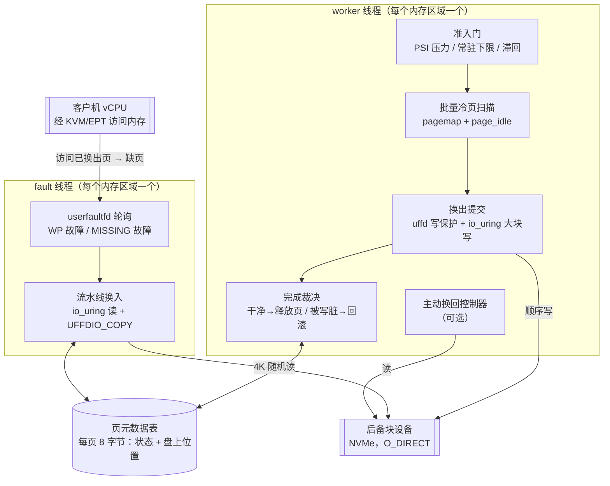
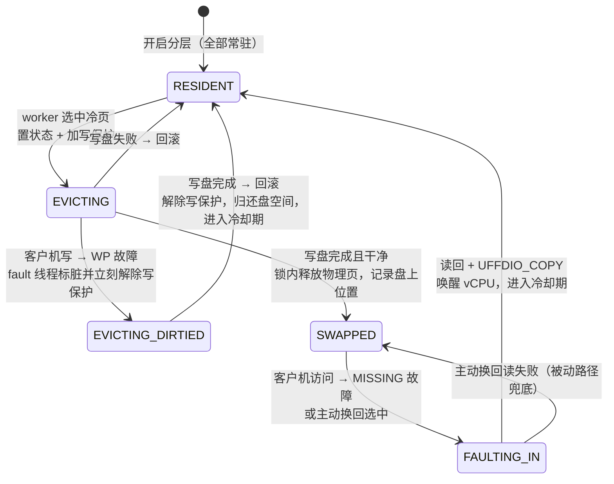
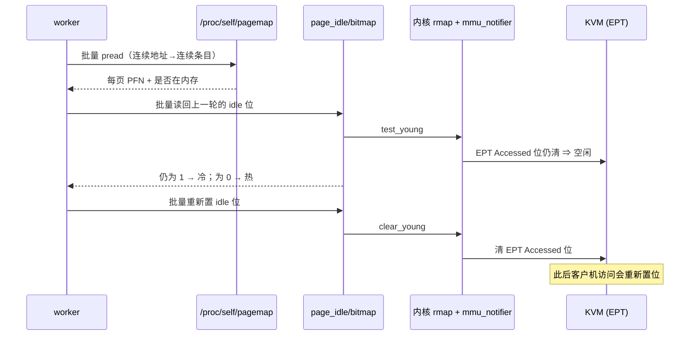
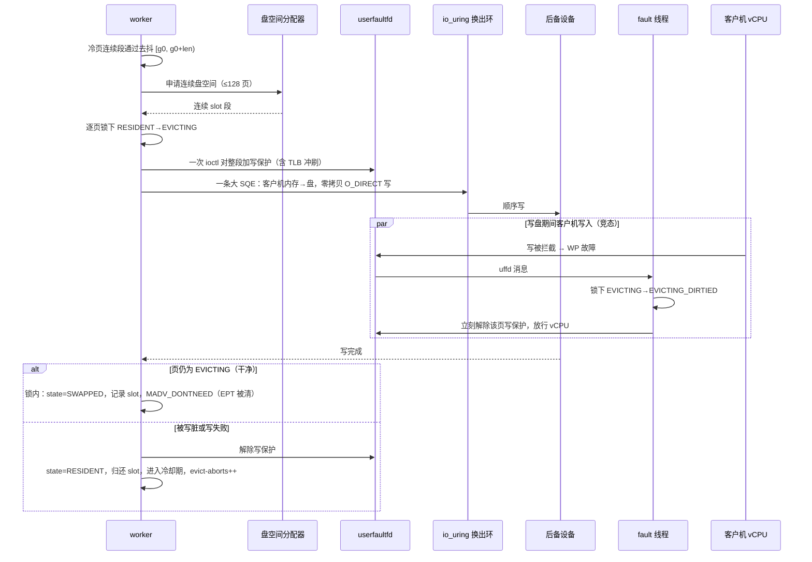
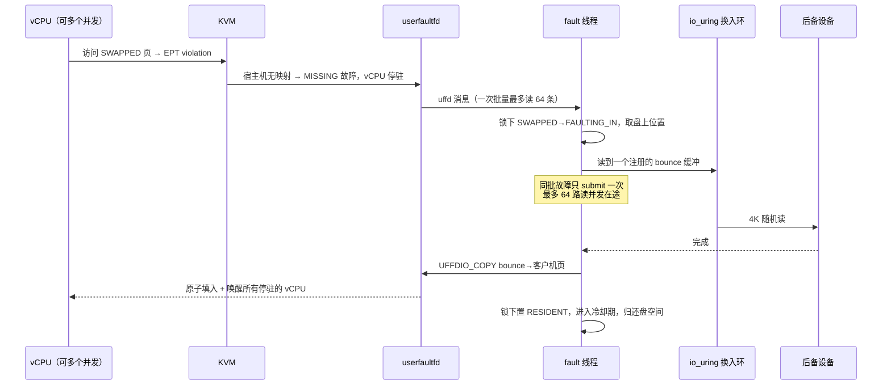
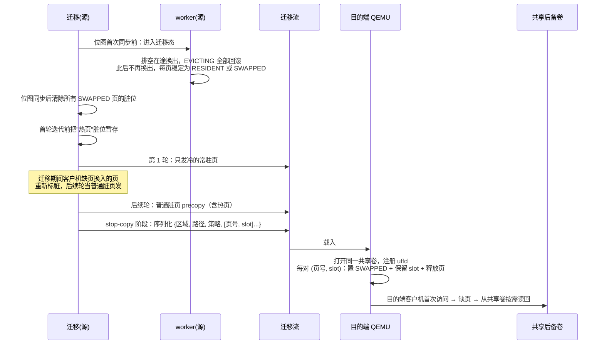

# 虚拟机内存分层（Memory Tiering）技术分享

> 面向没有接触过这个功能的同事。目标是讲清楚：它解决什么问题、在 QEMU 里怎么实现、
> 怎么用 QMP 操作、怎么在线调超分比、怎么监控、以及不同超分比下性能到底掉多少。
> 全文基于 QEMU 10.0 的 memory-tiering 分支代码与 2026-08 的 redis 基准测试。
>
> 阅读路线：只想知道"是什么、能不能用"看 §0 和 §6；要做集成看 §2、§3、§4；
> 要做运维看 §5。

---

## §0 一页纸摘要

**问题**：一台宿主机的 DRAM 是最贵、最不容易扩的资源。虚拟机申请的内存往往
只有一部分是"热"的（频繁访问），其余长期不动。传统做法要么全量预留（浪费），
要么靠内核 swap 超分（延迟不可控、guest 会被回收路径卡住）。

**方案**：把每台虚拟机的内存做成两层。热页留在宿主机 DRAM；冷页由 QEMU 自己
识别出来，写到一块 NVMe 上，并把对应的宿主机物理页释放掉。客户机再访问这些页时，
QEMU 透明地把它读回来。客户机完全无感知，不需要安装任何驱动或 agent。

**关键特性**：

| 特性 | 说明 |
|---|---|
| 不改内核、不改 KVM | 全部逻辑在 QEMU 用户态，只用现成的内核接口（userfaultfd、page_idle、io_uring、PSI） |
| 客户机透明 | 无 balloon、无 virtio 协作、无 guest agent |
| 数据一致性有证明 | 换出期间客户机并发写、并发缺页、迁移中的状态都有明确协议，有确定性完整性测试 |
| 运行时可调 | 一条 QMP 命令即可改常驻下限、换出速率、触发阈值，下一拍（≤200 ms）生效，不重启不暂停 |
| 回收永不阻塞客户机 | 换出在后台线程做，客户机线程从不参与内存回收，尾延迟比内核 swap 低一个数量级 |
| 与热迁移协同 | 后备卷为共享卷时，已换出页不走网络，只传映射表 |

**代价**：访问已换出页会触发一次缺页（约 20~100 µs，取决于介质）。超分越深、
负载局部性越差，缺页越频繁。§6 给出量化数据：有热点局部性的负载在 50% 常驻下
可以达到不分层基线的 98%；完全随机访问的负载在 50% 常驻下只剩基线的 4.5%（这是
理论下界，不是典型情况）。

---

## §1 实现原理

### 1.1 设计目标与约束

1. **不修改 KVM、不依赖内核新特性开发**。只用主线内核已有的接口：
   userfaultfd 写保护（WP）与缺页（MISSING）、`/proc/self/pagemap`、
   `/sys/kernel/mm/page_idle/bitmap`、io_uring、PSI、`madvise`。
2. **正确性优先**。任何时刻客户机读到的数据必须一致，换出期间的并发写、
   换入的并发缺页、迁移期间的状态都必须有明确协议。
3. **对客户机透明**。客户机不知道自己被分层，不需要任何协作。

### 1.2 和内核 swap 的本质区别

内核 swap 也能把冷页换到盘上，为什么要在 QEMU 里再做一套？

| 维度 | 内核 swap | QEMU 内存分层 |
|---|---|---|
| 谁决定换出 | 内核全局 LRU，按整机压力 | QEMU 按每台 VM 的策略自治 |
| 回收发生在哪 | 分配路径上同步回收，客户机 vCPU 会被卡住 | 独立后台线程，vCPU 从不参与回收 |
| 策略面 | sysctl 级别，无法逐 VM 指定 | QMP 逐 VM、逐旋钮、运行时可调 |
| 后备设备 | 整机共享 swap 分区 | 每台 VM 独立的裸设备/文件/共享卷 |
| 热迁移 | 换出页必须先读回再传 | 共享后备时只传映射表，停机时间与换出量无关 |
| 尾延迟（实测） | 最大延迟 800 ms 级 | 最大延迟 100 ms 级，写操作 p99 低 3 倍 |

一句话：内核 swap 是"整机兜底"，内存分层是"逐 VM 可控的资源工具"。

### 1.3 整体数据流

```
空闲扫描找出冷页
  → 对整段冷页加 userfaultfd 写保护（WP）
  → io_uring O_DIRECT 顺序大块写到后备设备
  → 写完成后确认期间未被客户机写脏，MADV_DONTNEED 释放宿主机物理页
    （内核 mmu_notifier 通知 KVM 自动清掉对应 EPT 表项，所以不用改 KVM）
  → 客户机再次访问 → EPT violation → 宿主页缺失 → userfaultfd MISSING 缺页送到 QEMU
  → io_uring 从后备设备读回该页 → UFFDIO_COPY 原子填入并唤醒 vCPU
```



### 1.4 依赖的内核机制（给不熟悉的人）

理解这个功能只需要弄清五个内核机制。

**① userfaultfd（uffd）**。Linux 允许用户态进程"接管"自己一段内存的缺页处理。
注册之后，这段内存发生两类事件时内核不会自己处理，而是把事件发给注册者：

- **MISSING**：访问了一个没有物理页的地址。注册者可以用 `UFFDIO_COPY` 把内容
  填进去，内核原子地建立映射并唤醒等待的线程。
- **WP（写保护）**：注册者可以给某些页加写保护；之后客户机写这些页时会产生 WP
  事件，注册者决定放行与否。

对 KVM 客户机来说，客户机访问一个已被释放的页 → EPT violation → KVM 尝试把宿主机
页映射进来 → 发现宿主机也没这页 → 走 uffd MISSING → QEMU 收到事件。整个过程
vCPU 停在 KVM 里等待，客户机看到的只是"这条指令慢了一点"。

**② page_idle 位图 + pagemap**。`/proc/self/pagemap` 能把 QEMU 的虚拟地址翻译成
物理页框号 PFN；`/sys/kernel/mm/page_idle/bitmap` 是按 PFN 索引的位图，写 1
表示"标记这页为空闲"，之后任何访问都会把这个位清零。关键在于它是 mmu-notifier
感知的：标记时内核会通知 KVM 清掉 EPT 的 Accessed 位，读回时再问 KVM 这个页
被访问过没有。所以**客户机经 EPT 的读和写都能被观测到**，这比只能看到写的
uffd-WP 强得多。

**③ mmu_notifier**。QEMU 对一段内存做 `MADV_DONTNEED` 释放物理页时，内核会通过
mmu_notifier 通知 KVM 把对应的 EPT 表项清掉（zap）。这就是为什么整个方案不需要
改 KVM：释放和重新映射都由内核已有的通知链路自动处理。

**④ io_uring + O_DIRECT**。高性能异步 I/O 接口。换出用一条大 SQE 直接以客户机
内存为源做零拷贝写；换入用注册的固定缓冲区做 4K 读，多个缺页的读可以重叠在途。
后备设备以 O_DIRECT 打开，绕过页缓存。

**⑤ PSI（Pressure Stall Information）**。`/proc/pressure/memory` 给出"有多少
比例的时间有任务在等内存"的指标。分层用它判断宿主机有没有内存压力：没压力时
完全不换出，分层是**压力响应式**的，不是常态搬运。

### 1.5 页状态机

每一页在任意时刻处于五个状态之一，状态与 userfaultfd 的事件类型一一对应：



| 状态 | 宿主机物理页 | EPT 映射 | 客户机访问时发生什么 |
|---|---|---|---|
| RESIDENT | 在 DRAM，可写 | 正常 | 直通，零开销 |
| EVICTING | 在 DRAM，写保护中 | 只读 | 读直通；写触发 WP 故障，微秒级放行 |
| EVICTING_DIRTIED | 在 DRAM，已解除写保护 | 可写 | 直通（本轮换出作废） |
| SWAPPED | 已释放 | 已清除 | 读/写触发 MISSING 故障 → 换入 |
| FAULTING_IN | 读回在途 | 未映射 | 并发访问者一起等，同一次填充集体唤醒 |

**重要性质**：稳态（没有换出活动）时，RESIDENT 页的访问路径**完全没有额外开销**。
没有页表 trap、没有采样钩子。写保护只在换出窗口内短暂存在。这是这个方案对
"平时不用的 VM 零开销"的保证。

### 1.6 内存热度识别

热度识别是整个方案里最有讲究的部分，分三层。

**主路径：page_idle 空闲位扫描。**

1. 用 pagemap 把区域内连续的虚拟地址批量翻译成 PFN（连续地址对应连续的
   pagemap 条目，几次 bulk `pread` 即可）。
2. 对 page_idle 位图做一次批量读-改-写：先读回上一轮设置的 idle 位，仍为 1 的页
   就是"整个轮间间隔内未被访问"的冷页；然后重新置位供下一轮观察。
3. 调用内**不睡眠**。观察窗口就是两轮扫描之间的秒级间隔，远长于任何调用内的
   sleep。这样整个区域拿到的是**近同一时刻的一致热度快照**。

一次扫描批量最少 16 MB、最多 8 GB，批大小按"距排水目标还差多少页"换算。



**去抖动：两级计数。**

```
 每轮批量扫描
      │
 页级：idle_streak[页]++（一旦被访问就清零）
      │  连续 idle-streak 轮（默认 2）都空闲才算冷
      ▼
 2 MB 块级：本块有冷页 → cold_runs[块]++
      │  连续 cold-runs 轮（balanced 预设 5）都冷才允许换出，中途变热清零
      ▼
 进入换出
```

`idle-streak` 拉长单页的观察视野；`cold-runs` 在 2 MB 粒度抑制偶发波动。
由于每轮覆盖整批，去抖在亚秒到秒级收敛。

默认 idle-streak 为 2 而不是 1 有个具体原因：换入的页会复用刚释放的物理页框，
页框上残留的 idle 位会让它被误判为冷，形成"换入→立刻换出→再换入"的跑步机。
要求第二次观察才可信就消除了这个问题。

**自适应回退：uffd-WP 写老化（write-aging）。**

某些宿主机/内核组合上 page_idle 对客户机内存无效（表现为所有页每轮都报"已访问"，
永远找不到冷页）。分层不做脆弱的启动自检，而是**行为自检 + 自动降级**：

- worker 统计"允许换出、余量充足、却一无所获"的连续窗口数；
- 连续 30 个窗口进展不足一个 2 MB 块，就单向切换到回退模式并打 warn 日志；
- 回退模式下所有在内存的页都是换出候选，冷热过滤转由换出路径本身的**写保护回滚**
  承担：换出期间被写的页回滚为 RESIDENT 并进入冷却期，下一轮不再碰它。

代价：回退模式只能看到**写热度**。读热写冷的页可能被误换出再换回，冷却期限制
这种抖动的幅度。

**THP 陷阱（已闭环）。**

page_idle 位图只认 folio 的头页。如果客户机内存在开启分层之前已经被 2 MB 透明
大页（THP）背书，4K 粒度的 idle 位写不进也读不回，所有页恒为"已访问"，分层会
静默退化为 write-aging。开启分层时的 `MADV_NOHUGEPAGE` 只阻止新的大页，不拆
已有的。

现在的实现在开启时自动处理：暂停 vCPU，按 `/proc/kpageflags` 识别 THP 块，
拷出→释放→按 4K 回填，6 GB 客户机拆完只需秒级。实测 THP 开启的 VM 也能拿到
不分层基线的 91%，与关闭 THP 等效。例外：vhost、VFIO 等绕过 QEMU 主循环的外部
写入者场景仍需关闭 THP。

### 1.7 换出（Evict）



实现要点：

- **run 切割**：把冷页图切成最大连续候选段（候选 = 冷 且 RESIDENT 且不在冷却期），
  每段按最多 128 页（512 KB）的 extent 换出。
- **一次 ioctl 保护整段**，摊薄 ioctl 与 TLB 冲刷成本。
- **零拷贝大写**：一条 SQE 直接以客户机内存为源，连续虚拟地址对应连续盘 slot，
  所以换出侧是**顺序写**，对 NVMe 和分布式卷都友好。
- **后备满**：分配器给不出空间时发 `MEMTIER_BACKING_FULL` 事件并放弃本次换出。
  无正确性影响，只是停止进一步换出。
- **同步收割**：每个 run 提交后 worker 等全部完成再继续，保证换出状态机单线程。

**关键竞态：为什么释放物理页必须在锁内。**

WP 故障处理器的动作是"标脏 + 无条件解除写保护 + 放行"。如果完成路径写成：

```
锁内: state = SWAPPED
解锁
MADV_DONTNEED(page)        ← 错误：锁外
```

在 `state=SWAPPED` 之后、DONTNEED 之前的时间窗里，一个被写保护拦住的客户机写
经故障处理器放行后**落到即将被丢弃的页里**，DONTNEED 把这次写连页一起丢掉，
**数据丢失**。

正确实现把 DONTNEED 放在锁内：故障处理器只能在页已经消失之后才观察到 SWAPPED，
它的"解除写保护 + 唤醒"让被拦的写重新触发，这次是 MISSING 故障，走换入路径，
写在换入完成后重放。数据不丢。

**客户机在换出期间写页的代价**：一次 uffd 往返 + 一次解除写保护的 ioctl，微秒级，
vCPU 几乎不停顿。该页本轮换出作废并进入冷却期。这也正是 write-aging 回退模式下
的"写热过滤器"：热页的换出尝试以极低代价失败并自动退避。

### 1.8 换入（Swap-in）

**被动换入（主路径）：缺页驱动。**



按状态分派：

- SWAPPED：置 FAULTING_IN，提交异步读。
- FAULTING_IN：已有并发故障在填充，直接返回。那次 UFFDIO_COPY 会一并唤醒本 vCPU。
  并发故障天然串行化，无重复 I/O。
- 从未填充过的页：`UFFDIO_ZEROPAGE` 直接给零页。启动后从未触碰的内存不占后备空间。

延迟优化：

- **流水线**：每个故障占一个注册的 bounce 缓冲（池 64 个），多 vCPU 并发缺页的
  盘读重叠执行而非串行排队。
- **自适应 busy-poll**：有换入在途或距上次活动 200 µs 内，fault 线程自旋轮询
  而不睡眠。NVMe 单页读约 85 µs，若睡在 `poll()` 里，每次故障要多付两次调度唤醒，
  这是非 I/O 开销的大头。
- **换入后冷却**：`cooldown-ms` 内不可再被选为换出候选，防止换出↔换入乒乓。

**错误语义**：读回失败是**致命错误**。页内容此刻只存在于后备设备上，读不回即
数据丢失。发 `MEMTIER_SWAPIN_ERROR` 事件、打日志、进程退出。后备设备的可靠性
等级就是 VM 的可靠性等级，生产应使用带冗余的卷。

**主动换回（Proactive swap-back，默认关闭）。**

被动故障之外，控制器可以在宿主机空闲时把最近被换出的页提前拉回 DRAM，削减
后续故障的尾延迟。

- 一个"最近换出环"记录换出顺序，控制器从最新端往旧端遍历，最近被换出者优先换回。
  条目时效 25.6 秒。
- 两道门：resident 低于 `target-resident-mb`，且宿主机 PSI 低于 `swapin-watermark`。
  引擎强制 `swapin-watermark < psi-trigger`，所以换出（PSI 高时触发）和换回
  （PSI 低时触发）在 PSI 轴上永不相交，不会振荡。
- 用独立的 io_uring 环和缓冲，不碰 fault 线程的资源。读失败不退出，恢复 SWAPPED
  让被动路径兜底。

### 1.9 换出页的记录与后备空间管理

**唯一权威记录是内存里的页元数据数组**，每页 8 字节：

```c
typedef struct {
    uint32_t state : 3;      /* 五态状态机 */
    uint32_t slot  : 29;     /* SWAPPED 时有效：盘上位置 = slot × 4096，上限 2 TB */
    uint32_t evict_epoch;    /* 被换出时的时钟，用于主动换回的时效判断 */
} page_meta_t;
```

32 GB 客户机对应 64 MB 元数据。

**盘上没有任何元数据**。后备存储是易失 swap 语义：VM 关机或关闭分层即作废，
设备初始化时整体视为一个大空闲 extent，无需格式化。需要跨 QEMU 实例传递映射的
唯一场景是热迁移，此时映射通过迁移流显式序列化（§2.6）。

空闲空间分配器只跟踪空闲 extent，同一集合维护两个有序索引：按起始位置（释放时
找前后邻居合并，对抗碎片化）和按长度（best-fit，同长度取最低地址）。所有操作
O(log n)。

### 1.10 线程模型与并发控制

每个开启分层的内存区域有两个专属线程：

- **worker**：主循环。空闲时约 200 ms 一拍；活跃换出时连续运转。做 PSI 采样、
  冷页扫描、换出提交与收割、回退判定、主动换回、限速。**所有换出状态变更单线程化
  在 worker 内**。
- **fault**：userfaultfd 轮询循环，处理 WP 与 MISSING 故障。

并发控制三件套：1024 个分片自旋锁（按页号取模），所有页状态转换都在对应分片锁下；
uffd 写保护是换出路径与客户机写之间唯一的同步原语；统计计数用原子操作。

### 1.11 可选加速：SPDK 用户态换入路径

为缩短缺页路径，后备设备还可以走 SPDK：NVMe 控制器经 vfio-pci 交给 QEMU 内的
用户态驱动，专核忙轮询，无中断无系统调用。分层的三条 I/O 通道（换入、换出写、
主动换回）各自单线程，正好 1:1 映射到三个 NVMe 队列对，零锁。

实测（Optane，50% 常驻，均匀随机负载）：SPDK 单独贡献 +7%，再加上 vCPU 1:1
绑核与 fault 线程独占核后合计 +45%，p99 延迟降 33%。介质越快，软件路径占比
越大，旁路优化收益越高；消费级 NVMe 上器件延迟占绝对大头，SPDK 收益只有 +4%。

---

## §2 QEMU 中增加的接口与实现方式

### 2.1 源码布局与规模

新增代码约 3700 行，集中在一个独立子目录，对 QEMU 主体的侵入很小：

| 文件 | 行数 | 职责 |
|---|---|---|
| `memtier/memtier.c` | 720 | 生命周期、策略解析、uffd/io_uring 初始化、QMP 命令实现、迁移目的端恢复 |
| `memtier/worker.c` | 474 | worker 线程：监控 + 扫描调度 + 换出 + 主动换回控制器 |
| `memtier/fault.c` | 385 | fault 线程：uffd 故障处理、流水线换入 |
| `memtier/scan.c` | 312 | page_idle/pagemap 冷页扫描（批量 + write-aging 回退） |
| `memtier/slot-alloc.c` | 231 | 后备设备空闲 extent 分配器 |
| `memtier/migrate.c` | 317 | 热迁移集成 |
| `memtier/backing-spdk.c` | ~700 | SPDK 用户态后备（可选） |
| `qapi/memtier.json` | 262 | QAPI 定义：4 条命令、3 个结构、2 个事件 |
| `migration/ram.c` 等 | ~170 | 迁移位图与热页处理的集成点 |
| `include/system/memtier.h` | 54 | 对外头文件 |

对 QEMU 主体的改动只有三处：meson 加入子目录；QAPI schema 注册新模块；
迁移代码在位图同步、首轮迭代、stop-copy 阶段各加一个钩子。

### 2.2 QAPI 接口定义

所有命令带 `x-` 前缀，表示实验性接口，不承诺稳定。

**枚举：策略预设**

```
MemTierPolicy = conservative | balanced | aggressive | custom
```

**结构：可调旋钮**（全部可选，省略的字段保持预设值）

| 旋钮 | 类型 | 含义 |
|---|---|---|
| `cold-runs` | uint16 | 2 MB 块连续多少轮冷才允许换出（越小越激进） |
| `psi-trigger` | number | 宿主机 PSI memory some avg10 超过此百分比才允许换出（越小越早换） |
| `max-evict-mbps` | uint32 | 换出吞吐上限 MB/s |
| `min-resident-mb` | uint64 | 常驻硬下限，换出永不低于此值 |
| `cooldown-ms` | uint32 | 换入后多久内不再作为换出候选 |
| `hysteresis-mb` | uint64 | 滞回带：常驻涨过 下限+带 才武装换出，排到 下限+带/2 解除。默认 0 |
| `idle-streak` | uint16 | 连续多少轮扫描空闲才算冷。默认 2 |
| `target-resident-mb` | uint64 | 主动换回上限。默认等于 min，即关闭 |
| `swapin-watermark` | number | 主动换回允许运行的 PSI 上限，引擎强制小于 psi-trigger |
| `max-swapin-mbps` | uint32 | 主动换回吞吐上限 MB/s |
| `cold-threshold` | uint16 | 预留给粗筛层，当前无消费者 |

**命令**

| 命令 | 参数 | 作用 |
|---|---|---|
| `x-memtier-enable` | `*id`, `path`, `*policy`, `*tunables` | 对一个 RAM block 开启分层。`id` 缺省为最大的客户机 RAM block |
| `x-memtier-set-policy` | `*id`, `*policy`, `*tunables` | 运行时调整策略/旋钮，只改提供的字段 |
| `x-memtier-query` | `*id` | 查询一个或全部区域的状态与统计，返回 `[MemTierInfo]` |
| `x-memtier-disable` | `*id` | 停止分层：先强制把全部换出页拉回 DRAM 再拆除 |

**返回结构 MemTierInfo**

| 字段 | 含义 |
|---|---|
| `id` / `enabled` / `path` | 区域 id、是否启用、后备路径 |
| `policy` / `tunables` | 当前预设、**解析钳制后的生效值快照**（不是用户输入） |
| `total-bytes` | 区域大小 |
| `resident-bytes` | 当前在宿主机 DRAM 的字节数 |
| `swapped-bytes` | 当前在后备设备上的字节数 |
| `backing-total-bytes` / `backing-used-bytes` / `backing-largest-free-bytes` | 后备容量、已用、最大连续空闲 |
| `evicted-pages` | 累计成功换出页数 |
| `evict-aborts` | 累计换出期间被写脏而回滚的页数 |
| `swapin-faults` | 累计被动换入次数（客户机缺页驱动） |
| `swapin-errors` | 累计致命读回失败 |
| `active-swapins` | 累计主动换回页数 |
| `evict-mbps` | 最近换出吞吐 |
| `psi-some-avg10` | 最近采样的宿主机 PSI |
| `swapin-avg-wait-ns` / `swapin-avg-device-ns` / `swapin-avg-publish-ns` | 缺页路径分段平均耗时：拾取到提交 / 器件读 / 完成到填充 |

**事件**

| 事件 | 数据 | 含义 |
|---|---|---|
| `MEMTIER_BACKING_FULL` | `id`, `used-bytes`, `total-bytes` | 后备满，换出暂停。无正确性影响 |
| `MEMTIER_SWAPIN_ERROR` | `id`, `gfn` | 某页无法读回，内容不可恢复，VM 即将停止 |

**迁移能力**：`migrate-set-capabilities` 新增 `memtier-shared-backing`。

### 2.3 旋钮详解

§2.2 的表只给了一句话定义。这一节逐个讲清楚每个旋钮控制的是哪一步、调大调小
会发生什么、怎么选值、看哪个指标验证。先把它们按控制的环节分组：

```
 找冷页             什么时候动手          换多少 / 换多快          换回来
 ─────────         ─────────────         ─────────────           ─────────
 idle-streak       psi-trigger           min-resident-mb         target-resident-mb
 cold-runs                               hysteresis-mb           swapin-watermark
 cooldown-ms                             max-evict-mbps          max-swapin-mbps
 (cold-threshold)
```

再记住一条总原则：**所有旋钮只影响"换不换、换哪些、换多快"，不影响数据正确性**。
任何取值组合都不会丢数据，最坏只是性能不好或者不动作。

---

**idle-streak**（默认 2，无预设差异）

控制的环节：页级冷判定。一页要连续多少轮扫描都测得"空闲"，才算冷页。

机制：每轮扫描给区域内的物理页打 idle 标记，下一轮读回。仍为 1 说明整个轮间
间隔（秒级）没被访问，该页的连续计数加 1；只要被访问一次，计数清零。计数达到
`idle-streak` 才进入候选。

- 调大：观察视野拉长。每加 1 大约多观察一整个轮间间隔。慢节奏重读的页（比如
  每 5 秒扫一遍的后台任务）也能被识别为热，不会被误换出。代价是换出启动变慢，
  排水到下限的时间变长。
- 调小到 1：一轮空闲就算冷。最快，但有一个具体的坑：换入的页会复用刚被释放的
  物理页框，页框上残留的 idle 位让它下一轮被立刻误判为冷，形成"换入→换出→换入"
  跑步机。默认改成 2 就是为了消这个坑。设 0 按 1 处理。
- 怎么选：绝大多数场景用默认 2。工作集有秒级到十秒级周期性访问的负载（定时
  刷新的缓存、周期性 GC 的运行时）可以设 3 到 4。
- 验证指标：缺页速率（Δ`swapin-faults`/Δt）。调大后稳态缺页速率应下降。

---

**cold-runs**（conservative 8 / balanced 5 / aggressive 2）

控制的环节：2 MB 块级去抖。一个 2 MB 块要连续多少轮都含冷页，才允许把块里的
冷页换出。中途该块变热（一轮内一个冷页都没有）计数清零。

和 `idle-streak` 的区别：`idle-streak` 是单页粒度的"这页有多久没被碰"，
`cold-runs` 是 2 MB 粒度的"这一片区域是不是整体稳定地冷"。两级叠加，
前者防单页误判，后者防局部区域的偶发波动。

- 调大：更保守，需要更多轮确认才动手。适合访问模式抖动大的负载。
- 调小：更激进，压力来了很快开始换。aggressive 预设的 2 基本上是"两轮确认即换"。
- 注意：因为每轮批量扫描覆盖整批块，`cold-runs` 轮的去抖是亚秒到秒级，不是分钟级。
  它不是"等多久"，是"确认几次"。
- 验证指标：误逐率（Δ`evict-aborts`/Δ`evicted-pages`）。误逐率高于 5% 就调大它。

---

**cooldown-ms**（conservative 2000 / balanced 1000 / aggressive 500）

控制的环节：候选过滤。一页刚被换入（缺页读回）或刚在换出中被写脏回滚之后，
多少毫秒内不再作为换出候选。

机制：换入和回滚都会写入该页的时间戳。扫描选候选时跳过时间戳在 `cooldown-ms`
之内的页。

- 它解决的问题：一个页刚被客户机访问过（所以才缺页换入），下一轮扫描时 idle 位
  可能已经又是空闲的（客户机只碰了一次），如果没有冷却期它会立刻再被换出，
  客户机再碰又缺页。冷却期给"刚访问过的页"一段保护时间。
- 在 write-aging 回退模式下它是**唯一的热度过滤器**：回退模式把所有在内存的页
  都当候选，靠"换出时被写→回滚→进冷却期"筛掉写热页。冷却期越长，写热页被反复
  尝试换出的频率越低。
- 调大：抖动少，但刚换入的页占着内存的时间更长，排水更慢。
- 调小：反应快，乒乓多。
- 怎么选：默认即可。回退模式下、或缺页速率和换出速率同时居高不下时，调到 2000
  到 5000。
- 和 `hysteresis-mb` 的关系：cooldown 保护的是**单个页**，滞回带保护的是**整体
  常驻量**。两者互补。

---

**psi-trigger**（conservative 20 / balanced 10 / aggressive 2，单位 %）

控制的环节：换出准入门。宿主机 `/proc/pressure/memory` 的 `some avg10` 超过
这个百分比，worker 才允许换出。

PSI some avg10 的含义：过去 10 秒里，有多少比例的时间至少有一个任务在等内存。
0 表示完全没压力，10 表示 10% 的时间有任务在等。

- 它决定了分层是"压力响应式"的：宿主机没压力时不动作，冷页留在内存里是免费的，
  没必要提前换出去。
- 两个特殊值最常用：
  - `0`：无条件换出。不管宿主机有没有压力，立刻朝下限排水。测试和主机级控制器
    的"换出"状态用它。
  - `100`：实际上永远达不到，等于暂停换出。控制器的"回血"和"死区"状态用它。
- 调小：更早开始换出，主机压力小时就腾内存。
- 调大：只有压力明显时才换。
- 怎么选：单机手工用时按预设即可。有主机级控制器时，控制器接管这个值（只设 0
  或 100），QEMU 内的 worker 不再自己判断全局压力，避免多台 VM 各自盯 PSI 抢着换。
- 关联：`swapin-watermark` 被强制小于它。
- 验证指标：query 里的 `psi-some-avg10` 就是 worker 最近采到的值，对照它看门开没开。

---

**min-resident-mb**（conservative 75% / balanced 50% / aggressive 25%，按区域大小换算）

控制的环节：换出的硬下限。常驻字节数永远不会被换出压到这个值以下。

这是**决定超分深度的旋钮**。8 GB 的 VM 设 4096 就是 2:1。

- 调大：立刻停止进一步换出（如果当前常驻已低于新下限，**不会**自动拉回来，
  只是不再往下换）。
- 调小：允许换得更深，但要等 PSI 门开才会继续排水。
- 钳制：不能超过区域大小。设成区域大小等于"开着分层但不换出"。
- 怎么选：至少要覆盖工作集。不知道工作集多大时，先设 100%，开着分层看一段时间
  `resident-bytes` 的自然水平（未触碰的页不算常驻），再按 6.7 节的负载分类往下压。
- 主机层面的约束：`Σ min-resident + 预留 ≤ DRAM`，否则下限之和就超过物理内存，
  控制器无法保证不 OOM。
- 验证指标：`resident-bytes` 是否能排到下限。排不到说明工作集比下限大，客户机
  会持续缺页。

---

**hysteresis-mb**（默认 0，无预设差异）

控制的环节：换出的武装/解除。把"高于下限就换"改成两条线：常驻涨过
`下限 + 带` 才开始换出，排到 `下限 + 带/2` 就停。

```
 常驻
   ↑
 下限+带    ─── 武装线：涨过这条线，换出才开始
   │           ↕ 滞回带
 下限+带/2  ─── 停止线：排到这条线就停，解除武装
   │
 下限       ─── min-resident-mb：永远不会低于
```

- 默认 0 时的问题：工作集恰好在下限附近的 VM，常驻会在"换出 100 MB → 缺页换入
  50 MB → 又高于下限 → 再换出"之间反复，每轮都是真实的盘写和真实的缺页延迟，
  但常驻量没有实质变化。
- 有带之后：常驻在停止线和武装线之间自由浮动，不触发任何换出。只有工作集真的
  增长超过半个带，才会有一轮换出，而且一次换够半个带而不是零碎地换。
- 为什么停在带的一半：排到停止线时，最近换入的那半带页留在内存里。它们是客户机
  最近刚碰过的，大概率还会再碰。
- 怎么选：工作集稳定、明显小于下限的 VM 不需要，保持 0。工作集在下限附近波动的
  VM（数据库、缓存）设下限的 5% 到 15%。做主机预算时按"下限 + 带"算，因为常驻
  实际会上浮最多一个带。
- 钳制：`带 ≤ 区域大小 − 下限`。
- 验证指标：误逐率在 1% 到 5% 之间、且缺页速率和换出速率同时不为零，是需要加带
  的典型信号。加带后两者应同时降到接近 0。

---

**max-evict-mbps**（conservative 200 / balanced 500 / aggressive 1000）

控制的环节：换出限速。滚动 1 秒窗口内换出的字节数超过这个值，worker 补偿性睡眠。

- 它保护的是两样东西：后备设备的写带宽（不要把盘写满，否则缺页读要排在写后面，
  NVMe 没有抢占）和宿主机的内存带宽（换出是 DMA 从客户机内存读）。
- 排水时间 ≈ (当前常驻 − 目标) ÷ 这个值。8 GB 排到 4 GB 在 500 MB/s 下约 8 秒。
- 调大：排水快，但缺页读的尾延迟会因为等在飞写而变差。写带宽慢的盘上尤其明显，
  实测读的尾延迟 = 在飞写字节 ÷ 写带宽。
- 调小：排水慢，主机压力缓解得慢。
- 怎么选：不超过后备设备顺序写带宽的一半。多台 VM 共用一块盘时，各自的上限之和
  也不要超过盘的写带宽。主机级控制器按优先级给：低优先级 VM 允许换得快（先牺牲它）。
- 验证指标：`evict-mbps`（瞬时）应在排水期贴近上限、稳态接近 0；后备设备 iostat
  的 `r_await` 排水期不应超过介质裸延迟的 3 倍。

---

**target-resident-mb**（默认 = min-resident-mb，即关闭）

控制的环节：主动换回的上限。常驻低于这个值、且宿主机 PSI 低于 `swapin-watermark`
时，控制器在后台把最近被换出的页预取回内存。

- 它和 `min-resident-mb` 构成工作带：换出永不低于 min，主动换回永不高于 target，
  带内只有被动缺页。默认 target == min，带宽为 0，主动换回关闭。
- 什么时候用：宿主机压力过去之后，想把 VM 的内存还回去，让它别再付缺页延迟。
  手工场景直接设 target 高于当前常驻；控制器场景在"有富余"状态下按优先级抬高它。
- 换回的顺序是"最近被换出者优先"，因为最近换出的页时间局部性最强。时效 25.6 秒，
  更早换出的页不会被主动召回，只能等客户机访问。
- 调大：回血更多。设成区域大小等于"尽可能全部拉回"。
- 注意：它不是"想把已换出页拉回"的唯一手段。`x-memtier-disable` 也会全部拉回，
  但那是同步的、会拆掉分层。
- 钳制：`min ≤ target ≤ 区域大小`。设得比 min 小会被抬到 min。
- 验证指标：`active-swapins` 的增速就是主动换回的速率；`resident-bytes` 应上升到 target。

---

**swapin-watermark**（默认 psi-trigger 的一半，单位 %）

控制的环节：主动换回的 PSI 门。宿主机 `some avg10` 低于这个值，主动换回才运行。

- 换出要求 PSI 高于 `psi-trigger`，换回要求 PSI 低于这个值。引擎强制它小于
  `psi-trigger`（设得大于等于时压到 0.9 倍），所以两个动作在 PSI 轴上的触发区间
  永不相交，不会围绕同一条线振荡。
- 主机级控制器的用法：回血状态下把 `psi-trigger` 设 100、这个值设 50。主机空闲时
  PSI 接近 0，门必然开；一旦 PSI 涨过 50 说明压力回来了，换回自动停。
- 怎么选：单机手工用时取 `psi-trigger` 的三分之一到一半。
- 验证指标：对照 `psi-some-avg10` 看门是否开着。

---

**max-swapin-mbps**（默认 256）

控制的环节：主动换回限速。每个 worker 节拍按这个值换算成页数预算，同时不超过
距 target 的差额。

- 它保护后备设备的读带宽不被预取占满，把带宽留给客户机的被动缺页（被动缺页无法
  限速，也不应该限速）。
- 调大：回血快，但和被动缺页争抢盘读。
- 怎么选：后备设备 4K 随机读带宽的一半以下。主机级控制器按优先级给，高优先级
  回得快。
- 验证指标：`active-swapins` 增速换算成 MB/s 应不超过它。

---

**cold-threshold**（conservative 0 / balanced 2 / aggressive 8）

预留旋钮，**当前没有任何代码消费它**。设计上是给一个粗筛层（基于内核 DAMON 的
区域级访问计数）准备的冷判据：区域访问次数低于此值才交给细扫。当前实现证明批量
细扫已经够便宜，粗筛层没有接入。设它没有任何效果，也不会报错。

---

**fault-shards**（较新版本，默认 1）

不属于策略旋钮，是换入并行度。客户机内存按 2 MB 对齐切成最多 8 个连续段，
每段独立的 userfaultfd、fault 线程和 I/O 队列。默认 1 与原行为完全一致。

只在后备设备 IOPS 超过单 fault 线程能力（约 20 万缺页/秒）时才有收益，也就是
Optane P5800X 级的器件。消费级 NVMe 和早期 Optane 在 5 万到 6 万 IOPS 就饱和，
分片没有意义。

---

**几个常用组合**

| 目的 | 设置 |
|---|---|
| 开着分层但先不换出，观察工作集 | `min-resident-mb = 区域大小`，或 `psi-trigger = 100` |
| 立刻强制排水到某个下限（测试） | `psi-trigger = 0`，`min-resident-mb = 目标` |
| 工作集在下限附近抖 | 加 `hysteresis-mb`（下限的 5% ~ 15%），必要时 `cooldown-ms = 2000` |
| 误逐率高，在啃写热页 | 调大 `cold-runs`、`idle-streak`，或换 conservative |
| 压力过去，把内存还给 VM | `psi-trigger = 100`，`target-resident-mb` 抬高，`swapin-watermark = 50` |
| 后备盘写慢，缺页尾延迟差 | 调小 `max-evict-mbps` |
| 后备盘读快、缺页并发高 | `fault-shards = 4` |

### 2.4 开启与关闭的实现

`x-memtier-enable` 做的事，按顺序：

1. 定位 RAM block，检查宿主机页大小为 4K、区域未启用。
2. 对区域 `MADV_NOHUGEPAGE`；检测已有 THP 背书量，有则暂停 vCPU 拆分。
3. 打开后备设备（O_DIRECT），取容量，初始化空闲分配器为一个大 extent。
   路径以 `spdk:` 前缀开头则走 SPDK 后端。
4. 注册 userfaultfd（MISSING + WP 双模式），分配页元数据数组、冷却时间戳数组、
   idle 计数数组、分片锁。
5. 按 pagemap 统计当前真实在内存的页数作为 resident 初值（而不是假设全部常驻，
   否则轻载客户机上未触碰的页永远无法换出，下限不可达）。
6. 创建三个 io_uring 环（换出 QD256、换入 QD64、主动换回 QD8），注册 bounce
   缓冲与文件描述符。
7. 解析策略得到生效旋钮，启动 worker 与 fault 线程。

`x-memtier-disable` 做的事：

1. 置 stopping 标志，worker 停止新换出并排空在途。
2. 对每个 SWAPPED 页同步读回并填充（这是唯一用同步单页换入的地方）。
   耗时与换出量成正比，实测消费级 NVMe 约 30 MB/s 到 40 MB/s，Optane 约 200 MB/s。
3. 停线程、注销 uffd、关闭设备、释放元数据。

### 2.5 策略解析：三层参数模型

理解 `x-memtier-set-policy` 需要看清参数是怎么叠出来的：

```
 层 1: policy 预设           conservative / balanced / aggressive / custom
        │  先按预设填全部基础值
        ▼
 层 2: override 覆盖集       用户提供过的字段，跨多次调用【累积合并】
        │  逐字段覆盖在预设之上
        ▼
 层 3: 生效值                解析 + 钳制后的最终值，worker/fault 每轮直接读
```

预设表：

| 旋钮 | conservative | balanced | aggressive |
|---|---|---|---|
| cold-runs | 8 | 5 | 2 |
| psi-trigger (%) | 20 | 10 | 2 |
| max-evict-mbps | 200 | 500 | 1000 |
| min-resident | 75% | 50% | 25% |
| cooldown-ms | 2000 | 1000 | 500 |

`custom` 与 `balanced` 同基线，语义上表示"全靠 tunables"。

钳制规则（用户给出矛盾配置时静默修正而不报错）：

1. `min-resident ≤ 区域大小`
2. `hysteresis ≤ 区域大小 − min-resident`
3. `min ≤ target ≤ 区域大小`，保证"换出下限 ≤ 换回上限"的工作带不塌缩
4. `swapin-watermark < psi-trigger`，超过时强制压到 0.9 倍，保证换出与换回的
   触发区间在 PSI 轴上永不相交

生效机制：QMP 命令在主循环线程执行，直接改写生效值；**不暂停、不重启线程**。
worker 每轮循环直接读生效值，下一个节拍（≤200 ms）新参数即生效。与 worker 的
并发读没有加锁，理论上一轮内可能读到新旧混合的字段组合，但所有字段都是独立的
标量门限，最多影响一轮判断，不影响任何正确性不变式。

### 2.6 热迁移集成

后备设备是源/目的两端都能访问的共享卷时，已换出的页不需要走迁移流：



要点：

- **quiesce 时机**在位图首次同步之前，不变式是"同步与清脏位之间不得有页变为 SWAPPED"。
- **首轮只发冷页**：分层本身就是热度源。最近 4 秒内换入或被写回滚的页视为热页，
  首轮跳过，后续轮随脏页走，避免"首轮发一遍、变脏再发一遍"的重复传输。
- **目的端**在 VM 尚未运行时恢复状态，然后天然继续处于分层状态。
  **迁移停机时间与换出量无关**。
- 不开该能力时，迁移/快照前应先 `x-memtier-disable` 收敛。

### 2.7 构建与运行前提

- 内核支持匿名内存的 userfaultfd 写保护（6.x）。
- QEMU 以 `--enable-linux-io-uring` 构建；SPDK 后端需要额外链接 SPDK 静态库。
- QEMU 进程有 `CAP_SYS_ADMIN`（读 pagemap 与 page_idle 需要）。
- 后备为裸块设备或预分配的 raw 文件。实测 O_DIRECT + 预分配文件与裸分区
  性能无可测差异（±0.1%），可以放心用文件管理后备。
- 宿主机页大小 4K；客户机内存后端为匿名内存（与大页、vhost-user 共享内存互斥）。

---

## §3 QMP API 使用方法

### 3.1 怎么连上 QMP

QEMU 启动时带一个 QMP socket：

```
-qmp unix:/var/run/vm-demo.qmp,server,nowait
```

三种常用方式：

```bash
# 方式 1：QEMU 自带的 qmp-shell（最省事，可以直接敲命令名和 key=value）
python3 qemu/scripts/qmp/qmp-shell /var/run/vm-demo.qmp
(QEMU) x-memtier-query

# 方式 2：socat 手工发 JSON（脚本化最直接）
# 注意 QMP 协议要求先发 qmp_capabilities 完成握手
( echo '{"execute":"qmp_capabilities"}'; \
  echo '{"execute":"x-memtier-query"}'; sleep 0.2 ) \
  | socat - UNIX-CONNECT:/var/run/vm-demo.qmp

# 方式 3：libvirt 托管的 VM
virsh qemu-monitor-command <domain> '{"execute":"x-memtier-query"}'
```

后面的例子都只写 JSON 本体。

### 3.2 开启分层

最简形式，对主客户机 RAM block 开启，后备是一个 NVMe 分区，用 balanced 预设：

```json
{ "execute": "x-memtier-enable",
  "arguments": { "path": "/dev/nvme1n1p3", "policy": "balanced" } }
```

指定 RAM block、用 custom 预设逐项微调：

```json
{ "execute": "x-memtier-enable",
  "arguments": {
    "id": "pc.ram",
    "path": "/dev/nvme1n1p3",
    "policy": "custom",
    "tunables": {
      "psi-trigger": 5,
      "min-resident-mb": 4096,
      "hysteresis-mb": 512,
      "idle-streak": 2,
      "max-evict-mbps": 800
    } } }
```

用预分配文件做后备（先 fallocate 出足够大小的文件）：

```bash
fallocate -l 8G /nvme/tier/vm-demo.raw
```

```json
{ "execute": "x-memtier-enable",
  "arguments": { "path": "/nvme/tier/vm-demo.raw" } }
```

用 SPDK 后端（NVMe 控制器已绑定 vfio-pci）：

```json
{ "execute": "x-memtier-enable",
  "arguments": { "path": "spdk:0000:5e:00.0", "policy": "balanced" } }
```

后备设备容量规划：至少要能装下"区域大小 − min-resident"，建议留 20% 余量。
装不下时换出会在满时停下并发 `MEMTIER_BACKING_FULL` 事件，不影响正确性。

常见错误：

| 错误信息 | 原因 |
|---|---|
| `region already enabled` | 重复 enable；改用 set-policy |
| `host page size must be 4K` | 宿主机页大小不是 4K |
| `userfaultfd: ... EPERM` | 缺 CAP_SYS_ADMIN 或 `vm.unprivileged_userfaultfd=0` 且非 root |
| `open backing: ... EINVAL` | 后备文件系统不支持 O_DIRECT，或文件未预分配 |

### 3.3 查询状态并解读

```json
{ "execute": "x-memtier-query" }
```

典型返回（单区域）：

```json
{ "return": [ {
    "id": "pc.ram", "enabled": true, "path": "/dev/nvme1n1p3",
    "policy": "balanced",
    "tunables": { "cold-runs": 5, "psi-trigger": 10, "max-evict-mbps": 500,
                  "min-resident-mb": 4096, "cooldown-ms": 1000,
                  "hysteresis-mb": 0, "idle-streak": 2,
                  "target-resident-mb": 4096, "swapin-watermark": 5,
                  "max-swapin-mbps": 256 },
    "total-bytes": 8589934592,
    "resident-bytes": 4831838208,
    "swapped-bytes": 3221225472,
    "backing-total-bytes": 17179869184,
    "backing-used-bytes": 3221225472,
    "backing-largest-free-bytes": 13958643712,
    "evicted-pages": 1843200, "evict-aborts": 12034,
    "swapin-faults": 1056768, "swapin-errors": 0, "active-swapins": 0,
    "evict-mbps": 0, "psi-some-avg10": 0.4 } ] }
```

怎么读这组数字：

- `resident + swapped` 可以小于 `total`，差值是客户机从未触碰过的页（不占 DRAM
  也不占盘）。
- 换出比例 = `swapped-bytes / total-bytes`，这里是 37.5%。
- `tunables` 里 `target-resident-mb == min-resident-mb` 说明主动换回是关闭的。
- `evict-aborts / evicted-pages` = 0.65%。这个比值高（比如超过 5%）说明在啃写热页，
  应调大 `cold-runs` 或 `idle-streak`，或换保守预设。
- `swapin-faults` 是累计值，本身没有意义，要看**增速**。增速高说明换出过度，
  应调大 `min-resident-mb` 或开主动换回。

每个字段的更新路径、解读阈值、派生指标公式和异常速查，见单独的
[MemTierInfo 字段手册](memtier-info-fields.html)。

### 3.4 运行时调参

`x-memtier-set-policy` 只改你提供的字段，其余保持不变。**多次调用是累积合并的**：

```json
调用 1: { "execute": "x-memtier-set-policy",
          "arguments": { "tunables": { "psi-trigger": 5 } } }
        → 覆盖集 = {psi-trigger: 5}

调用 2: { "execute": "x-memtier-set-policy",
          "arguments": { "tunables": { "min-resident-mb": 4096 } } }
        → 覆盖集 = {psi-trigger: 5, min-resident-mb: 4096}

调用 3: { "execute": "x-memtier-set-policy",
          "arguments": { "policy": "aggressive" } }
        → 预设换成 aggressive，但 psi-trigger=5 和 min-resident-mb=4096 仍覆盖其上
```

**注意**：当前没有"撤销单个覆盖、回落到预设值"的手段。想让某个旋钮回到预设，
只能显式把它设成目标预设的数值。

开启主动换回（让 target 大于 min 形成工作带）：

```json
{ "execute": "x-memtier-set-policy",
  "arguments": { "tunables": { "target-resident-mb": 6144,
                               "swapin-watermark": 3,
                               "max-swapin-mbps": 256 } } }
```

调参的行为语义（容易误解的点）：

| 操作 | 立即效果 | 不会发生的事 |
|---|---|---|
| 调大 `min-resident-mb` | 停止进一步换出 | **不会**把已换出的页拉回来 |
| 想把已换出页拉回 | 设 `target-resident-mb` 高于当前 resident（且宿主机 PSI 低），或直接 disable | |
| 调小 `min-resident-mb` | 下次 PSI 超过 trigger 时继续排水到新目标 | 不会立刻排水（还要过 PSI 门） |
| 换 `policy` 预设 | 未被覆盖的旋钮全部切到新预设 | 已覆盖的旋钮**不会**跟随预设变 |
| 设 `swapin-watermark ≥ psi-trigger` | 被静默钳到 0.9 倍 | 不会报错 |
| 设 `psi-trigger: 0` | 不管宿主机有没有压力，立刻朝下限换出 | |
| 设 `psi-trigger: 100` | 实际上暂停换出 | |

### 3.5 关闭分层

```json
{ "execute": "x-memtier-disable" }
```

会先把全部换出页读回 DRAM，耗时与换出量成正比（3 GB 在消费级 NVMe 上约 90 秒，
在 Optane 上约 15 秒）。这期间客户机正常运行。关闭后 QEMU 回到普通状态，
可以重新 enable。

### 3.6 处理事件

订阅 QMP 事件流的编排程序应处理两个事件：

```json
{ "event": "MEMTIER_BACKING_FULL",
  "data": { "id": "pc.ram", "used-bytes": 17179869184, "total-bytes": 17179869184 },
  "timestamp": { "seconds": 1756800000, "microseconds": 123456 } }
```

后备满了，换出已暂停。处理选项：扩容后备（需 disable 后换设备重新 enable）、
调高 `min-resident-mb` 让它不再需要更多空间、或把 VM 迁走。

```json
{ "event": "MEMTIER_SWAPIN_ERROR",
  "data": { "id": "pc.ram", "gfn": 1048576 } }
```

致命，VM 即将退出。编排层应记录并触发 VM 的故障恢复流程。

### 3.7 共享后备热迁移

```json
源端与目的端都执行:
{ "execute": "migrate-set-capabilities",
  "arguments": { "capabilities": [
      { "capability": "memtier-shared-backing", "state": true } ] } }

源端正常发起:
{ "execute": "migrate", "arguments": { "uri": "tcp:目的地址:4444" } }
```

前提：两端后备路径指向同一共享卷；两端 QEMU 二进制都含此功能；目的端不需要
也不能预先 enable。QEMU 无法自证目的端可达性，由编排层判断并设置能力。

### 3.8 一个完整的操作脚本

```bash
#!/bin/bash
# 用法: memtier-ctl.sh <qmp socket> <enable|query|set|disable> [json args]
SOCK=$1; CMD=$2; ARGS=${3:-'{}'}
case $CMD in
  enable)  EXEC=x-memtier-enable ;;
  query)   EXEC=x-memtier-query ;;
  set)     EXEC=x-memtier-set-policy ;;
  disable) EXEC=x-memtier-disable ;;
  *) echo "bad cmd"; exit 1 ;;
esac
( echo '{"execute":"qmp_capabilities"}'
  echo "{\"execute\":\"$EXEC\",\"arguments\":$ARGS}"
  sleep 0.3 ) | socat - UNIX-CONNECT:$SOCK | tail -n1 | python3 -m json.tool
```

```bash
./memtier-ctl.sh /var/run/vm-demo.qmp enable '{"path":"/dev/nvme1n1p3"}'
./memtier-ctl.sh /var/run/vm-demo.qmp set '{"tunables":{"min-resident-mb":2048,"psi-trigger":0}}'
./memtier-ctl.sh /var/run/vm-demo.qmp query
./memtier-ctl.sh /var/run/vm-demo.qmp disable
```

---

## §4 如何动态调整内存超分比例

### 4.1 超分比的两个层面

**单 VM 层面**：配置内存 / 常驻内存。一台 8 GB 的 VM 常驻下限设 4 GB，就是 2:1。
这由 `min-resident-mb` 直接决定。

**主机层面**：所有 VM 配置内存之和 / 物理 DRAM。比如 256 GB DRAM 的主机开了
合计 512 GB 的 VM，就是 2:1。这由每台 VM 的常驻下限之和决定：
`Σ min-resident ≤ DRAM − 系统预留` 是主机不被 OOM 的必要条件。

两个层面都是**运行时可调**的，因为每台 VM 的下限一条 QMP 命令即改，下一拍生效。

### 4.2 三个旋钮决定一台 VM 的常驻带

```
 resident
 total    ┌────────────────────────────────────── 开启时：全部常驻
          │      PSI ≥ psi-trigger 且已武装 ⇒ 持续排水 ↓
 floor+带 ─── 武装线：resident 涨过此线才开始换出
          │        ↕ 滞回带 hysteresis-mb
 floor+带/2 ─ 排水停止线：到此解除武装
          │
 target   ─── 主动换回上限 target-resident-mb（≥ floor，默认 = floor 即关闭）
          │      resident < target 且 PSI < swapin-watermark ⇒ 预取回 ↑
 floor    ─── min-resident-mb：换出永不逾越的硬下限
          0 └──────────────────────────────────────
```

- `min-resident-mb`：下限，决定最深能超分到多少。
- `target-resident-mb`：上限，决定宿主机空闲时会回血到多少。
- `psi-trigger`：什么时候动手。设 0 = 立刻朝下限换；设 100 = 暂停。

三者构成一个工作带：换出不低于 min，主动换回不高于 target，带内只有被动缺页。

### 4.3 单 VM 手工调整的操作序列

以一台 8 GB VM 为例，从不超分逐步加深再恢复：

```json
// 第 0 步：开启，但先不换出（下限 = 全量，psi-trigger = 100）
{ "execute": "x-memtier-enable",
  "arguments": { "path": "/dev/nvme1n1p3", "policy": "custom",
                 "tunables": { "min-resident-mb": 8192, "psi-trigger": 100 } } }

// 第 1 步：超分到 4:3（常驻 6 GB），并立刻执行
{ "execute": "x-memtier-set-policy",
  "arguments": { "tunables": { "min-resident-mb": 6144, "psi-trigger": 0,
                               "max-evict-mbps": 500 } } }
// 观察 query：resident-bytes 会在 (8192−6144) MB ÷ 500 MB/s ≈ 4 秒后到 6 GB

// 第 2 步：加深到 2:1（常驻 4 GB）
{ "execute": "x-memtier-set-policy",
  "arguments": { "tunables": { "min-resident-mb": 4096 } } }

// 第 3 步：宿主机压力缓解，允许回血到 6 GB
{ "execute": "x-memtier-set-policy",
  "arguments": { "tunables": { "psi-trigger": 100,
                               "target-resident-mb": 6144,
                               "swapin-watermark": 50,
                               "max-swapin-mbps": 256 } } }
// psi-trigger=100 停换出；target > min 开回血；主机 PSI 低于 50 就回

// 第 4 步：完全恢复 1:1
{ "execute": "x-memtier-set-policy",
  "arguments": { "tunables": { "target-resident-mb": 8192 } } }
// 或者直接 x-memtier-disable（同步读回，更快但会占满盘带宽）
```

调整期间客户机一直在运行。加深时客户机会感到缺页延迟上升；回血时被动缺页
逐渐减少。

### 4.4 主机级自动控制器（推荐的生产形态）

手工逐 VM 调参不现实。生产上应有一个**主机级控制环**，把"按主机全局压力决定
谁换出、换到多深"的决策集中起来，QEMU 内的 worker 只在下发的边界内执行。
下面是一种已经实现并验证的模型。

**每 5 秒一拍：**

1. 找出本机所有开启分层的 VM 及其优先级（high / normal / low）。
2. 读主机内存信号，合成两个 0..1 的值：
   - `pressure`：PSI memory some avg10 相对满刻度（10%）的比例，与
     "可用内存低于低水位（10%）的程度"取最大值。
   - `headroom`：可用内存高于高水位（50%）的程度。
   - 两条水位线之间是**死区**，pressure 和 headroom 都为 0，防止换出与回血振荡。
3. 对每台 VM 按 `(pressure, headroom, 优先级)` 算一组 tunables 并下发。

**按优先级的基准参数：**

| 优先级 | 常驻下限基准 | 换出速率上限 | 回血权重 | 回血速率上限 |
|---|---|---|---|---|
| high | 75% | 256 MB/s | 1.0 | 512 MB/s |
| normal | 50% | 512 MB/s | 0.6 | 256 MB/s |
| low | 25% | 1024 MB/s | 0.3 | 128 MB/s |

优先级越高，压力下保留的常驻越多、换得越慢、回血越多越快。低优先级的 VM
先牺牲。

**三种状态的决策：**

```
有压力（pressure > 0）→ 换出：
    psi-trigger = 0                         （立刻动手）
    min-resident = 总量 × 基准 × (1 − 0.8 × pressure)   （压力越大下限越低）
    max-evict-mbps = 按优先级
    target = min                            （回血关）

有富余（headroom > 0）→ 回血：
    psi-trigger = 100                       （停换出）
    min-resident = 总量 × 基准
    target = 基准 + (总量 − 基准) × headroom × 回血权重
    swapin-watermark = 50，max-swapin-mbps = 按优先级

死区 → 仅被动：
    psi-trigger = 100，target = min
```

**这个模型的两个契约**：

- 控制器**独占**"谁换出、换到多深"的决策。它把每台 VM 的 `psi-trigger` 显式设成
  0 或 100，QEMU 内的 worker 不再各自盯全局 PSI 抢着换。
- 控制器**不依赖集群状态**，节点被网络分区时仍正常缓解本机内存压力。

**与 cgroup 预算的配合**：VM 池用 `memory.high` 做软预算时，压力合成应加入
"VM 池 memory.current 相对 memory.high 的挤占度"这一项，让分层的水位线在
cgroup 直接回收之前触发。否则顶到 high 后 QEMU 线程会被内核回收路径节流，
vCPU 出现毛刺。

### 4.5 主机超分比的规划公式

设主机 DRAM 为 M，系统与虚拟化服务预留为 R，每台 VM i 配置内存 C_i、优先级基准
比例 f_i，则：

```
无压力时：       Σ C_i 可以远大于 M − R（未触碰的页不占内存）
最深压力时：     Σ C_i × f_i × 0.2 ≤ M − R      （下限被压到基准的 20%）
可承诺的超分比： Σ C_i / (M − R)
```

安全做法是把 `Σ C_i × f_i`（无压力下限之和）控制在 `M − R` 以内，这样任何时刻
控制器都有余量把下限往下压。后备设备容量至少 `Σ (C_i − C_i × f_i × 0.2)`。

一个例子：M = 256 GB，R = 32 GB，全部 normal 优先级（f = 0.5）。
`Σ C_i × 0.5 ≤ 224 GB` ⇒ `Σ C_i ≤ 448 GB`，超分比 2:1，后备至少 400 GB。

---

## §5 虚拟机内存分层的监控

### 5.1 数据来源

| 来源 | 提供什么 | 采集方式 |
|---|---|---|
| `x-memtier-query` | 每 VM 的常驻/换出/后备/累计计数/瞬时速率/缺页分段延迟 | QMP，建议 5 秒一次；主机控制器每拍已在查，复用同一份缓存避免双倍 QMP |
| `/proc/pressure/memory` | 主机内存压力 PSI | 直接读文件 |
| `/proc/meminfo` | MemAvailable 占比 | 直接读文件 |
| 后备设备的 `/sys/block/<dev>/stat` 或 `iostat -x` | 换出写入与换入读取的真实带宽、IOPS、延迟 | 直接读文件 |
| QEMU trace（环境变量开关） | 逐事件的 evict / fault / scan 明细，含每轮扫描的 present/cold 计数 | 仅调试 |
| 客户机内 `/proc/vmstat` 等 | 客户机视角完全看不到分层（这是设计目标） | 无 |

### 5.2 内存热度情况

分层里"热度"不是一个直接暴露的数值，而是通过几个比例体现的：

**① 常驻比例与换出比例**

```
常驻比例 = resident-bytes / total-bytes
换出比例 = swapped-bytes / total-bytes
未触碰   = 1 − 常驻比例 − 换出比例
```

在 psi-trigger = 0 的强制排水下，常驻比例会停在 `min-resident-mb / total`。
如果它**停不到**下限，说明冷页不够（工作集大于下限），或者 page_idle 失效在
等 write-aging 回退。

**② 误逐率：evict-aborts / evicted-pages**

换出期间被客户机写脏而回滚的比例。它直接反映"扫描器选出来的冷页里有多少
其实是写热的"。

| 比值 | 解读 | 处置 |
|---|---|---|
| < 1% | 选页质量好 | |
| 1% ~ 5% | 工作集边界附近有抖动 | 加 `hysteresis-mb` |
| > 5% | 在啃写热页 | 调大 `cold-runs` / `idle-streak`，或换保守预设 |

**③ 缺页速率：Δ swapin-faults / Δt**

每秒有多少次客户机访问踩到了已换出页。这是"读热页被误换出"最直接的信号
（写热页会先被 evict-aborts 挡住）。

```
缺页速率（次/秒）= (swapin-faults_now − swapin-faults_prev) / 间隔秒数
缺页字节速率      = 缺页速率 × 4096
```

稳态热集负载下这个值应该趋近 0。持续高说明换出过度或热度识别失效。

**④ 热度分布（调试级）**

打开 trace 后每轮扫描会输出 `present=N cold=M`，M/N 就是当前扫描批次里
冷页的占比。连续多轮 cold=0 且 resident 远高于下限，就是 page_idle 失效的
信号，30 个窗口后会自动切到 write-aging。

**⑤ 有没有掉进回退模式**

QEMU 日志里出现 `write-aging fallback` 的 warn 就是掉进去了。回退模式只看写
热度，热集性能会损失约 14 个百分点。先检查客户机内存有没有被 THP 背书
（`grep AnonHugePages /proc/<qemu pid>/smaps_rollup`）。

### 5.3 内存交换的速度

**换出速度**：`evict-mbps` 是 QEMU 内滚动 1 秒窗口的瞬时值，直接可用。
它受 `max-evict-mbps` 限速，也受后备设备写带宽限制。

**换入速度**：QEMU 没有直接给瞬时值，从累计计数差分：

```
被动换入 MB/s = Δ swapin-faults × 4096 / Δt / 1M
主动换回 MB/s = Δ active-swapins × 4096 / Δt / 1M
```

**换入延迟分段**（每次 query 都带，纳秒平均值）：

| 字段 | 含义 | 正常量级（Optane + SPDK + 绑核） |
|---|---|---|
| `swapin-avg-wait-ns` | fault 线程拾取故障到提交读 | 0.2 µs（忙轮询）；不绑核时 5 ~ 20 µs |
| `swapin-avg-device-ns` | 器件读 4K | Optane 10 ~ 12 µs；消费级 NVMe 80 ~ 100 µs |
| `swapin-avg-publish-ns` | 读完成到 UFFDIO_COPY 发布 | 3 ~ 4 µs（页分配 + 建页表 + 唤醒） |

三段之和加上 QEMU 看不见的约 5 µs（两次 VM-exit/entry、uffd 入队、vCPU 睡眠唤醒、
EPT 二次缺页）就是客户机感受到的一次缺页延迟。

`device-ns` 突然变大是后备设备的问题：要么盘忙（同一块盘上的换出写在挤占，
NVMe 无抢占，读要等在飞写完成），要么盘在退化。

### 5.4 内存交换的比例

面板上应同时显示三个比例：

```
换出比例      = swapped-bytes / total-bytes          （这台 VM 有多少内存在盘上）
后备使用率    = backing-used-bytes / backing-total-bytes
后备碎片度    = 1 − backing-largest-free-bytes / (backing-total − backing-used)
```

后备使用率接近 100% 会触发 `MEMTIER_BACKING_FULL`。碎片度高说明大量散点换入
后空闲空间被切碎，换出的顺序大写会被迫拆成小写，评估影响看 `evict-mbps` 是否
掉下来。碎片随页换回和空闲合并自然收敛。

主机级汇总：`Σ swapped-bytes` 是"借出去"的内存，不占宿主机 DRAM。在主机内存
构成图上应当作一个独立段画出来，让 `DRAM = 内核 + 预留 + Σ resident + 空闲`
的恒等式在视觉上闭合。

### 5.5 分层对 NVMe 的读写压力

分层给后备设备带来的 I/O 模式很有特点，监控时要分开看：

| 方向 | I/O 模式 | 由什么驱动 | 观察指标 |
|---|---|---|---|
| 换出 | 顺序大块写，块 ≤ 512 KB，QD 最多 256 | worker，受 `max-evict-mbps` 限速 | `iostat` 的 `wMB/s`、`w_await` |
| 被动换入 | 4K 随机读，QD 最多 64 | 客户机缺页，无法限速 | `r/s`、`r_await`、`rareq-sz` ≈ 4K |
| 主动换回 | 4K 随机读，QD 8 | 控制器，受 `max-swapin-mbps` 限速 | 同上 |
| disable | 4K 同步读，QD 1 | 一次性 | 持续时间 |

对一块盘做 `iostat -x 1 nvme1n1` 时的健康判据：

- `r_await` 应接近介质的裸延迟（Optane 约 10 µs，消费级 NVMe 约 100 µs）。
  明显高于此值说明读在等写：NVMe 没有抢占，一个 512 KB 写在飞时后面的读要等它完成。
  写带宽慢的盘（例如 Optane M10 只有 145 MB/s 写）上这个效应很显著，
  实测读尾延迟 = 在飞写字节 ÷ 写带宽。
- `wMB/s` 不应长期贴着 `max-evict-mbps`。长期贴着说明宿主机一直有压力在持续排水，
  应检查主机超分是否过深。
- 同一块盘上如果还放了别的负载（例如 VM 的系统盘），它们的 I/O 会和缺页读争抢。
  **后备设备应独占**。

实测参考（redis 均匀随机负载、50% 常驻、消费级 NVMe）：稳态缺页读约 5000 ~ 6000
次/秒，即 20 ~ 25 MB/s 的 4K 随机读；换出写在排水阶段贴 500 MB/s 上限，稳态接近 0。
Optane 上缺页读可达 20000 ~ 28000 次/秒。

分层对**不同介质**的适配：

| 介质 | 4K 读延迟 | 适合程度 |
|---|---|---|
| Optane / SLC 类 | ~10 µs | 最佳，缺页延迟与软件路径同量级 |
| 企业级 NVMe | 50 ~ 80 µs | 良好 |
| 消费级 NVMe | ~100 µs | 可用，吞吐比 Optane 低 3.3 倍 |
| SATA SSD | ~200 µs | 勉强 |
| HDD | ~10 ms | 不可用，缺页服务速率仅约 190 次/秒 |

### 5.6 建议的面板与告警

**每 VM 面板**：

```
常驻 / 换出 / 未触碰 三段条            ← resident / swapped / total
缺页速率曲线（次/秒）                  ← Δ swapin-faults
换出速率曲线（MB/s）                   ← evict-mbps
误逐率曲线                             ← Δ evict-aborts / Δ evicted-pages
缺页延迟分段柱                         ← swapin-avg-{wait,device,publish}-ns
当前档位 / 下限 / 上限                 ← tunables 里的 psi-trigger / min / target
```

**主机面板**：

```
压力计（PSI + 可用内存合成）+ 两条水位线刻度（低水位 / 高水位）
Σ resident vs Σ swapped 堆叠条
后备设备使用率与 iostat r_await / w_await
```

**告警建议**：

| 条件 | 级别 | 含义 |
|---|---|---|
| `swapin-errors > 0` 或收到 `MEMTIER_SWAPIN_ERROR` | 致命 | VM 即将退出，触发故障恢复 |
| 收到 `MEMTIER_BACKING_FULL` | 严重 | 后备满，超分无法继续加深 |
| 缺页速率持续 > 10000 次/秒超过 60 秒 | 警告 | 换出过度，客户机性能显著下降 |
| 误逐率 > 5% | 警告 | 选页质量差 |
| 日志出现 write-aging fallback | 警告 | 热度识别退化，检查 THP |
| `r_await` > 3 倍介质裸延迟 | 警告 | 后备设备被写挤占或退化 |
| `Σ min-resident > DRAM − 预留` | 严重 | 主机超分规划失效 |

### 5.7 一个最小采集脚本

```bash
#!/bin/bash
# 每 5 秒采一次，输出 CSV：时间, 常驻比, 换出比, 缺页/s, 换出MB/s, 误逐率
SOCK=$1; PREV_F=0; PREV_E=0; PREV_A=0
while true; do
  J=$( ( echo '{"execute":"qmp_capabilities"}'; echo '{"execute":"x-memtier-query"}'; sleep 0.2 ) \
       | socat - UNIX-CONNECT:$SOCK | tail -n1 )
  read T R S F E A M <<< $(echo "$J" | python3 -c '
import sys,json; r=json.load(sys.stdin)["return"][0]
print(r["total-bytes"],r["resident-bytes"],r["swapped-bytes"],
      r["swapin-faults"],r["evicted-pages"],r["evict-aborts"],r["evict-mbps"])')
  FR=$(( (F-PREV_F)/5 )); DE=$((E-PREV_E)); DA=$((A-PREV_A))
  AB=$( [ $DE -gt 0 ] && echo "scale=3; $DA/$DE" | bc || echo 0 )
  echo "$(date +%T),$(echo "scale=3;$R/$T"|bc),$(echo "scale=3;$S/$T"|bc),$FR,$M,$AB"
  PREV_F=$F; PREV_E=$E; PREV_A=$A; sleep 5
done
```

---

## §6 不同超分比对内存性能的影响

### 6.1 测试方法

| 项 | 配置 |
|---|---|
| 宿主机 | Xeon Gold 6240（18 核 36 线程）、61 GB DRAM、Linux 7.0 |
| 客户机 | 8 vCPU、8 GB、Ubuntu 26.04 |
| 负载 | redis 数据集 380 万 key × 1 KB（约 4.85 GB），关闭持久化；redis-benchmark 在客户机内本机执行 |
| 均匀随机 | key 均匀随机覆盖全键空间，50 并发，GET 200 万次 / SET 100 万次 |
| 热集 | GET/SET 只打 10% 键空间（约 500 MB），先 100 万次预热再测量 |
| 分层设置 | `aggressive` + `psi-trigger=0`（空闲主机上强制排水）+ `min-resident-mb` 设定常驻下限 |
| 后备 | 消费级 NVMe SSD 裸分区；Optane；SATA HDD |

**关于均匀随机负载**：它没有任何热点局部性，命中换出页的概率就等于换出比例。
这是分层内存的**最坏情况**，用来量化"纯缺页路径"的代价。真实负载都有局部性，
会显著好于这组数字。

### 6.2 维度一：超分比（均匀随机，消费级 NVMe）

| 常驻比例 | 超分比 | GET rps | 占基线 | GET 平均 | GET p99 | SET rps | SET p99 | disable 回读耗时 |
|---|---|---|---|---|---|---|---|---|
| 100%（不分层） | 1:1 | 129,433 | 100% | 0.21 ms | 0.30 ms | 128,849 | 0.33 ms | |
| 75%（常驻 6 GB） | 1.33:1 | 14,698 | 11.4% | 3.17 ms | 18.1 ms | 19,380 | 10.2 ms | 33 s |
| 50%（常驻 4 GB） | 2:1 | 5,791 | 4.5% | 8.38 ms | 27.1 ms | 5,224 | 28.4 ms | 91 s |
| 25%（常驻 2 GB） | 4:1 | 1,635 | 1.3% | 30.3 ms | 74.0 ms | 1,469 | 133 ms | 129 s |

**为什么下降是超线性的**：缺失率上升的同时，每个请求触碰的辅助页（哈希表桶、
字符串头、分配器元数据）也更多落在换出集里。redis 单线程，缺页无法重叠，一次
缺页期间 50 个并发连接全部停摆，吞吐退化为缺页服务速率。延迟由 Little 定律放大：
50 并发 × 单请求服务时间（50% 常驻时约 173 µs）≈ 8.6 ms，与实测 8.4 ms 吻合；
设备本身的 4K 读延迟只有约 100 µs。

### 6.3 维度二：后备介质（均匀随机，50% 常驻）

| 后备 | GET rps | GET 平均 | GET p99 | disable 回读（约 3 GB） |
|---|---|---|---|---|
| Optane 裸分区 | 19,092 | 2.40 ms | 10.1 ms | 14.5 s |
| Optane ext4 预分配文件 | 19,176 | 2.39 ms | 10.4 ms | 15.5 s |
| 消费级 NVMe 裸分区 | 5,791 | 8.38 ms | 27.1 ms | 91 s |
| 消费级 NVMe ext4 预分配文件 | 5,796 | 8.37 ms | 28.2 ms | 98 s |
| SATA HDD | 未跑完 | | | 缺页服务约 190 次/秒 |

两个结论：**文件与裸盘无差异**（O_DIRECT + 预分配，ext4 只在打开时解析一次块
映射）；**介质决定上限**，Optane 比消费级 NVMe 快 3.3 倍，与 4K 读延迟之比一致。

### 6.4 维度三：软件路径优化（均匀随机，Optane，50% 常驻）

| 配置 | GET rps | GET p50 | GET p99 | SET rps | SET p99 |
|---|---|---|---|---|---|
| io_uring，不绑核 | 19,092 | 1.92 ms | 10.1 ms | 21,188 | 5.7 ms |
| SPDK，不绑核 | 20,472 | 1.74 ms | 10.3 ms | 23,139 | 5.6 ms |
| SPDK + vCPU 绑核 + fault 线程独核 | 27,642 | 1.31 ms | 6.8 ms | 31,122 | 2.6 ms |
| 同上 + cpuset 排他隔离 | 27,868 | 1.31 ms | 6.1 ms | 31,177 | 2.6 ms |

- SPDK 单独 +7%：绕过内核块层、中断、io_uring 唤醒，每次缺页省约 20 µs 软件开销。
- 绑核追加 +35%：vCPU 不被调度走、fault 线程独核忙轮询，缺页从触发到唤醒不再付
  调度延迟。
- cpuset 排他隔离不改均值，但压尾延迟：最大延迟 220 ms → 137 ms。部署要点是
  cpuset 收窄后 QEMU 内**所有非 vCPU 线程**必须显式赶到管家核，否则反而劣化。

### 6.5 对照：内核 swap（Optane，同等换出比例，绑核 + 隔离）

| 配置 | GET rps | GET p50 | GET p99 | GET max | SET rps | SET p99 | SET max |
|---|---|---|---|---|---|---|---|
| 内核 swap（cgroup MemoryMax） | 37,470 | 0.73 ms | 6.1 ms | **826 ms** | 42,588 | 7.5 ms | 456 ms |
| 分层 SPDK | 27,868 | 1.31 ms | 6.1 ms | **137 ms** | 31,177 | 2.6 ms | 11 ms |

均匀随机负载下内核 swap 的平均吞吐高 34%，原因是：缺页在 vCPU 自身上下文同步
完成，没有跨线程往返；8 个 vCPU 的缺页天然并行；swap 有簇预读。但分层的尾延迟
低 6 倍：swap 的回收在分配路径上同步挤兑客户机，分层的换出在后台线程异步进行，
客户机线程从不参与回收。

### 6.6 热集负载：有局部性时分层能收敛到什么程度

这才是接近真实场景的测试。热集约 500 MB，完全装得进 4 GB 常驻。

| 配置（Optane，50% 常驻） | GET rps | 占基线 | GET p99 | GET max | SET max | 测量期缺页 |
|---|---|---|---|---|---|---|
| 内核 swap | 126,526 | 98% | 0.43 ms | 1.9 ms | 245 ms | 14k |
| 分层，THP 开（掉进 write-aging 回退） | 101,994 | 79% | 1.05 ms | 19.9 ms | 37 ms | 239k |
| 分层，THP 关（真实 idle 扫描） | 120,496 | 93% | 0.70 ms | 22.6 ms | 19.8 ms | 100k |
| 分层，THP 开 + 开启时自动拆分 | 118,287 | 91% | 0.73 ms | 28.5 ms | 18.6 ms | 69k |
| 同上，完全收敛后（连续第 3 轮） | **127,462** | **98.5%** | **0.34 ms** | 7.5 ms | | |

收敛动态：100 万次预热不足以到稳态，连续三轮 GET 依次为 95.7k → 113.8k → 127.5k。
热集驻留与冷页判定需要数百万请求积累；每次写突发会扰动驻留集，需 200 ~ 400 万
请求重新收敛。

**结论**：有局部性的负载在 2:1 超分下，分层完全收敛后达到不分层基线的 98.5%，
p99 延迟 0.34 ms 甚至优于基线的 0.30 ms 量级，与内核 swap 持平且尾延迟更好
（SET 最大延迟 18.6 ms 对 245 ms）。

### 6.7 选型建议

把上面的数据压成一张表：

| 负载特征 | 建议超分 | 预期性能 | 说明 |
|---|---|---|---|
| 热集明显小于常驻下限（大多数业务 VM：办公、Web、开发测试） | 2:1 ~ 3:1 | 基线的 90% ~ 98% | 收敛需要几分钟到几十分钟；写突发后会短暂抖动 |
| 热集接近常驻下限（数据库、缓存） | 1.2:1 ~ 1.5:1 | 基线的 70% ~ 90% | 加 `hysteresis-mb`，设 high 优先级 |
| 全内存随机访问（内存计算、大规模哈希） | 不超分 | 每加深一档吞吐掉一个数量级 | 这类 VM 设 `min-resident = total` 或不开分层 |
| 长期空闲的 VM（备用、低频） | 4:1 及以上 | 无感 | 冷页全部下盘，唤醒时有一波缺页 |

介质选择：Optane 类介质的缺页延迟与软件路径同量级，是分层的最佳搭档；
企业级 NVMe 可用；消费级 NVMe 可用但吞吐上限低 3 倍；HDD 不可用。

软件路径：介质越快越值得做 SPDK 与绑核。Optane 上合计 +45%，消费级 NVMe 上
只有 +4%。

---

## §7 限制与注意事项

- 仅支持 4K 页。区域强制 `MADV_NOHUGEPAGE`，与大页后端互斥；开启时会自动拆分
  已有 THP，但 vhost/VFIO 等外部写入者场景仍需关 THP。
- 与 vhost-user 共享内存后端互斥（分层只能作用于匿名内存）。
- 单页换入读失败即 VM 退出。后备设备可靠性即 VM 可靠性，生产应使用带冗余的卷。
- 非共享后备时热迁移/快照应先 disable 收敛。
- 后备上限 2 TB（29 位 slot × 4K）。
- 每区域单 fault 线程，实测能力约 20 万缺页/秒；更快的器件（P5800X 级）上可以
  启用按地址分片的多 fault 线程（`fault-shards` 旋钮）。
- 主动换回只按"最近换出"召回，没有按访问模式预取。
- 没有接 KVM async page fault，缺页期间 vCPU 硬停驻。
- `x-` 前缀：QAPI 接口不承诺稳定。

---

## 附录 术语表

| 术语 | 含义 |
|---|---|
| 常驻（resident） | 页在宿主机 DRAM 里 |
| 换出（evict / swap-out） | 把冷页写到后备设备并释放宿主机物理页 |
| 换入（swap-in / fault-in） | 客户机访问已换出页，触发缺页，从后备读回 |
| 主动换回（proactive swap-back） | 不等客户机访问，控制器在宿主机空闲时提前读回 |
| 后备设备（backing） | 存放换出页的块设备或文件 |
| slot | 后备设备上一个 4K 单位的位置编号 |
| userfaultfd（uffd） | Linux 用户态缺页处理接口 |
| WP 故障 | 写保护页被写时产生的 uffd 事件 |
| MISSING 故障 | 无物理页的地址被访问时产生的 uffd 事件 |
| page_idle | 内核按物理页框的"自上次标记以来是否被访问"位图 |
| PSI | Pressure Stall Information，内核的资源压力指标 |
| EPT | Intel 二级地址转换页表，客户机物理地址到宿主机物理地址 |
| THP | 透明大页，2 MB |
| 工作集 / 热集 | 一段时间内被频繁访问的页集合 |
| 超分比 | 配置内存与实际占用 DRAM 之比 |
| 滞回（hysteresis） | 武装线与停止线分开，避免在阈值附近反复触发 |
