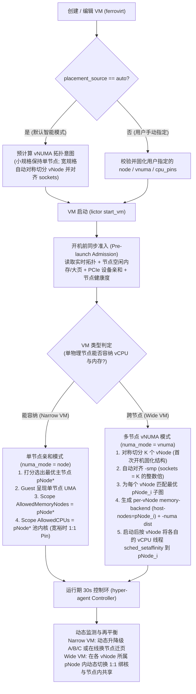
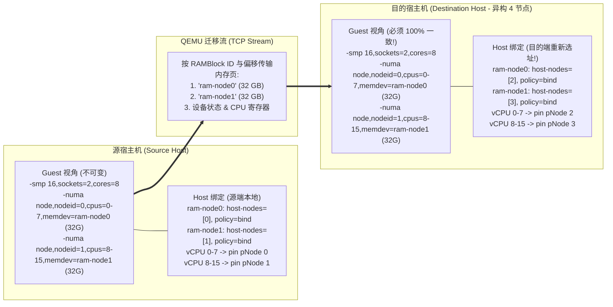

# 智能 NUMA（Smart NUMA）设计方案：自动 vNUMA 拓扑与主机 NUMA 归属调度

> 生成时间：2026-11-02  
> 适用范围：`ferrovirt`（控制面） / `hyper-agent`（宿主机代理与放置控制器） / `lictor`（QEMU/QMP 运行时） / `xvirt-client`（Web 控制台）  
> 关联文档：`docs/resource-planning.md`

---

## 目录

1. [背景与核心目标](#一-背景与核心目标)
2. [主流商用虚拟化产品的 NUMA 配置方式对标](#二-主流商用虚拟化产品的-numa-配置方式对标)
   - [2.1 主流产品全景对比](#21-主流产品全景对比)
   - [2.2 VMware vSphere (ESXi) 深度拆解](#22-vmware-vsphere-esxi-深度拆解)
   - [2.3 Microsoft Hyper-V 与 Nutanix AHV](#23-microsoft-hyper-v-与-nutanix-ahv)
   - [2.4 国内商用超融合与开源 KVM 平台](#24-国内商用超融合与开源-kvm-平台)
3. [当前系统（ferrostack / xvirt）现状与关键差距分析](#三-当前系统ferrostack--xvirt现状与关键差距分析)
4. [智能 NUMA 总体架构与核心算法设计](#四-智能-numa-总体架构与核心算法设计)
   - [4.1 产品交互原则：默认全自动 + 专家手动锁定](#41-产品交互原则默认全自动--专家手动锁定)
   - [4.2 全生命周期工作流](#42-全生命周期工作流)
   - [4.3 算法一：自动配置虚拟机 vNUMA 拓扑（Auto vNUMA Sizing）](#43-算法一自动配置虚拟机-vnuma-拓扑auto-vnuma-sizing)
   - [4.4 算法二：自动设置主机 NUMA 内存与 CPU 归属（Auto Host Placement）](#44-算法二自动设置主机-numa-内存与-cpu-归属auto-host-placement)
   - [4.5 执行层闭环：QEMU 命令行生成与 per-vNode 线程亲和性](#45-执行层闭环qemu-命令行生成与-per-vnode-线程亲和性)
   - [4.6 运行期动态调整（Dynamic Rebalance）与在线迁移兼容](#46-运行期动态调整dynamic-rebalance与在线迁移兼容)
5. [工程落地改造清单（按组件与源码文件）](#五-工程落地改造清单按组件与源码文件)
6. [典型场景效果对比](#六-典型场景效果对比)
7. [异构集群下的 vNUMA 配置与在线迁移（Live Migration）处理](#七-异构集群下的-vnuma-配置与在线迁移live-migration处理)
   - [7.1 集群宿主机 NUMA 规格不同，vNUMA 如何配置？](#71-集群宿主机-numa-规格不同vnuma-如何配置)
   - [7.2 在线迁移（Live Migration）的 QEMU 底层硬约束](#72-在线迁移live-migration的-qemu-底层硬约束)
   - [7.3 目的端异构 NUMA 拓扑的四种重映射策略](#73-目的端异构-numa-拓扑的四种重映射策略)
   - [7.4 当前代码迁移链路（`vm_migrate.rs` / `migration.py`）的缺陷修复](#74-当前代码迁移链路vm_migraters--migrationpy的缺陷修复)

---

## 一、 背景与核心目标

在多路服务器（Multi-Socket）或单路多 Die（如 AMD EPYC CCD/NPS、Intel Sub-NUMA Clustering）架构下，跨 NUMA 节点访问远端内存（Remote Memory Access）相比本地内存（Local Memory Access）会带来 **30% ~ 80% 的延迟增加** 和互联总线（UPI/Infinity Fabric）带宽争抢。

所谓 **“智能 NUMA”**，目标是让普通用户在完全不感知 NUMA 复杂性的前提下，由虚拟化平台自动完成两件事：

1. **对内（Guest 视角）—— 自动配置虚拟机 vNUMA 拓扑（Auto vNUMA Sizing）**
   - 自动判断虚拟机应该呈现为单节点（UMA）还是多节点（vNUMA）。
   - 自动计算虚拟 NUMA 节点数量（`vNodes`）、每个虚拟节点的 `vCPU` 数与内存容量、虚拟节点间的距离矩阵（ACPI SLIT），并自动修正虚拟 CPU 拓扑（`-smp sockets/cores/threads`）使其与 ACPI SRAT 表严格对齐。
2. **对外（Host 视角）—— 自动设置虚拟机内存与 vCPU 所属的主机 NUMA（Auto Host NUMA Placement & Affinity）**
   - **开机准入（Pre-launch Admission）**：在 QEMU 进程启动并分配内存**之前**，综合宿主机各物理节点（`pNode`）的空闲内存、CPU 池超分率、大页余量、PCIe 直通设备位置、节点健康度，算出每个 `vNode` 对应的最佳主机物理节点（`Home Node`）。
   - **强亲和执行（Execution）**：将每个 `vNode` 的内存后端（`memory-backend` 或 `cpuset.mems`）绑定到对应的主机 `pNode`，同时将该 `vNode` 下的 vCPU 线程约束在同一 `pNode` 的物理核集合内（杜绝“内存绑在 Node 0，vCPU 却被调度到 Node 1”的伪亲和）。
   - **运行期动态平衡（Rebalance）**：当主机节点负载失衡时，在线平滑迁移单节点 VM 或调整 vNode 内绑核策略。

---

## 二、 主流商用虚拟化产品的 NUMA 配置方式对标

**核心结论**：主流商业虚拟化产品全部采用 **“默认全自动配置 + 极少数场景手动覆盖”** 的模式，绝不会要求普通用户在创建虚拟机时手动去配 NUMA。

原因在于：
1. **95% 的用户不知道底层宿主机有几个物理 NUMA 节点、每个节点有几核、当前哪个节点内存有富余**；
2. 虚拟机一旦发生跨主机热迁移（vMotion / Live Migration）或高可用重启（HA），手动写死的主机 NUMA 节点号在目标主机上可能不合理甚至不存在。

### 2.1 主流产品全景对比

| 产品 | 虚拟机 vNUMA 拓扑（Guest 视角） | 主机 NUMA 内存与 CPU 归属（Host 视角） | 用户交互体验 |
| :--- | :--- | :--- | :--- |
| **VMware vSphere (ESXi)** | **全自动**（`vCPU > 8` 或超单节点核数/内存时自动对称切分） | **全自动**（NUMA Scheduler 自动选 Home Node 分配本地内存并约束 vCPU） | **完全无感**。建 VM 只填 vCPU 和内存；vSphere 8 才在高级下拉框里开放了可选的手动拓扑，默认仍是“自动”。 |
| **Microsoft Hyper-V** | **全自动**（Dynamic NUMA 按宿主机单节点上限自动切分） | **全自动**（自动映射物理节点，默认允许跨节点弹性溢出 `NUMA Spanning`） | **默认无感**。自带从宿主机继承的节点最大核数/内存阈值，除非特殊调优否则不用改。 |
| **Nutanix AHV** | **自动分级**（窄 VM 单节点 UMA，宽 VM 自动对称切分 vNUMA） | **全自动**（开机时 Acropolis 调度器自动绑定 `memory-backend` 与 vCPU 亲和） | **默认自动**。普通创建无感；超大型数据库 VM 支持自动或一键开启宽虚拟机 vNUMA 强绑。 |
| **国产商用超融合**<br>*(SmartX / 深信服 HCI / 华为 FusionCompute / H3C CAS)* | **策略开关（默认自动）**<br>开启 NUMA 亲和后自动按宿主机均分 vNode | **自动选址 + 手动绑核可选**<br>开机时自动挑选空闲物理节点绑定内存与 CPU | **“自动开关 + 手动兜底”**。默认自动亲和；在“高级设置”里提供开关，允许给核心数据库手动指定绑核或节点映射。 |
| **半商用/开源 KVM**<br>*(Proxmox VE / oVirt / OpenStack)* | **半自动（需勾选开关或配模板）**<br>勾选后按 Socket 数自动均分，不勾则是单节点 | **需显式配置或依赖模板**<br>Proxmox 默认不绑主机节点（靠内核 `AutoNUMA`）；OpenStack 靠 Flavor 元数据自动绑 | 创建时需要用户**主动打勾 `Enable NUMA`**（Proxmox）或选特定规格模板（OpenStack）。 |

### 2.2 VMware vSphere (ESXi) 深度拆解

VMware 将物理 NUMA 域称为 **PPD（Proximal Processor Domain）**，将呈现给 Guest 的虚拟 NUMA 节点称为 **VP（Virtual Proximity Domain，即 vNode）**。其核心机制如下：

1. **小规格虚拟机（Narrow VM，如 4C8G、8C16G）**：
   - **不给虚拟机配置 vNUMA**：เมื่อ `vCPU <= 8`（`numa.vcpu.min = 8`）且单个物理 NUMA 节点能容纳该 VM 的核数与内存时，Guest 看到的是单节点 UMA，避免 Guest OS 内核多节点调度的开销。
   - **自动设置主机 NUMA 归属**：ESXi 开机时自动在宿主机上挑一个最空闲的物理 NUMA 节点作为它的 `Home Node`，把该 VM 的内存 100% 分配在该物理节点上，同时将其 vCPU 限制在该物理节点的 CPU 核上运行。
2. **大规格虚拟机（Wide VM，如 `vCPU > 8` 且超过单物理节点核数，或内存超过单节点可用容量）**：
   - **对称切分原则（Symmetric Partitioning）**：
     计算所需跨度：
     $$N_{\text{span}} = \max\left(\left\lceil \frac{\text{vCPU}}{\text{CoresPerpNode}} \right\rceil, \left\lceil \frac{\text{vMem}}{\text{AvailMemPerpNode}} \right\rceil\right)$$
     **严禁生成大小不一的非对称 vNode**（Guest OS 内核与数据库默认假设各 NUMA 节点对称）。例如宿主机单节点 8 核，创建一台 **12 vCPU** 的 VM，ESXi **不会**切成 `8 + 4`，而是均分为 **2 个 6 vCPU 的 vNode（`6 + 6`）**；若是 **18 vCPU**，则均分为 **3 个 6 vCPU 的 vNode（`6 + 6 + 6`）**。
   - **默认按物理核（Core）而非超线程（HT）计算单节点上限**：
     `numa.vcpu.preferHT = FALSE`（默认）：单 `pNode` 若是 16 核 32 线程，ESXi 按 **16** 作为单节点 vNode 的分裂阈值，只有超过 16 vCPU 才跨第二个 `pNode`，优先保证同核 IPC 吞吐。
   - **vNUMA 与 CPU 拓扑解耦对齐（vSphere 6.5+）**：
     自动调整虚拟 Socket/Core，保证**同一个虚拟 Socket（或 L3 Cache 域）绝对不横跨两个不同的 vNUMA 节点**，防止 Windows Server / SQL Server / Linux 调度器因 CPUID 与 SRAT 冲突而退化。
   - **首次开机自动固化（Autosize Once）**：
     `numa.autosize.once = TRUE`：VM 首次开机计算出 vNUMA 拓扑后自动写入 `.vmx` 配置文件（`numa.autosize.vcpu.maxPerVirtualNode = X`）固化下来。后续重启客户机看到的虚拟 NUMA 结构保持不变（防止数据库绑定参数或软件 License 失效）；只有当用户扩容修改了 vCPU 或内存大小时，才触发重新计算。
3. **什么时候才需要手动干预？**
   - 仅在不到 5% 的特殊场景：例如开启了 **CPU 热添加（vCPU Hot-Add）**（ESXi 默认开启 CPU 热添加会退化为 UMA）、或特殊软件 License 按 Socket 数量计费与 vNUMA 冲突时，管理员才进高级设置手动覆盖。

### 2.3 Microsoft Hyper-V 与 Nutanix AHV

- **Microsoft Hyper-V（Dynamic NUMA）**：
  - VM 设置的“处理器 -> NUMA”页面默认根据宿主机硬件自动填入 `MaximumProcessorsPerNumaNode` 和 `MaximumMemoryPerNumaNode`，默认开启 `NUMA Spanning`。
  - 用户创建 VM 时无需干预，Hyper-V 自动将大规格 VM 切分为多个虚拟 NUMA 节点并映射到宿主物理节点。
- **Nutanix AHV（基于 KVM 的超融合标杆）**：
  - 原生 QEMU/KVM 不会自动配置 `-numa`，也不会自动将 vNode 下的 vCPU 线程绑到对应的 `host-nodes`。
  - Nutanix 在管理层 Acropolis 中实现了自动分级：**Narrow VM** 自动单节点亲和；**Wide VM** 在创建/启动时自动切分对称 vNode，并在 QEMU 启动时同时做 **内存侧 `memory-backend` 绑定** 与 **计算侧 per-vNode vCPU 线程组亲和性绑定（Group Pinning）**。

### 2.4 国内商用超融合与开源 KVM 平台

- **国内商用超融合（SmartX SMTX OS / 深信服 HCI / 华为 FusionCompute / H3C CAS）**：
  - 针对国内用户常跑 Oracle / 达梦 / 高性能网元（NFV）的特点，普遍采用 **“默认智能自动 + 高级手动覆盖”**：
  - **默认档（自动）**：建 VM 零配置，开机时调度器自动判断单节点亲和或自动生成 vNUMA 并绑定主机节点。
  - **专家档（手动）**：在 VM 高级设置中提供切换开关，切到“手动”后展开拓扑面板，允许管理员手动指定 `vNode -> pNode` 映射及 1:1 独占绑核。
- **开源/半商用平台（Proxmox VE / oVirt / OpenStack Nova）**：
  - **Proxmox VE**：需手动勾选 `Enable NUMA`，勾选后按 `Sockets` 数均分生成 `-numa node`，但默认不绑定主机 `hostnodes`（依赖 Linux 内核 `AutoNUMA` 事后扫描迁页）。
  - **OpenStack Nova**：需在 Flavor 模板中声明 `hw:numa_nodes=N`，由 `NUMATopologyFilter` 在调度选机时完成 `vNode -> pNode` 匹配，并生成 libvirt `<numatune>` 与 `<cputune>`。

---

## 三、 当前系统（ferrostack / xvirt）现状与关键差距分析

盘点当前代码库（`ferrovirt/src/service/resource_plan.rs`、`hyper-agent/hyper_agent/support/resource_plan/placement.py`、`lictor/lictor/support/placement.py`、`lictor/lictor/support/qemu_command.py`），我们已经具备了非常扎实的基础设施：
- 已支持宿主机 CPU/NUMA/大页/距离矩阵扫描（`host_cpu_topology`、`host_numa_node`）；
- 已实现每台 VM 独立 `systemd-run --scope`（`vm-<uuid>.scope`）与 cgroup v2 `AllowedCPUs` / `AllowedMemoryNodes` 控制；
- 已实现 30s 周期的 `Controller`（`A 独占 / B 节点共享 / C 浮动`）及 `numa_maps` / `RDT MBM` / `schedstat` 健康观测。

但距离成熟的 **“智能 NUMA”** 还存在 **5 个核心断层**：

| 序号 | 断层点 | 当前代码位置与实现现状 | 导致的实际问题 |
| :---: | :--- | :--- | :--- |
| **1** | **缺少自动 vNUMA 切分算法** | `ferrovirt/src/service/resource_plan.rs:376`<br>`numa_mode` 仅支持 `none \| node \| vnuma`，且 `vnuma` 必须由用户手动传入 `numa[]` 数组。 | 创建大规格 VM（如双路主机上建 32C/128G VM）时，用户不手填就会保持 `numa_mode=none`；在 `placement.py:solve()` 中因单节点放不下直接退化为 **`C 级浮动`**——Guest 看到单节点 UMA，底层内存跨节点随机分配，远端访存高达 50%。 |
| **2** | **缺少开机前同步准入（Pre-launch Admission）** | `lictor/lictor/vm/guest.py:1296`<br>`start_vm` 直接读取静态 `placement.json`（新建 VM 默认为 `none` 浮动），等开机 120s（`settle_after_boot_s`）后才由后台 `Controller.tick()` 绑定并触发 `cpuset.mems` 迁页。 | ① `memfd(prealloc=on)` 和大页在 QEMU 启动瞬间就分配完内存，开机后再搬迁白白消耗数十 GB 内存带宽；<br>② QEMU 的 `-numa` 和 `host-nodes` **只能在启动命令行指定**，开机后再算已经无法改变 Guest 拓扑。 |
| **3** | **vNUMA 模式下缺 per-vNode 的 vCPU 亲和绑定** | `lictor/lictor/support/placement.py:156`<br>当 `numa_mode == "vnuma"` 时，仅设置了整个 scope 的 `AllowedMemoryNodes=0,1`，**既未设 `AllowedCPUs`，也未按 vNode 给 vCPU 线程设置亲和性**。 | 即使配了 `vnuma` 将 `vNode 0` 的内存绑在 `pNode 0`，`vNode 0` 的 vCPU 线程仍会被 Linux 调度器调度到 `pNode 1` 的核上运行，造成严重的跨节点访存！ |
| **4** | **`-smp` 拓扑与 vNUMA 未联动对齐** | `ferrovirt/src/service/vm_create.rs:144`<br>默认 `sockets=1, cores=max_vcpu, threads=1`。 | 若开启 2 个 `vNode`，而 `-smp` 仍是 `sockets=1, cores=16`，Guest 内核会发现“1 个物理插槽被劈成了 2 个 NUMA 节点”，触发 SRAT/CPUID 拓扑冲突警告甚至调度退化。 |
| **5** | **未感知 PCIe / VFIO / SR-IOV 设备的 NUMA 亲和** | `placement.py:solve()` 仅按节点内存使用率排序选节点。 | 当 VM 挂载了直通 GPU/网卡或 SR-IOV VF（位于 `pNode 1`）时，可能把 VM 分配到 `pNode 0`，导致所有 PCIe DMA 流量跨 Socket 传输。 |

---

## 四、 智能 NUMA 总体架构与核心算法设计

### 4.1 产品交互原则：默认全自动 + 专家手动锁定

沿用现有 `placement_source: "auto" | "manual"` 字段，将其升级为完整的智能 NUMA 状态机：

1. **智能自动模式（`placement_source = "auto"`，系统默认）**：
   - 用户创建或编辑 VM 时，**无需填写任何 NUMA 参数**。
   - **窄虚拟机（Narrow VM，单物理节点可容纳）**：自动设为 `numa_mode = "node"`，Guest 呈现为单节点 UMA，底层内存与 vCPU 在开机瞬间自动归属到最优的单个主机物理 NUMA 节点。
   - **宽虚拟机（Wide VM，单物理节点核数或内存放不下）**：自动设为 `numa_mode = "vnuma"`，自动对称切分虚拟节点、自动将虚拟 `sockets` 对齐为虚拟节点数，并在 QEMU 启动时自动把每个虚拟节点的内存（`host-nodes`）与对应的 vCPU 线程亲和性（`sched_setaffinity`）绑定到各自的主机物理 NUMA 节点上。
2. **专家手动模式（`placement_source = "manual"`）**：
   - 当用户在 UI 上显式指定了绑核、指定了固定节点或手写了 `vnuma` 拓扑并点击“锁定”时，`placement_source` 置为 `"manual"`。
   - 智能控制器将其视为不可移动的硬约束（先把手动 VM 占用的独占核与节点内存扣除，再为自动 VM 求解）。

### 4.2 全生命周期工作流



---

### 4.3 算法一：自动配置虚拟机 vNUMA 拓扑（Auto vNUMA Sizing）

对标 VMware ESXi Autosize 算法，定义纯函数 `auto_size_vnuma(vm_spec, plan, topo)`：

#### Step 1：计算宿主机单节点有效容量
从宿主机拓扑与资源规划缓存中读取：
- $N_{\text{host}}$：宿主机在线物理 NUMA 节点数（若 $N_{\text{host}} \le 1$，直接返回单节点 UMA）。
- $C_{\text{node\_cores}}$：单个物理 NUMA 节点划给 `vm` 池的**物理核心数（Physical Cores，不含超线程）**。
- $C_{\text{node\_threads}}$：单个物理 NUMA 节点划给 `vm` 池的**逻辑线程数（Logical CPUs）**。
- $M_{\text{node\_budget}}$：单个物理节点的 VM 池内存预算（扣除 OS 预留、虚拟化预留、大页池、安全余量后的容量，若 VM 使用大页后端，则取单节点大页总容量）。

#### Step 2：Narrow VM vs Wide VM 触发判定
设虚拟机规格为 $(V_{\text{cpu}}, M_{\text{vm}})$，满足以下**任一条件**即触发自动 vNUMA（判定为 **Wide VM**）：
1. **CPU 跨节点条件**：$V_{\text{cpu}} > 8$ **且** $V_{\text{cpu}} > C_{\text{node\_cores}}$（默认按物理核数判定，与 ESXi `numa.vcpu.preferHT=FALSE` 一致；若 $V_{\text{cpu}} > C_{\text{node\_threads}}$ 则无条件触发）；
2. **内存跨节点条件**：$M_{\text{vm}} > M_{\text{node\_budget}}$（单节点内存或单节点大页放不下整台 VM）。

> 若以上两个条件均不满足，则判定为 **Narrow VM（窄虚拟机）**：不配置 vNUMA（向 Guest 呈现单节点 UMA），底层走单节点绑定（`numa_mode = "node"`）。

#### Step 3：对称切分算法（Symmetric Partitioning）
当判定为 Wide VM 时，计算虚拟 NUMA 节点数 $K$（$2 \le K \le N_{\text{host}}$）：

1. **计算最小物理节点跨度 $K_{\min}$**：
   $$K_{\min} = \min\left( N_{\text{host}}, \max\left( \left\lceil \frac{V_{\text{cpu}}}{C_{\text{node\_cores}}} \right\rceil, \left\lceil \frac{M_{\text{vm}}}{M_{\text{node\_budget}}} \right\rceil, 2 \right) \right)$$
2. **寻找对称整除的虚拟节点数 $K$**：
   - 在 $[K_{\min}, N_{\text{host}}]$ 区间内，寻找能整除 $V_{\text{cpu}}$（即 $V_{\text{cpu}} \bmod K == 0$）且满足单节点容量的最小整数 $K$。
   - **对称切分示例**：
     - 宿主机为 2 路 × 8 核/节点，创建 **12 vCPU** 虚拟机：$K_{\min} = \lceil 12 / 8 \rceil = 2$，$12 \bmod 2 == 0$，切分为 **2 个 vNode，每个 vNode 6 vCPU**（`[0..5]`, `[6..11]`），绝不切成 `8 + 4`。
     - 宿主机为 4 路 × 8 核/节点，创建 **18 vCPU** 虚拟机：$K_{\min} = \lceil 18 / 8 \rceil = 3$，$18 \bmod 3 == 0$，切分为 **3 个 vNode，每个 vNode 6 vCPU**。
   - **非整除奇异核数兜底**：若用户设置了奇数或质数核（如 11 vCPU 跨 2 节点），前 $K-1$ 个节点分配 $\lceil V_{\text{cpu}} / K \rceil = 6$ 核，最后一个节点分配 $5$ 核，同时在校验接口返回 `warn` 提示用户改为对称偶数核。
3. **虚拟节点内存均分与对齐**：
   - 对齐粒度 $\Delta$：普通内存 / 2M 大页取 $\Delta = 256\text{ MB}$（最小不低于 $2\text{ MB}$）；1G 大页强制取 $\Delta = 1024\text{ MB}$。
   - 前 $K-1$ 个 vNode 的内存：
     $$M_i = \left\lfloor \frac{M_{\text{vm}} / K}{\Delta} \right\rfloor \times \Delta$$
   - 最后一个 vNode 吸收余数：$M_{K-1} = M_{\text{vm}} - \sum_{i=0}^{K-2} M_i$。

#### Step 4：`-smp`（Socket / Core / Thread）自动对齐与拓扑固化
- **CPU 拓扑对齐规则**：
  - 当启用 `vnuma`（共 $K$ 个虚拟节点）且用户未强行锁定自定义 `sockets` 时，自动设置：
    $$\text{sockets} = K, \quad \text{threads} = 1\ (\text{或保持用户指定}), \quad \text{cores} = \frac{V_{\text{cpu}}}{K \times \text{threads}}$$
  - 确保 **1 个虚拟 Socket 恰好对应 1 个 vNUMA 节点**，使 Guest OS 的调度域（Scheduling Domain）在 LLC 与 NUMA 层级完全吻合。
- **首次开机拓扑固化（Autosize Once）**：
  - 首次计算出的虚拟节点切分结构（`vNode` 数量、各 `vNode` 的 `vcpus` 与 `memory_mb`）写入 `vm_config.numa_json` 与 `placement.json`。
  - 只要用户后续未修改虚拟机的 `vcpu` 总数和 `memory` 总量，**重启或跨主机迁移时 Guest 看到的 vNode 切分结构永远不变**，只重新计算底层映射到哪几个主机 `host_node`。

---

### 4.4 算法二：自动设置主机 NUMA 内存与 CPU 归属（Auto Host Placement）

在 VM 启动前（以及运行期周期性重平衡时），为 Narrow VM 选出 1 个最佳 `pNode`，或为 Wide VM 的 $K$ 个 `vNode` 选出 $K$ 个最佳的不同 `pNode`。

#### 1. 候选物理节点打分函数（Node Scoring Function）
对于宿主机上的每个物理节点 $n \in \{0, \dots, N_{\text{host}}-1\}$，先做硬约束过滤，再计算综合得分 $S(n)$：

- **硬约束过滤（Hard Constraints）**：
  1. **大页硬约束**：若 `mem_backend == "hugepage-2m"` 或 `"hugepage-1g"`，节点 $n$ 当前的空闲大页容量必须 $\ge$ 该 vNode 所需内存（大页不支持 swap 也不能跨节点回退，不满足则 QEMU 启动必败）。
  2. **节点共享核非空约束**：节点 $n$ 在 `vm` 池中的可用 CPU 核数必须 $> 0$。

- **综合评分公式（分数越高越优先）**：
  $$S(n) = 50 \cdot I_{\text{dev}}(n) + 25 \cdot \frac{\text{free\_mem\_mb}(n)}{\text{budget\_mb}(n)} + 15 \cdot \frac{1}{1 + \text{oc}(n)} - 10 \cdot \text{health\_score}(n)$$
  各分量含义：
  1. **$I_{\text{dev}}(n) \in [0, 1]$（PCIe / VFIO / SR-IOV 设备亲和度，权重 50）**：
     检查该 VM 挂载的 `pciPassthroughs`、SR-IOV 网卡或 NVMe 磁盘所属的物理 `numa_node`（来自 `host_device.numa_node`）。若设备位于节点 $n$，则 $I_{\text{dev}}(n) = 1$，确保 VM 内存和 vCPU 紧贴 PCIe 设备所在节点。
  2. **内存空闲度（权重 25）**：节点 $n$ 剩余可用的 VM 池内存预算占比，优先放入内存最宽裕的节点。
  3. **CPU 空闲度（权重 15）**：节点 $n$ 当前的 vCPU 超分比 `oc(n)` 越低，得分越高。
  4. **实测节点健康度惩罚（权重 -10）**：直接采用 `placement.py:node_health()` 合成的 `score`（融合了 CPU 运行队列延迟 `runq`、内存分配溢出率 `spill`、内存回收率 `reclaim`、RDT 远端访存比 `remote_mem_ratio`），自动避开亚健康节点。

#### 2. 多节点子图优选（针对 4 路 / 8 路 / AMD 多 CCD 主机）
当宿主机节点数 $N_{\text{host}} > K$（例如 4 节点主机上启动 2 个 vNode 的 VM）时：
- 遍历大小为 $K$ 的候选节点子集 $P = \{p_1, \dots, p_K\}$，最大化目标函数：
  $$\text{Score}(P) = \sum_{i=1}^K S(p_i) - \lambda \cdot \frac{1}{K(K-1)} \sum_{i \neq j} \text{distance}(p_i, p_j)$$
- 即：**在满足容量与健康度的前提下，优先选择物理距离（`distance`）最近的一组节点**（例如优先选同一 Socket 内的两个 CCD 节点，其次选直连 UPI 的两个节点，避开两跳节点）。

#### 3. 主机 NUMA 内存绑定策略自适应（Strict `bind` vs Elastic `preferred`）
如何将虚拟机内存设置到主机 NUMA 节点上？需区分单节点与多节点、大页与普通内存：

| 虚拟机形态与内存模式 | QEMU `memory-backend` 配置 | systemd scope `AllowedMemoryNodes` (`cpuset.mems`) | 为什么这样设计？ |
| :--- | :--- | :--- | :--- |
| **Narrow VM（单节点 `numa_mode=node`）** | 不加 `host-nodes`（仅设 `-m` 或基础 `memfd`） | 设为选中的单节点 `N`（如 `AllowedMemoryNodes=0`） | **最佳热迁移与在线换节点弹性**：只用 cgroup `cpuset.mems` 约束单节点内存。当运行期需要将整台 VM 从 Node 0 搬到 Node 1 时，只需改写 `AllowedMemoryNodes=1`，Linux 内核会自动触发 `do_migrate_pages` 异步迁页；若在 QEMU 层加了 `MPOL_BIND` 反而会阻碍动态换节点。 |
| **Wide VM（多节点 `numa_mode=vnuma`，大页或常规容量）** | 每个 `ram-node<i>` 设 `host-nodes=[pNode_i], policy="bind"` | 设为所选节点并集（如 `AllowedMemoryNodes=0,1`） | 因为 cgroup `cpuset.mems` 是进程级（作用于整个 QEMU），写 `0,1` 无法阻止 `vNode 0` 的内存分配到 `Node 1`。因此 **多节点 vNUMA 必须在 QEMU 的每个 `memory-backend` 上显式指定 `host-nodes=[pNode_i]`**。 |
| **Wide VM（开启了内存分层 `memtier` 或高超分）** | 每个 `ram-node<i>` 设 `host-nodes=[pNode_i], policy="preferred"` | 设为全部在线节点 | `policy="preferred"` 保证平时 100% 从对应 `pNode_i` 本地分配内存；极端情况下某节点内存耗尽时允许临时借用邻居节点内存，避免触发宿主机 OOM 杀掉 QEMU。 |

---

### 4.5 执行层闭环：QEMU 命令行生成与 per-vNode 线程亲和性

#### 1. QEMU 启动命令行完整示例
以一台 **16 vCPU、64 GB 内存** 的虚拟机在双路宿主机（选中 `pNode 0` 和 `pNode 1`，距离为 `10 / 21`）上自动切分为 2 个 vNode 为例，由 `lictor/lictor/support/qemu_command.py` 生成如下参数：

```bash
# 1. CPU 拓扑自动对齐为 2 Sockets × 8 Cores × 1 Thread
-smp 16,sockets=2,dies=1,clusters=1,cores=8,threads=1

# 2. 为每个 vNode 生成独立的 memory-backend，绑定各自的主机 NUMA 节点
-object '{"qom-type":"memory-backend-ram","id":"ram-node0","size":34359738368,"host-nodes":[0],"policy":"bind"}'
-object '{"qom-type":"memory-backend-ram","id":"ram-node1","size":34359738368,"host-nodes":[1],"policy":"bind"}'

# 3. 声明 Guest vNUMA 节点（明确指定 cpus 范围与 memdev）
-numa node,nodeid=0,cpus=0-7,memdev=ram-node0
-numa node,nodeid=1,cpus=8-15,memdev=ram-node1

# 4. 透传物理节点间的真实距离矩阵（生成 Guest ACPI SLIT 表）
-numa dist,src=0,dst=0,val=10
-numa dist,src=0,dst=1,val=21
-numa dist,src=1,dst=0,val=21
-numa dist,src=1,dst=1,val=10
```

#### 2. vNUMA 模式下的 per-vNode vCPU 线程亲和性绑定（关键闭环）
在 `lictor/lictor/support/placement.py` 中，当 QEMU 进程启动就绪（`-S` 暂停点之后、`cont` 之前），通过 QMP `query-cpus-fast` 获取每个 `vcpu` 的宿主线程号 `tid`，并按以下规则施加亲和性：

- **情形 A：vNUMA + 独占绑核（`cpu_placement == "dedicated"`，宽裕档）**
  - `vNode 0` 的 `vCPU 0..7` 逐一调用 `os.sched_setaffinity(tid, {pcpu})` 1:1 绑定到 `pNode 0` 的空闲物理核上；
  - `vNode 1` 的 `vCPU 8..15` 逐一 1:1 绑定到 `pNode 1` 的空闲物理核上。
- **情形 B：vNUMA + 节点内共享（`cpu_placement == "shared"`，适中/紧张档）**
  - Scope 的 `AllowedCPUs` 设为 $\bigcup_{i} \text{shared\_cpus}(p_i)$；
  - 遍历每个 `vNode i`（映射到物理节点 $p_i$，包含虚拟核集合 $C_i$）：
    - 计算物理节点 $p_i$ 上的共享池逻辑核集合 $H_i = \text{shared\_cpus}(p_i)$；
    - 对所有 $v \in C_i$ 的线程 `tid`，调用：
      ```python
      os.sched_setaffinity(tid, set(H_i))
      ```
  - **核心价值**：每个虚拟 NUMA 节点的 vCPU 线程既可以在对应物理节点的共享池核之间自由负载均衡，又**绝不会漂移到其他物理 NUMA 节点上执行**，从而保证每个 vNode 的“计算”与“内存”严格同处一个主机物理 NUMA 节点！

---

### 4.6 运行期动态调整（Dynamic Rebalance）与在线迁移兼容

1. **消除开机 120s 盲区（开机即准入）**：
   - 改造前：VM 开机先以 `C 浮动` 启动，等 120s 后再由后台控制器绑定节点并迁页。
   - 改造后：`lictor` 在 `start_vm` 执行 `systemd-run` 之前，若 `placement_source == "auto"`，同步调用一次准入计算（`< 5ms`），直接以最优节点（`node` 或 `vnuma`）启动 QEMU，**从第一页内存分配起就 100% 落在目标主机 NUMA 节点上**。
2. **运行期 Narrow VM 动态调优**：
   - 沿用现有 30s 控制环：根据主机负载指数 $L$ 在 `A（独占绑核） ↔ B（单节点共享） ↔ C（跨节点浮动）` 之间平滑升降级；当某节点内存或 CPU 过载时，自动触发 `AllowedCPUs` + `AllowedMemoryNodes` 在线换节点异步迁页。
3. **运行期 Wide VM（vNUMA）动态调优**：
   - 对于自动生成的 `vnuma` 虚拟机，Guest 看到的 vNode 拓扑在运行期保持不变（ACPI 表只读），但底层的 **CPU 绑核等级可动态调整**：
     - 主机处于 `roomy（宽裕）` 档位时，控制器自动为每个 vNode 在其对应的 `host_node` 内分配 1:1 独占物理核（`V-A` 态）；
     - 主机进入 `medium / tight` 档位时，控制器在线将各 vNode 的 vCPU 线程亲和性放宽回各自 `host_node` 的共享池核集（`V-B` 态），释放独占核供全池共享，同时依然保持严格的 NUMA 节点亲和。
4. **跨主机热迁移（Live Migration）自动重映射**：
   - 当 VM 在线迁移到目标宿主机时，目标端 `lictor` 在启动 `-incoming` QEMU 进程前，保持 `vNode` 的数量、核数、内存切分大小完全不变（确保 QEMU 内存布局与 `ram-node0..k` ID 严格一致），**重新运行节点打分算法为每个 `vNode` 挑选目标宿主机上最空闲的 `host_node`**。

---

## 五、 工程落地改造清单（按组件与源码文件）

本方案与现有数据库表结构及 ZMQ 通信协议完全兼容，只需在以下 5 个核心模块做增量改造：

### 1. 控制面 `ferrovirt`（Rust）
- **`ferrovirt/src/service/resource_plan.rs`**
  - `validate_placement()`：允许 `numa_mode` 取值为 `"auto" | "none" | "node" | "vnuma"`（当 `placement_source == "auto"` 时默认 `numa_mode = "auto"`）。
  - `ingest_placement_event()`：当接收到 `hyper-agent` 上报的 `vm.placement_changed`（含开机准入 `action="admit"`）时，若为自动生成的 `vnuma`，同步更新 `vm_config` 表的 `numa_mode`、`numa_json` 及 `placement_tier`。
- **`ferrovirt/src/service/vm_create.rs` & `vm_update.rs`**
  - 在创建或修改 VM 规格（`vcpu` / `memory`）时，若 `placement_source == "auto"`，读取目标宿主机的 `host_numa_node` 与 `host_cpu_topology` 预计算是否需要开启 `vnuma`：
    - 若需要开启 `vnuma`（切成 $K$ 个虚拟节点）且用户未显式指定多 Socket，自动将 `vm_config.sockets` 设为 $K$、`cores` 设为 `max_vcpu / K`。
  - 在生成的 `placement.json` sidecar `spec` 中增加 `device_nodes: [i32]`（汇总该 VM 挂载的 PCIe 直通设备与 SR-IOV 网卡所在的物理 `numa_node`）。

### 2. 宿主机代理 `hyper-agent`（Python）
- **`hyper-agent/hyper_agent/support/resource_plan/placement.py`**
  - 新增纯函数 **`auto_size_vnuma(vm_spec, plan, topo)`**：实现 §4.3 的对称切分算法，返回 `{"numa_mode": "node" | "vnuma", "vnodes": [...], "recommended_sockets": K}`。
  - 新增纯函数 **`score_nodes(vm_spec, plan, topo, stats, health, distance)`**：实现 §4.4 的节点综合打分与多节点距离子图优选。
  - 新增方法 **`Controller.admit_vm(uuid, vm_spec=None)`**：供 VM 启动前同步调用，算出初始最优放置（`A / B / V`），更新 `placement.json` sidecar 并发布 `vm.placement_changed (action="admit")` 事件。
  - 升级 **`is_forced_fixed(vm)` 与 `solve()`**：
    - 区分“用户手写的 `vnuma`（`placement_source == "manual"`）”与“系统自动生成的 `vnuma`（`placement_source == "auto"`）”；
    - 对自动 `vnuma` 虚拟机，支持在每个 `vNode` 所属的 `host_node` 内动态求解 `dedicated`（1:1 绑核）与 `shared`（节点级共享池亲和）。
- **`hyper-agent/hyper_agent/controller/resource_plan.py`**
  - 暴露轻量 action `placement_admit`（或由 `lictor` 直接调用共享模块 / 本地 RPC），在 `start_vm` 前触发准入。

### 3. 虚拟机监控服务 `lictor`（Python）
- **`lictor/lictor/support/qemu_command.py`**
  - `_build_memory_backends()`：
    - 支持读取 `vnodes` 中的 `cpus` 列表（如 `"0-7"`）和 `policy`（`"bind"` 或 `"preferred"`）；
    - 当 `len(vnodes) > 1` 且存在节点距离信息时，自动生成 `-numa dist,src=i,dst=j,val=d`。
  - `_build_smp()`：
    - 当 `placement.get("numa_mode") == "vnuma"` 且 `len(vnodes) > 1` 时，若 `guest.cpu.sockets` 未对齐 `len(vnodes)`，自动将 `-smp` 的 `sockets` 对齐为 `len(vnodes)` 的整数倍。
- **`lictor/lictor/support/placement.py`**
  - `scope_spec()`：当 `numa_mode == "vnuma"` 时，自动将 `AllowedCPUs` 设置为各 `vNode` 对应 `host_node` 的 `vm` 池 CPU 并集（或独占核并集），不再留空。
  - `post_launch()` & `apply_placement()`：新增 **`apply_vnuma_affinity(uuid, pl, manager_sync)`**：
    - 若 `cpu_placement == "dedicated"`，按 `cpu_pins` 1:1 绑核；
    - 若 `cpu_placement == "shared"`，按每个 `vNode` 的 `cpus` 范围和 `host_node`，将对应 vCPU 线程 `sched_setaffinity` 到该 `host_node` 的共享核集合。

---

## 六、 典型场景效果对比

以一台 **2 路 × 16 核 32 线程（共 32C/64T）、256 GB 内存（每节点 128 GB）** 的宿主机为例：

| 业务场景 | 改造前（现状） | 改造后（智能 NUMA） |
| :--- | :--- | :--- |
| **场景 1：创建普通虚拟机（8 vCPU, 16 GB）** | 开机时 `numa_mode=none`（跨节点浮动），跑满 120s 后才由后台控制器绑到单节点并触发后台迁页。 | **开机即最优**：启动前准入自动选定最空闲健康的单节点（如 `pNode 0`），Guest 见 UMA，内存与 vCPU 从第 0 秒起 100% 本地分配；主机宽裕时自动 1:1 绑核。 |
| **场景 2：创建大规格数据库 VM（24 vCPU, 96 GB）** | 用户未手填 `vnuma` $\rightarrow$ 单节点物理核数（16C）不够 $\rightarrow$ 退化为 `C 浮动`：Guest 看到单节点 UMA，底层内存散落两颗 CPU，跨 UPI 远端访存高达 **~50%**。 | **自动识别为 Wide VM**：自动对称切分为 **2 个 `12 vCPU + 48 GB` 的 vNode**，`-smp` 自动对齐为 `2 Sockets × 12 Cores`；`vNode 0 → pNode 0`、`vNode 1 → pNode 1`，vCPU 线程各自锁定在对应 `pNode`，远端访存降至 **< 5%**。 |
| **场景 3：创建超大内存 VM（8 vCPU, 160 GB）** | `vCPU=8` 小于单节点核数，但内存（160G）超过单节点容量（128G）$\rightarrow$ 单节点放不下，退化为跨节点无序浮动。 | **内存维度自动触发 vNUMA**：检测到 $160\text{G} > M_{\text{node\_budget}}$，自动切分为 **2 个 `4 vCPU + 80 GB` 的 vNode**，分别绑定 `pNode 0` 和 `pNode 1`。 |
| **场景 4：带 GPU/SR-IOV 直通的 VM（8 vCPU, 32 GB，GPU 插在 Node 1）** | 仅按内存空闲率可能被分到 `Node 0`，导致 GPU PCIe DMA 全程跨 Socket 传输。 | **设备亲和打分生效**：自动识别直通设备在 `Node 1`（+50 分），强制将 VM 内存和 vCPU 锁定在 `Node 1`，计算、内存、PCIe DMA 同节点零跨跳。 |


---

## 七、 异构集群下的 vNUMA 配置与在线迁移（Live Migration）处理

在真实生产集群中，不同宿主机往往具有不同的物理 NUMA 拓扑（例如：**Host A** 是 `2 路 × 16 核 / 128 GB 每节点`，**Host B** 是 `2 路 × 24 核 / 256 GB 每节点`，**Host C** 是 `4 路 × 12 核` 或 `单路 32 核`）。当集群存在异构 NUMA 宿主机时，必须解决两个关键问题：**① 虚拟机的 vNUMA 应该按什么标准切分？ ② 虚拟机跨异构宿主机在线迁移时如何处理？**

---

### 7.1 集群宿主机 NUMA 规格不同，vNUMA 如何配置？

#### 核心铁律：“前端虚拟拓扑（vNUMA）”与“后端物理映射（pNUMA）”彻底解耦
- **前端虚拟拓扑（Guest 看到的 vNode 数量、每个 vNode 的 vCPU 列表与内存大小）**：在虚拟机开机运行期间**绝对不可变**。因为 Guest OS（Linux / Windows）只在内核启动引导阶段解析一次 ACPI SRAT / SLIT 表来初始化内存管理区（`pglist_data`）和调度域（Scheduling Domains），运行期无法动态增删 NUMA 节点。
- **后端物理映射（每个 vNode 到底落在宿主机哪个物理 `pNode` 上）**：完全可变。在源宿主机和目的宿主机上，可以通过 QEMU `memory-backend` 的 `host-nodes`、cgroup `cpuset.mems` 以及 `sched_setaffinity` 随时重新映射（支持 `1:1` 映射、`N:1` 合并映射、`1:N` 拆分映射）。

#### 异构集群下的两种 vNUMA 定型策略

| 策略 | 适用场景 | 切分基准与规则 | 优缺点分析 |
| :--- | :--- | :--- | :--- |
| **策略 A（默认）：首次开机宿主机定型 + 固化**<br>*(对标 VMware `numa.autosize.once = TRUE`)* | 单机环境、同构集群、或较少发生跨代际大规格迁移的集群 | 1. 虚拟机**首次开机**落在哪台宿主机，就按该宿主机的单节点物理核数与可用内存预算计算对称 vNUMA 拓扑；<br>2. 计算结果立即写入 `vm_config.numa_json` 和 `placement.json` **固化**；<br>3. 后续重启或迁移到其他宿主机时，**保持首次开机固化的 vNode 切分结构不变**（仅当用户修改了 VM 的 vCPU 总数或内存大小时才重新触发计算）。 | **优点**：在首次落位的宿主机上 100% 贴合硬件，且重启前后 Guest 内部拓扑绝对稳定（不影响 Oracle/SQL Server 绑定配置）。<br>**缺点**：若首次在大节点主机（如单节点 24 核）上建了 20 vCPU 的 VM（被定型为单节点 UMA），后续迁移到小节点主机（单节点 16 核）时，单节点放不下。 |
| **策略 B（集群增强）：集群最小单节点基线定型**<br>*(Cluster-Min-Node Baseline)* | 混部了不同代际 CPU、且频繁在线迁移的异构集群 | 控制面 `ferrovirt` 查询集群内所有在线宿主机的 `host_numa_node` 表，取集群内**最小的单物理节点容量**作为切分基线：<br>$$C_{\text{cluster\_base}} = \min_{h \in \text{Cluster}} C_{\text{node\_cores}}(h)$$<br>$$M_{\text{cluster\_base}} = \min_{h \in \text{Cluster}} M_{\text{node\_budget}}(h)$$ | **核心原理：“小块能装进大桶，大块装不进小桶”**。<br>例如集群有 16 核/节点（Host A）和 24 核/节点（Host B）两类机器，创建 24 vCPU 的 VM 时按 16 核基线切分为 **2 个 12 vCPU 的 vNode**。<br>・在 Host A 上：2 个 12C vNode 刚好 `1:1` 放入两个 16C 物理节点；<br>・迁到 Host B 上：2 个 12C vNode 既可以 `1:1` 放入两个 24C 节点，也可以 `2:1` 合并放入同一个 24C 节点，**在所有主机上均能实现 100% 本地内存访问！** |

> **推荐落地方案**：在 `ferrovirt` 中默认启用 **“集群基线感知 + 首次固化”**：若主机属于多节点集群，创建大规格 VM（`vCPU > 8`）时优先参考集群内宿主机的最小单节点核数 $C_{\text{cluster\_base}}$ 进行对称切分并固化到 `numa_json`；单机模式则直接取本机 $C_{\text{node\_cores}}$。

---

### 7.2 在线迁移（Live Migration）的 QEMU 底层硬约束

在 KVM / QEMU 体系下做跨主机在线迁移，必须严格区分 **“哪些参数必须两端一致”** 与 **“哪些参数可以在目的端重配”**：



1. **必须与源端字节级一致的参数（QEMU ABI 硬约束）**：
   - `-smp` 参数（`vcpus / sockets / dies / cores / threads`）；
   - `-numa node` 的节点数量、`nodeid`、`cpus` 归属、以及 `memdev` 的对象 ID（如 `ram-node0`、`ram-node1`）；
   - 每个 `memory-backend` 的字节大小 `size`（哪怕差 1 MB，QEMU 迁移握手都会报错 `Length mismatch: ram-node0`）；
   - 如果源端是单节点（未开 `vnuma`）且使用的是普通 `-m`（RAMBlock 名字为 `pc.ram`），目的端也必须是 `pc.ram`，不能在在线迁移中途把 `pc.ram` 改成 `ram-node0`（反之亦然）。
2. **目的端可以自由修改的参数（宿主机物理绑定层）**：
   - `-object memory-backend-*` 中的 **`host-nodes` 数组** 和 **`policy`（`bind` / `preferred` / `default`）** —— 这两个属性纯属宿主机内核 `mbind()` 参数，完全不进 QEMU 迁移流；
   - systemd scope 的 **`AllowedCPUs`、`AllowedMemoryNodes`、`CPUWeight`**；
   - vCPU 线程的 **`sched_setaffinity`（`cpu_pins` 1:1 绑核或节点共享核集合）**。

---

### 7.3 目的端异构 NUMA 拓扑的四种重映射策略

当虚拟机带着 $K$ 个虚拟节点（`vNode 0 .. K-1`）在线迁移到拥有 $M$ 个物理节点（`pNode 0 .. M-1`）的目的宿主机时，目的端的准入器在启动 `-incoming` QEMU 前，按以下 4 种情形自动重算物理绑定：

| 异构迁移场景 | 拓扑关系示例 | 目的端内存归属设置 | 目的端 vCPU 归属设置 | 迁移后性能表现 |
| :--- | :--- | :--- | :--- | :--- |
| **场景 1：同构或目的端节点更多**<br>*(1:1 选优重映射)* | 源端 **2 个 vNode**（各 8C/32G）$\rightarrow$ 迁往 **4 节点主机**（如 `pNode 0,1` 已满，`pNode 2,3` 空闲） | `ram-node0` 改绑 `host-nodes=[2]`<br>`ram-node1` 改绑 `host-nodes=[3]`<br>Scope `AllowedMemoryNodes=2,3` | `vNode 0` (vCPU 0-7) 绑 `pNode 2`<br>`vNode 1` (vCPU 8-15) 绑 `pNode 3` | **100% 本地访存**，自动避开目的端繁忙节点。 |
| **场景 2：目的端单节点更大、节点数更少**<br>*(N:1 合并折叠 Folding)* | 源端在老机器上有 **2 个 vNode**（各 8C/32G）$\rightarrow$ 迁往新机器（**单路 32C/128G**，或双路中单个 24C/128G 节点就装得下整台 VM） | **多 vNode 指向同一物理节点**：<br>`ram-node0` 设 `host-nodes=[0]`<br>`ram-node1` 设 `host-nodes=[0]`<br>Scope `AllowedMemoryNodes=0` | `vNode 0` 与 `vNode 1` 的全部 vCPU 线程均绑在 `pNode 0` 的核集内（独占时分配 `pNode 0` 内不重叠的物理核）。 | **100% 本地访存**！Guest 内部仍看到 2 个 vNode（保证迁移不断），但底层物理内存和 CPU 全部收敛在同一个大物理节点内，零跨跳开销。 |
| **场景 3：源端是单节点 UMA，但目的端单节点太小装不下**<br>*(1:N 弹性跨节点展开)* | 源端在大节点机器上是 **单节点 24C/96G UMA** $\rightarrow$ 应急迁往小节点机器（**每节点仅 16C/64G**） | 保持单节点 UMA 启动（保证 `pc.ram` 迁移兼容），将 Scope `AllowedMemoryNodes` 放宽为 `0,1`，允许跨节点分配内存。 | Scope `AllowedCPUs` 设为 `pNode 0,1` 共享核并集。同时写入 `placement_event` 提示：“当前跨节点运行，下次重启 VM 将自动切分为 2 节点 vNUMA”。 | **保障高可用迁移成功**；若建 VM 时启用了 §7.1 的“集群最小单节点基线策略”，则可从根源避免此场景。 |
| **场景 4：目的端某节点剩余内存略小于单个 vNode**<br>*(Preferred 弹性溢出)* | 源端 **2 个 vNode**（各 48G）$\rightarrow$ 目的端 `pNode 0` 空闲 60G，`pNode 1` 空闲仅 36G | `ram-node0`: `host-nodes=[0], policy="bind"`<br>`ram-node1`: `host-nodes=[1], policy="preferred"`<br>Scope `AllowedMemoryNodes=0,1` | `vNode 0` 绑 `pNode 0`<br>`vNode 1` 绑 `pNode 1` | `vNode 0` 100% 本地；`vNode 1` 前 36G 本地分配，超出部分借用 `pNode 0`，既不 OOM 又最大化本地比例；后续目的端 `pNode 1` 释放内存后可由控制器自动迁回。 |

---

### 7.4 当前代码迁移链路（`vm_migrate.rs` / `migration.py`）的缺陷修复

在梳理现有在线迁移代码（[`ferrovirt/src/service/vm_migrate.rs`](file:///root/work/ferrostack/ferrovirt/src/service/vm_migrate.rs) 与 [`lictor/lictor/vm/migration.py`](file:///root/work/ferrostack/lictor/lictor/vm/migration.py)）时，发现一个**必须在本次智能 NUMA 中一并修复的迁移断层**：

- **现状问题**：
  - [`lictor/lictor/vm/migration.py:85-105`](file:///root/work/ferrostack/lictor/lictor/vm/migration.py#L85-L105) 的 `migrate_export` 目前只导出了 `config.xml` 和 `petrel-disks.json`，**没有导出源端的 `placement.json` sidecar**！
  - 目的端 `migrate_incoming`（[`migration.py:107-135`](file:///root/work/ferrostack/lictor/lictor/vm/migration.py#L107-L135)）在本地目录没有 `placement.json` 的情况下调用 `guest.launch_vm(..., incoming_uri=uri)`，导致目的端 `launcher.placement` 为空字典 `{}`：
    1. 若源端 VM 开启了 `vnuma`（RAMBlock 为 `ram-node0`, `ram-node1`），目的端却按默认 `-m`（RAMBlock 为 `pc.ram`）启动，**在线迁移会立即失败报错**；
    2. 目的端迁移完成后，丢失了该 VM 的 `placement.json` sidecar（包括 `mem_backend`、`priority`、`vnuma` 结构等）。
- **修复方案（三步闭环）**：
  1. **源端导出 `placement`**：在 [`migration.py:migrate_export`](file:///root/work/ferrostack/lictor/lictor/vm/migration.py#L85) 中一并读取源端 VM 目录下的 `placement.json`，通过 [`vm_migrate.rs:249`](file:///root/work/ferrostack/ferrovirt/src/service/vm_migrate.rs#L249) 传给目的端 `migrate_incoming`。
  2. **目的端启动前重映射（Dest Admission Remap）**：
     目的端 `migrate_incoming` 收到源端 `placement` 后：
     - **保留不可变字段**：`mem_backend`、`numa_mode`、`numa` 数组中每个 vNode 的 `vcpus` / `memory_mb` 切分大小、`spec`；
     - **重算宿主机相关字段**：调用目的端本机的 `admit_vm_incoming(placement)`，根据目的宿主机的 NUMA 拓扑和当前空闲内存/大页/CPU 负载，按 §7.3 重新填充 `numa_node`、`numa[i].host_node` 和 `cpu_pins`，写入目的端 VM 目录的 `placement.json`，再拉起 `QEMU -incoming`。
  3. **目的端 `post_launch` 施加亲和性**：
     `QEMU -incoming` 进程启动后，立即由 [`lictor/lictor/vm/guest.py:1418`](file:///root/work/ferrostack/lictor/lictor/vm/guest.py#L1418) 的 `_placement.post_launch()` 将每个 vNode 的 vCPU 线程亲和性绑定到目的端新选出的 `host_node` 上，使得源端发过来的每一页内存从写入目的端伊始就精准落位！
