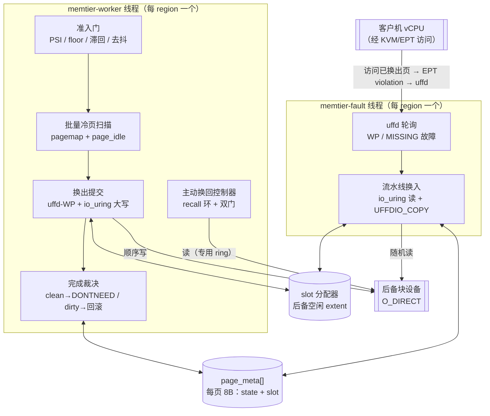
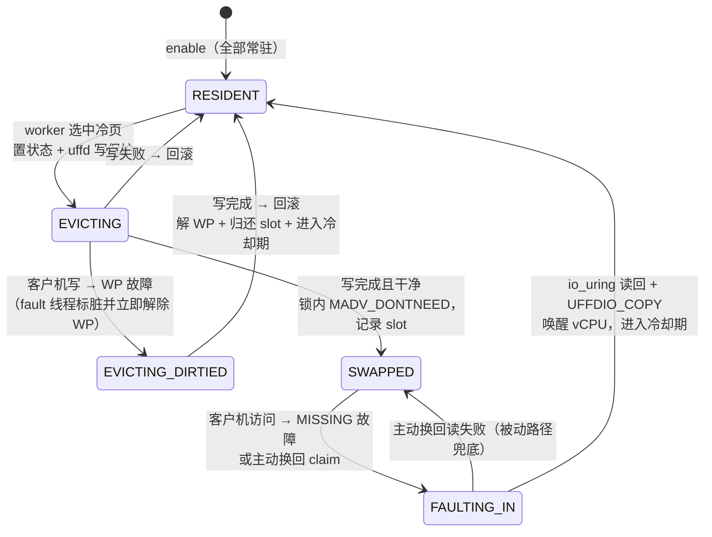
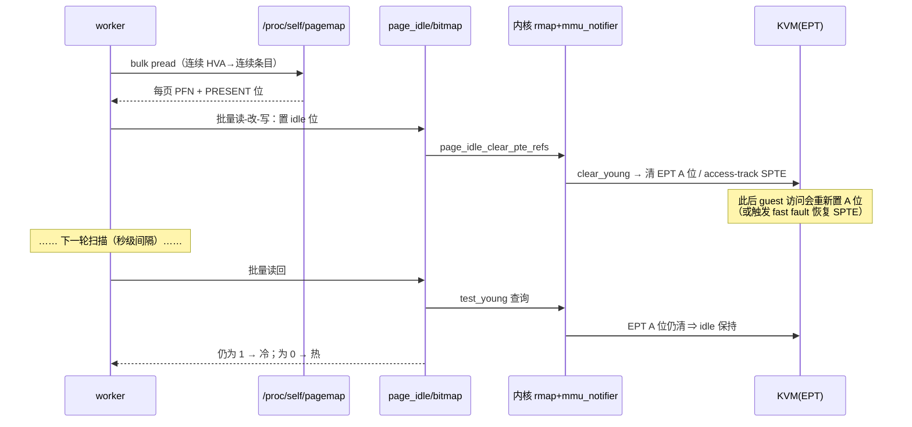
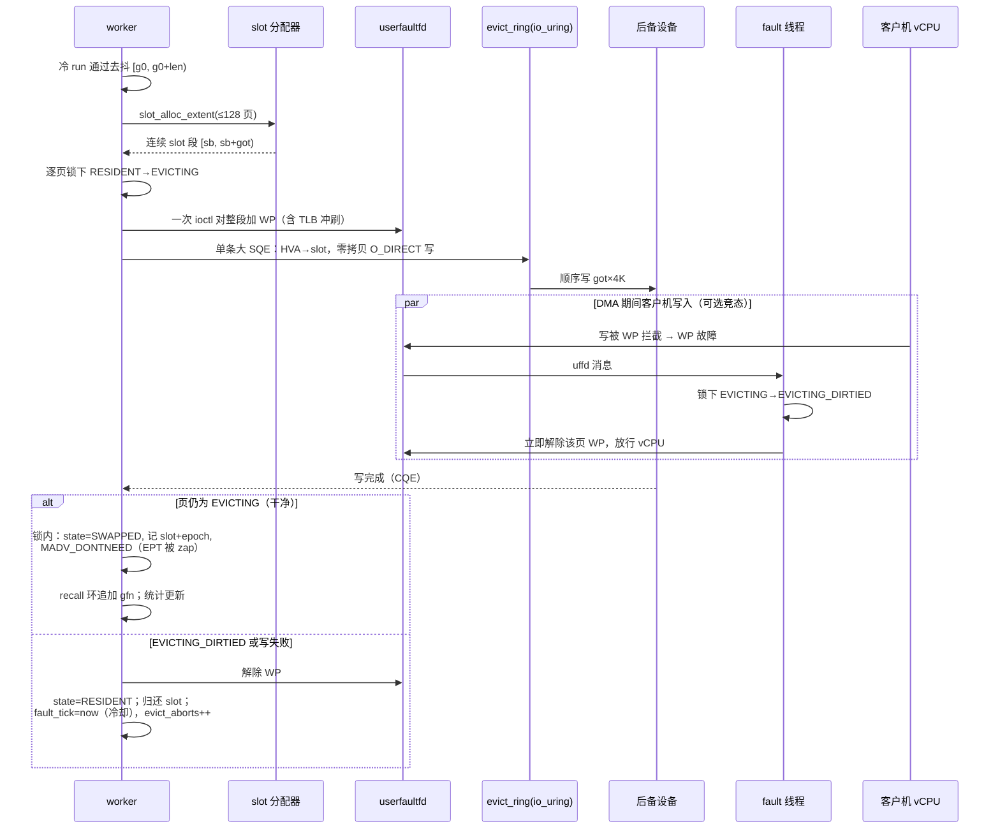
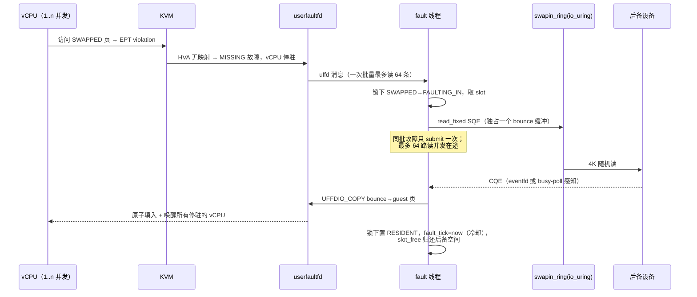
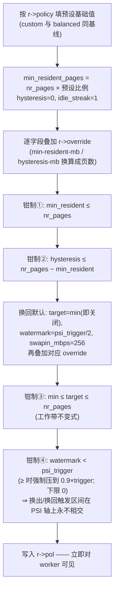
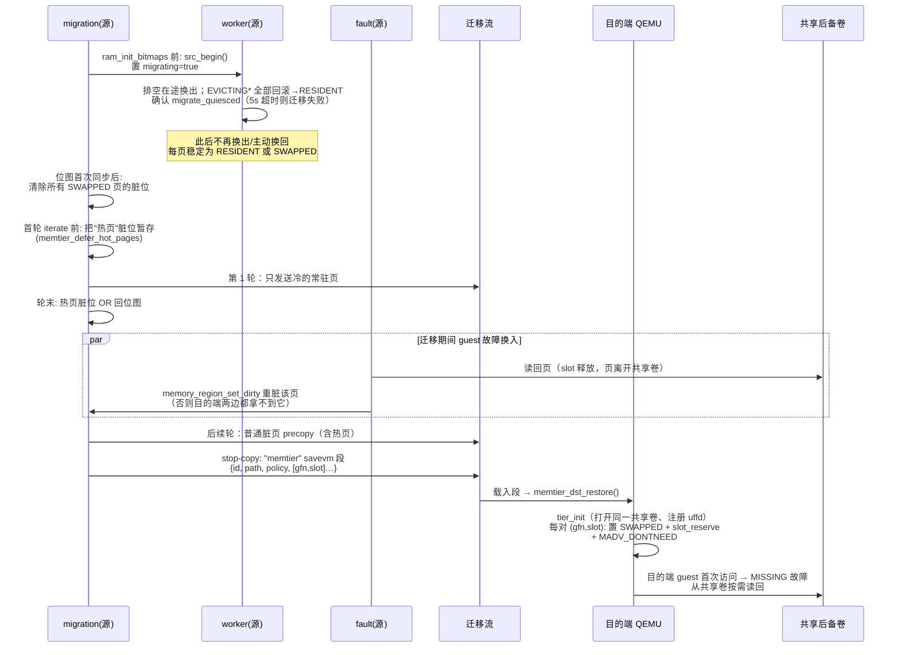

# QEMU memory-tiering 分支：客户机内存分层技术方案（详版）

> 基于 `ferrostack/qemu` 仓库 `memory-tiering` 分支（基线 `stable-10.0-dev`，顶端提交 `208e41fb4c`）的代码梳理。
> 源码位置：`memtier/` 子目录（约 2800 行新增代码）、`qapi/memtier.json`、`migration/ram.c` 集成、`docs/devel/memory-tiering.rst`。
> 附录 A 讨论"为什么当前没有用 DAMON"；附录 B 核实"Haswell-EP 上 page_idle 失效"论断的准确性。

---

## 1. 背景与目标

把客户机 RAM 做成两层：**热页常驻宿主机 DRAM，冷页换出到低一层的块设备**（NVMe 裸分区 / 预分配 raw 文件，未来可为分布式卷），客户机再次访问时透明换回。约束与取舍：

- **不修改 KVM、不依赖内核新特性开发**：全部逻辑在 QEMU 用户态，只用现成内核接口（userfaultfd-WP、io_uring、pagemap、page_idle、PSI、madvise）；
- **正确性优先**：任何时刻客户机读到的数据必须一致（换出期间的并发写、换入并发故障、迁移期间的状态都有明确协议）；
- **对客户机透明**：guest 无感知，无 balloon/virtio 协作。

与内核 swap 的本质区别：分层由 QEMU 按 region 自治管理，有独立的策略面（QMP 可调）、独立的后备设备、且能与热迁移协同（共享后备卷时换出页不走网络）。

## 2. 总体架构

### 2.1 数据流总览



一句话流程：

```
空闲扫描找出冷页
  → uffd 对整段冷页 run 加写保护（WP）
  → io_uring O_DIRECT 顺序大写到后备设备
  → 完成时确认期间未被写脏，MADV_DONTNEED 释放宿主页
    （内核 mmu_notifier 使 KVM 自动 zap 对应 EPT 表项，无需改 KVM）
  → 客户机再访问 → EPT violation → 宿主页缺失 → userfaultfd MISSING 故障进 QEMU
  → io_uring 读回该页 → UFFDIO_COPY 原子填入并唤醒 vCPU
```

### 2.2 源码布局（`memtier/`）

| 文件 | 行数 | 职责 |
|---|---|---|
| `memtier.c` | 720 | 生命周期、策略解析、uffd/io_uring 初始化、QMP 命令、目的端迁移恢复 |
| `worker.c` | 474 | worker 线程：监控 + 扫描调度 + 换出 + 主动换回控制器 |
| `fault.c` | 385 | fault 线程：uffd 故障处理、流水线换入、主动换回执行 |
| `scan.c` | 312 | page_idle/pagemap 细粒度冷页扫描（批量 + write-aging 回退） |
| `slot-alloc.c` | 231 | 后备设备空闲 extent 分配器 |
| `migrate.c` | 317 | 热迁移集成（quiesce、savevm "memtier" 段） |
| `memtier-stubs.c` | 55 | 非 Linux / 无 io_uring 构建的报错桩 |

### 2.3 线程模型与并发协议

每个开启分层的 RAM region（`MemTierRegion`）有两个专属线程：

- **memtier-worker**：主循环。空闲时约 200ms 一拍；活跃换出时连续运转（批量扫描窗口本身即节拍）。做 PSI 采样、epoch 时钟推进、冷页扫描、换出提交与收割、write-aging 回退判定、主动换回、限速。**所有换出状态变更单线程化在 worker 内**。
- **memtier-fault**：uffd 轮询循环，处理 WP 与 MISSING 故障。带自适应 busy-poll：有换入在途或距上次活动 200µs 宽限期内，自旋轮询非阻塞 uffd 和完成队列；空闲时回落 `poll()`（uffd fd + io_uring eventfd 一起等）。动机：NVMe 单页读约 85µs，若睡在 poll() 里，每次故障多两次调度唤醒（vCPU→fault 线程、ring eventfd→fault 线程），是非 I/O 开销的大头。

并发控制三件套：

1. **1024 个分片自旋锁**：`LOCK_OF(r, gfn) = &locks[gfn & 1023]`，所有页状态转换都在对应分片锁下进行；
2. **uffd 写保护是换出路径与客户机写之间唯一的同步原语**（见 §5.3 竞态分析）；
3. 统计计数用 `qatomic_*`；`stopping/migrating/migrate_quiesced` 等标志用原子读写。

### 2.4 核心数据结构

```c
/* 每页元数据，按 gfn（region 内页号）线性索引 —— 8 字节/页
 * 32GB 客户机 → 64MB 元数据 */
typedef struct {
    uint32_t state : 3;      /* 页状态机（5 态） */
    uint32_t slot  : 29;     /* SWAPPED 时有效；2^29 slot × 4K = 2TB 后备上限 */
    uint32_t evict_epoch;    /* 被换出时的 epoch，用于主动换回的时效判断 */
} page_meta_t;
```

`MemTierRegion` 内存布局（省略部分字段）：

```
MemTierRegion
├─ id / path / policy / pol(解析后的生效旋钮) / override(用户覆盖集)
├─ base / nr_pages / mr(+mr_offset, 迁移重脏用)
├─ meta[nr_pages]          8B/页   ← 权威状态 + slot 映射
├─ fault_tick[nr_pages]    4B/页   ← 最近换入/回滚时刻（冷却期 & 迁移热度）
├─ idle_streak[nr_pages]   1B/页   ← 连续空闲扫描轮数
├─ locks[1024]                     ← 分片自旋锁
├─ cell_heat / cell_cold_runs      ← 2MB 粗粒度 cell（去抖 + DAMON 预留）
├─ uffd                            ← MISSING|WP 双模式注册
├─ slot（分配器：by_off/by_size 双 GTree）
├─ evict_ring(QD256) / swapin_ring(QD64) / swapback_ring(QD8)  ← 三个独立 io_uring
├─ bounce_pool（64×4K，注册固定缓冲）/ sb_bounce（1×4K）
├─ recall[cap] 环 + recall_head + epoch 时钟
└─ worker_thread / fault_thread
```

区域初始化时强制 `MADV_NOHUGEPAGE`（首版只支持 4K 页），并要求宿主页大小恰为 4K（拒绝 arm64 16K/64K 配置）。

## 3. 页状态机

状态与 userfaultfd 故障类型一一对应：



| 状态 | 宿主页 | EPT | 客户机访问的后果 |
|---|---|---|---|
| `RESIDENT` | 在 RAM，可写 | 正常映射 | 直通，无任何开销 |
| `EVICTING` | 在 RAM，uffd-WP | 只读 | 读直通；写 → WP 故障（微秒级放行） |
| `EVICTING_DIRTIED` | 在 RAM，已解除 WP | 可写 | 直通（完成时将回滚，本轮不换出） |
| `SWAPPED` | 已释放（DONTNEED） | 已 zap | 读/写 → MISSING 故障 → 换入 |
| `FAULTING_IN` | 读回在途 | 未映射 | 并发故障者停在 uffd 上，同一次 COPY 集体唤醒 |

**稳态（无换出活动）时 RESIDENT 页的访问路径完全无额外开销**——没有页表 trap、没有采样钩子；这是"WP 只在换出窗口内短暂存在"的设计收益。

## 4. 内存热度识别

热度识别是分层递进的机制，全部在 `scan.c` + `worker.c`。

### 4.1 主路径：page_idle / pagemap 空闲位扫描

利用两个内核接口（都需要 `CAP_SYS_ADMIN`）：

- `/proc/self/pagemap`：把 QEMU 虚拟地址（HVA）解析为物理页框号 PFN（bit63 `PM_PRESENT` 判断是否在内存，低 55 位为 PFN）；
- `/sys/kernel/mm/page_idle/bitmap`：按 PFN 索引的位图。写 1 = 标记该物理页"空闲"；此后**任何访问都会清掉这个位**——关键在于该机制是 **mmu-notifier 感知**的：标记时内核经 rmap 走 `ptep_clear_young_notify` → KVM 的 `clear_young` 回调清 EPT Accessed 位（或将 SPTE 置为 access-tracking 态）；读回时经 `test_young` 回调查询 EPT 侧访问。因此 **guest 经 EPT 的读和写都能被观测到**，这是 uffd-WP（只能看见写）做不到的。

判定逻辑：标记为 idle → 经过观察窗口 → 读回仍为 1 ⇒ 窗口内 guest 未访问 ⇒ 冷页。



### 4.2 批量实时扫描（`memtier_scan_range_cold`）

朴素的"每 2MB cell 扫一次、睡 100ms"在多 GB 区域上要几分钟才覆盖一轮（既不实时也不同调）。现行实现（提交 `9b694af4`）是**批量、无睡眠**的：

- worker 按游标一次取一批连续 cell，批大小 = 距排水目标的差额页数换算，钳制在 `SCAN_CELLS_MIN=8`（16MB）～ `SCAN_CELLS_MAX=4096`（8GB）；
- **一次（或数次）bulk `pread` 读整段 pagemap**：HVA 连续 ⇒ pagemap 条目连续，替代逐页 pread；
- **对 page_idle bitmap 做一次批量读-改-写**（RMW）：按本批 PFN 的 min/max 跨度取一个切片（上限 256MB；宿主物理页高度碎片化导致跨度过宽时退化为逐页路径）；
- **调用内不睡眠**：本轮读到的 idle 位是**上一轮**设置的，"仍为 1"意味着整个轮间间隔（秒级）都未被访问——观察窗口远长于任何调用内 sleep，慢节奏重读的页也能正确判热。判定完再统一重新置位供下一轮观察。

这样整个 region 得到**近同时刻的一致热度快照**，去抖在秒级收敛而非分钟级。

### 4.3 去抖动：页级 idle_streak + cell 级 cold_runs

```
        每轮批量扫描
             │
   页级: idle_streak[gfn]++（访问即清零）
             │  达到 idle-streak（默认 1）才算冷
             ▼
   cell 级: 本 2MB cell 有冷页 → cell_cold_runs[cell]++
             │  连续 cold-runs 轮（balanced=5）都冷才允许换出
             ▼          中途变热清零
        进入换出
```

- `idle-streak` 拉长单页的观察视野（每 +1 ≈ 多观察一整个轮间隔）；
- `cold-runs` 在 cell 粒度抑制偶发波动。由于批量扫描每轮覆盖整批 cell，`cold-runs` 轮去抖是**亚秒~秒级**（按迭代计），不是按轮转周期计的分钟级。

### 4.4 换出准入门与水位模型

worker 每轮的换出准入 = 四个条件同时成立：

1. `can_scan`：pagemap/page_idle 可用（或已进入 write-aging 回退）；
2. **PSI 压力门**：`/proc/pressure/memory` 的 `some avg10` ≥ `psi-trigger`——宿主没有内存压力时完全不动作，分层是"压力响应式"而非常态搬运；
3. **常驻下限**：resident > 排水目标；
4. **双水位滞回**已武装（`evict_armed`）。

水位图（`hysteresis-mb` = 滞回带 band）：

```
 resident
 nr_pages ┌──────────────────────────────────────── 初始：全部常驻
          │      PSI ≥ psi-trigger 且已武装 ⇒ 持续排水 ↓
 floor+band ─── 武装线：resident 涨过此线 → evict_armed=true
          │        ↕ 滞回带
 floor+b/2  ─── 排水停止线 tier_drain_target()：到此解除武装
          │        （最新换入的半带页留在 RAM）
 target   ─── 主动换回上限 target-resident-mb（≥ floor，默认=floor 即关闭）
          │      resident < target 且 PSI < swapin-watermark ⇒ 预取回 ↑
 floor    ─── min-resident-mb：换出永不逾越的硬下限
          0 └────────────────────────────────────────
```

band=0（默认）退化为"高于 floor 即评估换出、排到 floor 为止"。滞回的意义：工作集恰好停在 floor 附近时，避免"换出→立刻故障换回→又高于 floor→又换出"的乒乓。另有 `max-evict-mbps` 滚动 1 秒窗口限速（超速则 worker 补偿性睡眠）。

### 4.5 自适应回退：uffd-WP 写老化（write-aging）

**问题**（提交 `d4075ce1`，实测于 60 网段节点 106，Xeon E5-26xx v3 / Haswell-EP）：该宿主+内核组合上 page_idle 扫描**永远返回 ncold=0**（所有页每轮都读回"已访问"），冷页扫描完全失效，分层名存实亡；同样代码在开发机上正常。（该现象的机制分析与措辞辨析见附录 B。）

**方案**：不做脆弱的启动自检，而是**行为自检 + 自动降级**：

- worker 统计"允许换出且余量充足（resident 高出 floor 至少 16MB）、却一无所获"的连续窗口数 `scan_stall`；
- 达到 30 个窗口 ⇒ 单向翻转该 region 的 `writeage_fallback`（打 warn 日志）；
- 回退模式下扫描器**把所有 PRESENT 页都当作换出候选**（pagemap 在这类宿主上是正常的，只有 page_idle 失效）；
- 冷热过滤转由**换出路径本身的 WP 回滚**承担：换出 DMA 期间被写的页回滚为 RESIDENT，**并写入 `fault_tick` 进入 `cooldown-ms` 冷却期**——下一轮不再碰它。写热工作集因此自然留在 RAM，写冷集合被逐步排干到后备。

代价与合理性：回退模式测不到**读热度**，读热写冷的页可能被误换出再故障换回（冷却期约束churn幅度）；而对热迁移"首轮只发冷页"优化来说，**写热恰恰才是需要的信号**（会不会被重新写脏），所以回退模式对迁移场景零损失。

### 4.6 预留的粗筛层

`tier_policy_t.cold_threshold` 与 `MemTierRegion.cell_heat[]` 当前**已定义但无消费者**——它们是设计文档中 DAMON 粗筛层（layer-1 oracle）的预留挂点：DAMON 给出 region 级 nr_accesses，`cold-threshold` 作为冷区判据，粗筛命中的 cell 才交给 page_idle 细扫。当前实现证明批量细扫成本足够低，粗筛层未接入（详见附录 A）。

## 5. 内存换出（Evict）

### 5.1 端到端时序



### 5.2 实现要点

- **run 切割**：`evict_cell_runs()` 把 coldmap 切成最大连续候选 run（候选 = 冷 且 RESIDENT 且不在冷却期），每个 run 经 `memtier_evict_run()` 按 ≤`EVICT_MAX_RUN=128` 页的 extent 换出；
- **一次 ioctl 保护整段**：`uffd_change_protection` 按 extent 调用而非按页，摊薄 ioctl 与 TLB 冲刷成本；
- **零拷贝大写**：一条 `io_uring_prep_write` SQE 直接以 guest 内存为源（O_DIRECT DMA），连续 HVA 对应连续 slot——**换出侧是顺序写**，对 NVMe/分布式卷都友好；`IOSQE_FIXED_FILE` + 注册文件描述符；
- **后备满**：分配器给不出任何 slot 时发 `MEMTIER_BACKING_FULL` QMP 事件并放弃本次 run（无正确性影响，只是停止进一步换出）；
- **同步收割**：每个 run 提交后 worker 等全部完成再继续（`memtier_drain_evict_completions(r, true)`），保证换出状态机单线程。

### 5.3 关键竞态：为什么 DONTNEED 必须在分片锁内

WP 故障处理器的动作是"标脏 + **无条件解除写保护** + 放行"。设想完成路径这样写（错误版本）：

```
锁内: state = SWAPPED
解锁
MADV_DONTNEED(page)          ← 错误：锁外
```

时间窗：`state=SWAPPED` 之后、DONTNEED 之前，一个被 WP 拦住的客户机写经故障处理器解除 WP 后**落到即将被丢弃的页里** ⇒ DONTNEED 把这次写连页一起丢掉 ⇒ **丢写**。

正确实现把 DONTNEED 放在锁内：故障处理器只能在页已经消失之后才观察到 SWAPPED，它的"解 WP + 唤醒"让被拦的写重新触发——这次是 MISSING 故障，走换入路径，写在换入完成后重放。数据不丢。

### 5.4 WP 故障：写与换出竞争的代价

客户机在换出 DMA 期间写页的代价 = 一次 uffd 往返 + 一次解除 WP 的 ioctl（微秒级），vCPU 几乎不停顿；该页本轮换出作废（`evict_aborts++`）并进入冷却期。**这就是 write-aging 回退模式下的"写热过滤器"**：热页的换出尝试以极低代价失败并自动退避。

## 6. 换出页的记录：页元数据 + slot 分配器

### 6.1 哪些页被换出、换到哪了

**唯一权威记录是内存中的 `page_meta_t` 数组**：`state==SWAPPED` 的页，其 29 位 `slot` 字段记录页内容在后备设备上的位置（字节偏移 = `slot × 4096`）。O(1) 查询，8B/页开销。

**盘上没有任何元数据**——后备存储是**易失 swap 语义**：VM 关机/disable 即作废，设备初始化时整体视为一个大空闲 extent，无需格式化。需要跨 QEMU 实例传递映射的唯一场景是热迁移，此时映射通过 savevm "memtier" 段显式序列化（§10）。

### 6.2 空闲 slot 分配器（`slot-alloc.c`）

只跟踪**空闲** extent（在用 slot 由 `meta[].slot` 记账，不进分配器）。同一空闲集合维护两个有序索引（GTree）：

```
            by_off（按 start 排序）              by_size（按 (len,start) 排序）
   ┌─────────┬────────┬──────────┐      ┌────────┬─────────┬──────────┐
   │ {0,16}  │ {40,8} │ {100,64} │      │ {40,8} │ {0,16}  │ {100,64} │
   └─────────┴────────┴──────────┘      └────────┴─────────┴──────────┘
    释放时找前驱/后继 → 双向合并          best-fit：≥want 的最小 extent，
    （对抗碎片化）                        同长度取最低地址（内建反碎片）
```

- `slot_alloc_extent(want, &got)`：best-fit；找不到整段时退还当前最大 extent 让调用方拆分 I/O；`got==0` = 设备满；
- `slot_free(base, n)`：带前驱/后继合并的归还（换入、回滚、raced 时调用）；
- `slot_reserve(slot)`：迁移目的端恢复时把单个在用 slot 从空闲集中挖出（切割所在 extent）；散点 reserve 造成的碎片随页换回、`slot_free` 合并而自然收敛；
- 全部操作 O(log n)，自旋锁保护（worker 与 fault 线程并发进出）。

## 7. 内存换入（Swap-in）

### 7.1 被动换入：MISSING 故障驱动（主路径）



按状态分派（`handle_fault`）：

- `SWAPPED`：置 `FAULTING_IN`，提交异步读；
- `FAULTING_IN`：已有并发故障在填充，直接返回——那次 `UFFDIO_COPY` 会一并唤醒本 vCPU（并发故障天然串行化，无重复 I/O）；
- 其它（从未填充过的页）：`UFFDIO_ZEROPAGE` 直接给零页（启动后从未触碰的内存不占后备空间）。

### 7.2 流水线化与延迟优化

- **流水线**：每个故障占一个注册 bounce 缓冲（`SWAPIN_QD=64` 池，位图管理，耗尽时先收割再取），同批 uffd 事件只 `io_uring_submit` 一次。多 vCPU 并发故障的后备读**重叠**执行而非串行排队——这是对"一台 VM 多个 vCPU 同时踩到冷区"场景的关键优化；
- **自适应 busy-poll**（§2.3）：换入在途或 200µs 宽限期内自旋，砍掉每故障两次调度唤醒；
- **换入后冷却**：`fault_tick[gfn] = now`，`cooldown-ms` 内不可再被选为换出候选，防换出↔换入乒乓。

**错误语义**：读回失败是**致命错误**——页内容此刻只存在于后备设备上，读不回即数据丢失。发 `MEMTIER_SWAPIN_ERROR` QMP 事件、打日志、`exit(1)`。（后备设备的可靠性等级即 VM 的可靠性等级，生产应使用带冗余的卷。）

`memtier_swapin_blocking()` 是同步单页版本，仅用于 `x-memtier-disable` 的强制收敛路径。

## 8. 主动换回（Proactive Swap-back，默认关闭）

被动故障之外的**控制器驱动预取回**：宿主空闲时把最近被换出的页提前拉回 RAM，削减后续故障尾延迟。

### 8.1 recall 环 + epoch 时钟

```
 recall 环（容量=min(region 页数, 4M)，单调 head，pos = head % cap）
 ┌────┬────┬────┬────┬────┬────┬────┐
 │gfn │gfn │gfn │gfn │gfn │gfn │gfn │ ← worker 每成功换出一页追加
 └────┴────┴────┴────┴────┴────┴────┘
                              ▲ head（最新）
 控制器从 head 向旧端遍历 ⇒ "最近被换出者优先"换回
 条目时效 = 当前 epoch − meta[gfn].evict_epoch ≤ 256 epoch（25.6s）
```

为什么是环而不是按 epoch 分桶：换出是**突发**的（批量扫描一个 epoch 可换出 GB 级），固定容量的 per-epoch 桶会溢出；按 region 容量分配的环能装下整个"最近换出集合"，老化交给 epoch 差判断（出窗条目被跳过并最终被覆写）。worker 的 epoch 时钟每 100ms 加一，换出时把当前 epoch 写入 `meta.evict_epoch`。

### 8.2 换回控制器（每 worker 节拍执行）

两道门，且与换出门形成**不相交的滞回区间**，保证二者永不振荡：

1. **目标门**：resident < `target-resident-mb`（默认 = min ⇒ 恒假 ⇒ 关闭）。与 `min-resident-mb` 构成工作带：换出不低于 min、主动换回不高于 target、带内只有被动故障；
2. **PSI 门**：宿主 `some avg10` < `swapin-watermark`，且解析时强制钳制 watermark < `psi-trigger`（换出要求 PSI ≥ trigger）——两个动作的触发区间在 PSI 轴上不相交。

预算 = `max-swapin-mbps` 换算的页数，同时不超过 target 差额。执行（`memtier_active_swapback`，逐页）：

- 锁下 `SWAPPED → FAULTING_IN`（claim：阻断并发换出候选与重复召回）；
- 用**专用 swapback_ring + 专用 bounce** 同步读一页（绝不碰 fault 线程的 swapin_ring——那个 ring 不是线程安全的）；
- 成功：`UFFDIO_COPY` 填入。对无人等待的页这是合法预填充；若恰有 guest 故障已停驻在该页（看到 FAULTING_IN），同一次 COPY 顺带唤醒它；
- 失败：**不 exit**（与被动路径不同）——恢复 SWAPPED、`UFFDIO_WAKE` 唤醒可能停驻的故障让被动路径重试。被动故障永远兜底，环里的陈旧/失效条目最多多花一次按需读。

## 9. QMP API

新增 QAPI 模块 `qapi/memtier.json`：4 条命令（全部 `x-` experimental 前缀）+ 2 个事件；另在 `qapi/migration.json` 新增 1 个迁移能力。

### 9.1 命令总览

| 命令 | 参数 | 作用 |
|---|---|---|
| `x-memtier-enable` | `*id`, `path`, `*policy`, `*tunables` | 对一个 RAM block 开启分层（id 缺省=最大的 guest RAM block） |
| `x-memtier-set-policy` | `*id`, `*policy`, `*tunables` | 运行时调整策略/旋钮（详见 §10） |
| `x-memtier-query` | `*id` | 查询一个/全部 region 状态与统计，返回 `[MemTierInfo]` |
| `x-memtier-disable` | `*id` | 停止分层：先强制换回全部 SWAPPED 页再拆除（耗时 ∝ 换出量） |

### 9.2 策略预设与全部旋钮

`MemTierPolicy`：`conservative` / `balanced`(默认) / `aggressive` / `custom`（基线同 balanced，语义上表示"全靠 tunables"）。

| 旋钮 | conservative | balanced | aggressive | 消费位置 |
|---|---|---|---|---|
| `cold-threshold` | 0 | 2 | 8 | （预留：DAMON 粗筛冷判据，当前无消费者） |
| `cold-runs` | 8 | 5 | 2 | worker：cell 连续冷轮去抖 |
| `psi-trigger` (%) | 20 | 10 | 2 | worker：换出准入 PSI 门 |
| `max-evict-mbps` | 200 | 500 | 1000 | worker：换出限速 |
| `min-resident` | 75% | 50% | 25% | worker：排水目标/硬下限 |
| `cooldown-ms` | 2000 | 1000 | 500 | worker：候选过滤 + 回滚退避 |

仅 tunables 可设（无预设差异）的旋钮：`hysteresis-mb`（滞回带，默认 0）、`idle-streak`（连续空闲轮数，默认 1）、`target-resident-mb`（主动换回上限，默认=min ⇒ 关闭）、`swapin-watermark`（默认 psi-trigger/2）、`max-swapin-mbps`（默认 256）。

### 9.3 MemTierInfo（query 返回）

状态：`id`、`enabled`、`path`、`policy`、`tunables`（**解析后的生效值快照**，不是用户输入）；容量：`total/resident/swapped-bytes`、`backing-total/used/largest-free-bytes`；累计计数：`evicted-pages`、`evict-aborts`（DMA 期间被写而回滚）、`swapin-faults`（被动换入）、`swapin-errors`、`active-swapins`（主动换回）；瞬时：`evict-mbps`、`psi-some-avg10`。

运维上最有用的两个比值：`evict_aborts/evicted_pages` 高 ⇒ 在啃写热页（调大 cold-runs/idle-streak 或换保守预设）；`swapin_faults` 增速高 ⇒ 换出过度（调大 min-resident 或开主动换回）。

### 9.4 事件

- **`MEMTIER_BACKING_FULL`** `{id, used-bytes, total-bytes}`：后备满，换出暂停。无正确性影响；编排层可扩容/迁移/调低 target。
- **`MEMTIER_SWAPIN_ERROR`** `{id, gfn}`：某页无法读回，内容不可恢复，**VM 即将退出**。

### 9.5 迁移能力

`migrate-set-capabilities` 新增 unstable 能力 **`memtier-shared-backing`**：后备是源/目的两端皆可达的共享卷（如分布式 petrel 卷）时，已换出页不走迁移流，只传 gfn→slot 映射（§10 详述）。必须两端同时开启；QEMU 无法自证目的端可达性，由编排层判断并设置。

## 10. `x-memtier-set-policy` 的控制机制详解

这是运行时唯一的调参入口，理解它需要看清"**三层参数模型**"和"**无锁热生效**"两件事。

### 10.1 三层参数模型

```
 层1: policy 预设         conservative / balanced / aggressive / custom
        │  memtier_policy_resolve() 先按预设填全部基础值
        ▼
 层2: r->override         用户覆盖集（MemTierTunables，逐字段 has_* 标志）
        │  预设之上逐字段覆盖；跨多次 set-policy 调用【累积合并】
        ▼
 层3: r->pol              解析+钳制后的最终生效值（tier_policy_t）
                          worker / fault 线程每轮直接读它
```

`qmp_x_memtier_set_policy(id?, policy?, tunables?)` 的执行步骤：

1. **定位 region**：`id` 缺省时取"最大的 guest RAM block"的 id（与 enable 相同的默认规则）；未启用则报错；
2. **替换预设**（仅当提供了 `policy`）：`r->policy = policy`。注意**不清空 override**——已有覆盖会继续压在新预设之上；
3. **合并 tunables**（仅当提供）：对 11 个字段逐一检查 `has_*`，提供了的写入 `r->override` 并置位；**未提供的字段保留既有覆盖**。因此多次调用是累积语义：

   ```
   调用1: {psi-trigger: 5}                → override = {psi:5}
   调用2: {min-resident-mb: 4096}         → override = {psi:5, min:4096}
   调用3: {policy: aggressive}            → 预设换成 aggressive，
                                            但 psi=5、min=4096 仍覆盖其上
   ```

   **当前实现没有"撤销单个覆盖、回落预设值"的手段**（QAPI optional 字段无法表达"删除"），只能显式把该字段设回目标预设的数值。这是使用上要注意的一点；
4. **重解析**：调用 `memtier_policy_resolve(r)` 重算 `r->pol`。

### 10.2 memtier_policy_resolve：解析与钳制规则



钳制③④是**系统稳定性不变式**：③保证"换出下限 ≤ 换回上限"的工作带不塌缩；④保证换出（PSI 高时触发）与主动换回（PSI 低时触发）不会围绕同一水位线振荡。用户给出矛盾配置时引擎静默修正而不是报错。

### 10.3 生效机制：无锁、无重启、按节拍热生效

- QMP 命令在主循环线程执行，直接改写 `r->pol` 各字段；**不暂停、不重启 worker/fault 线程，不做任何 quiesce**；
- worker 每轮循环直接读 `r->pol.*`（PSI 门、floor、限速……），fault 路径读 `cooldown_ms` 等——**下一个 worker 节拍（≤ ~200ms）新参数即生效**；
- 并发语义：与 worker 的并发读没有加锁，理论上一轮内可能读到新旧混合的字段组合。这是有意的取舍：所有字段都是独立的标量门限，混合值最多影响一轮的判断（比如这一轮用旧 floor、新 psi-trigger），下一轮即完全一致，不影响任何正确性不变式（页状态机与数据一致性从不依赖策略字段）。

### 10.4 调参的行为语义（容易误解的点）

| 操作 | 立即效果 | 不会发生的事 |
|---|---|---|
| 调大 `min-resident-mb` | 停止进一步换出（floor 抬高） | **不会**把已换出的页拉回来 |
| 想把已换出页拉回 | 设 `target-resident-mb` > 当前 resident（且宿主 PSI 低），或直接 `x-memtier-disable` | — |
| 调小 `min-resident-mb` | 下次 PSI ≥ trigger 时继续排水到新目标 | 不会立刻排水（还要过 PSI 门） |
| 换 `policy` 预设 | 未被 override 的旋钮全部切到新预设 | 已 override 的旋钮**不会**跟随预设变 |
| 设 `swapin-watermark` ≥ `psi-trigger` | 被静默钳到 0.9×trigger | 不会报错 |
| 设 `idle-streak: 0` | 按 1 处理（resolve 里特判） | — |

## 11. API 调用实施流程

### 11.1 单机启用 → 观测 → 调参 → 停用

```bash
# 经 QMP socket（qmp-shell / socat）；libvirt 下:
#   virsh qemu-monitor-command <dom> '<json>'

# 1) 开启：对主 guest RAM block 分层，后备为 NVMe 分区
{ "execute": "x-memtier-enable",
  "arguments": { "path": "/dev/nvme1n1p3", "policy": "balanced" } }

#    指定 RAM block + 逐项微调:
{ "execute": "x-memtier-enable",
  "arguments": { "id": "pc.ram", "path": "/dev/nvme1n1p3",
                 "policy": "custom",
                 "tunables": { "psi-trigger": 5,
                               "min-resident-mb": 4096,
                               "hysteresis-mb": 512,
                               "idle-streak": 2,
                               "max-evict-mbps": 800 } } }

# 2) 观测
{ "execute": "x-memtier-query" }

# 3) 运行时调参（累积合并语义，见 §10.1）
{ "execute": "x-memtier-set-policy",
  "arguments": { "policy": "aggressive",
                 "tunables": { "min-resident-mb": 4096 } } }

# 3b) 开启主动换回（默认关闭）：target > min 形成工作带
{ "execute": "x-memtier-set-policy",
  "arguments": { "tunables": { "target-resident-mb": 8192,
                               "swapin-watermark": 3,
                               "max-swapin-mbps": 256 } } }

# 4) 停用（先把全部换出页拉回 RAM，耗时 ∝ swapped 量）
{ "execute": "x-memtier-disable" }
```

运行前提：内核支持 anonymous 内存 uffd-WP（6.x）；QEMU 以 `--enable-linux-io-uring` 构建；进程有 `CAP_SYS_ADMIN`（pagemap/page_idle）；后备为裸块设备或预分配 raw 文件；宿主页 4K。调试：`XVIRT_MEMTIER_TRACE=1` 环境变量打开 evict/fault/worker/scan 逐事件 stderr 跟踪。

### 11.2 共享后备热迁移

```bash
# 前提：两端后备路径指向同一共享卷；两端 QEMU 二进制都含 memtier
# （"memtier" savevm 段无条件注册，目的端无需也不能预先 enable）

# 源端与目的端都设置能力:
{ "execute": "migrate-set-capabilities",
  "arguments": { "capabilities": [
      { "capability": "memtier-shared-backing", "state": true } ] } }

# 正常发起迁移:
{ "execute": "migrate", "arguments": { "uri": "tcp:DST:4444" } }
```

不开该能力时，迁移/快照前应先 `x-memtier-disable` 收敛（文档建议）。

## 12. 热迁移集成（memtier-shared-backing）

### 12.1 总体时序



### 12.2 源端要点

1. **quiesce 时机**：`memtier_migration_src_begin()` 在位图**首次同步之前**调用——不变式是"同步与清脏位之间不得有页变为 SWAPPED"，否则清错位。quiesce 由 worker 自己执行（保持换出状态机单线程），migration 侧只等 `migrate_quiesced` 标志；
2. **换出页不走网络**：`migration_bitmap_clear_memtier_swapped()` 对每个 SWAPPED 页 `test_and_clear_bit` 清脏位并递减 `migration_dirty_pages`（做法对齐既有的 discarded-pages 处理）；
3. **换入重脏**：quiesce 后被动换入仍允许（guest 体验优先）。换入使页离开共享卷（slot 已释放），两个 fault 路径都检测 `migrating` 并 `memory_region_set_dirty()`——下次位图同步把它当普通脏页发送；
4. **首轮只发冷页（feature-4）**：memtier 自身就是热度源——`fault_tick` 在 4 秒内（刚换入或刚被写回滚）的 RESIDENT 页视为"很可能再变脏"的热页。首轮 iterate 前把它们的脏位暂存进每 block 影子位图（`ram_find_and_save_block` 自然跳过），轮末 OR 回去，热页在后续轮随脏页走。收益：避免热页"首轮发一遍、变脏再发一遍"的重复传输；
5. **失败恢复**：`ram_save_cleanup → memtier_migration_src_end()` 清 `migrating`，worker 恢复换出。

### 12.3 目的端要点

"memtier" savevm 段（`register_savevm_live`，在 `migration_object_init` 无条件注册——目的端从未跑过 enable 也必须能加载）。`memtier_dst_restore()` 在 VM 尚未运行时执行：完整 `tier_init`（打开同一共享卷、注册 uffd、建三个 ring），然后逐对 (gfn,slot)：置 `SWAPPED`、`slot_reserve()`（防该 slot 被将来换出复用）、`MADV_DONTNEED`。启动两线程后，目的端天然继续处于分层状态，冷页按需从共享卷故障读回——**迁移停机时间与换出量无关**。

序列化格式（版本 1，stop-copy 阶段、VM 已停）：

```
be32 n_regions
per region:
  str id | str path | u8 policy | be64 nr_pages
  be64 n_swapped | n_swapped × { be64 gfn, be32 slot }
```

## 13. 限制与后续工作（当前版本）

- 仅 4K 页（region 强制 `MADV_NOHUGEPAGE`），不支持 THP/大页；要求宿主页 4K；
- DAMON 粗筛层未接入（`cold-threshold`/`cell_heat` 为预留挂点，见附录 A）；
- 后备无加密、无按 stride 预取（主动换回只按"最近换出"召回）、未接 KVM async page fault（故障期间 vCPU 硬停驻）；
- 单页换入读失败即 VM 退出——后备设备可靠性即 VM 可靠性；
- 非共享后备时热迁移/快照应先 disable 收敛；
- 后备上限 2TB（29 位 slot × 4K）；每 region 单 fault 线程（超大 region 高并发故障时可能成为瓶颈）；
- `x-` 前缀：QAPI 接口不承诺稳定。

## 14. 测试

- `memtier/tests/redis_integrity.sh` + `redis_integrity_guest.py`：guest 内 redis 用确定性值 `value(key)=sha256(tag:key)` 填充 → QMP 压低 floor 强制换出 → 校验（干净换入）→ 覆写 tag=2（换入页转脏）→ 再换出（脏写回）→ 再校验 → disable 拉回终验。任一字节损坏即退出非 0；
- `memtier/tests/stagec_shared_backing_migrate.py`：localhost 共享后备热迁移端到端（Stage C）。

---

## 附录 A：为什么当前没有用 DAMON 做热度监控

设计文档里 DAMON 本是规划中的 layer-1 粗筛（"coarse oracle"），`cold-threshold` 旋钮和 `cell_heat[]` 数组就是给它预留的挂点；当前实现（`docs/devel/memory-tiering.rst` 明言）没有接入，由 worker 直接驱动 page_idle 细扫。原因可归纳为四点：

**1. 精度模型不匹配：DAMON 是区域级统计近似，换出需要页级确定性判据。**
DAMON 的核心机制是自适应区域划分 + 按 `sampling interval` 抽样每区域一个地址，输出 region 级 `nr_accesses` 统计。它回答"哪些大区域**大概**冷"，好处是开销与 region 数（而非页数）成正比；代价是单页粒度上不可靠——把一个"统计冷"的区域整体换出会误伤其中的热 4K 页，每次误伤 = 一次约 85µs+ 的 vCPU 硬停顿（比内核 swap 缺页更贵，因为要穿 uffd + 用户态 + io_uring）。所以 DAMON 最多当粗筛，最终仍需 page_idle 逐页确认——它无法**替代**细扫，只能**减少**细扫范围。

**2. 批量细扫已经足够便宜，粗筛省不出东西。**
提交 `9b694af4` 把细扫改造成批量模式后：一批最多 8GB，pagemap 是几次 bulk pread，page_idle 是一次切片 RMW，**调用内零睡眠**（观察窗口复用轮间间隔）。此时"先粗后细"节省的扫描量有限，却引入第二个采样心跳、两层结果的对齐问题，以及去抖收敛变慢（粗筛先要积累 `cold-runs` 个 aggregation 周期，细扫再来一遍）。工程上直接全域细扫更简单也更实时。

**3. 控制回路形态笨重。**
DAMON 的用户态接口（damon sysfs：建 kdamond/context/target，轮询 `tried_regions`）是面向进程虚拟地址空间的异步采样服务；QEMU 需要的是"对这个 RAM block 的这段 HVA，现在告诉我哪些页冷"的同步查询。用 sysfs 驱动内核线程再解析回 HVA 区间，不如进程内直接 `pread/pwrite` pagemap/page_idle 来得直接、可控（且后者天然按 HVA 索引）。DAMON 的内核内方案（damon_reclaim/LRU_SORT）则完全绕过 QEMU 策略面，没法与 uffd 换出协议协同。

**4. 对 KVM guest 内存的可见性与 page_idle 同源，解决不了失效场景。**
DAMON vaddr 模式的访问检测建立在页表 Accessed 位（`damon_mkold/damon_young`，经 `*_young_notify` 系列进 mmu_notifier）之上——与 page_idle 走的是**同一条 KVM `clear_young/test_young` 链路**。在 page_idle 对 guest RAM 失效的宿主（附录 B 的节点 106）上，DAMON 大概率同样失效。真正兜底的是与这条链路完全独立的 uffd-WP write-aging 回退。

结论：DAMON 不是被否定，而是"未接入"——若将来 region 规模大到细扫成本可观（数百 GB 级），DAMON 粗筛 + 细扫确认的两层结构仍是预留的演进方向；挂点已在。

## 附录 B："Haswell-EP（Xeon E5-26xx v3）上 page_idle 不反映 EPT 访问"是否准确？

**结论先行：现象是真实的经验观察（有提交记录与复现节点），但该表述在"归因"和"方向"上都不够准确，不应理解为 Haswell-EP 硬件不支持。**

**1. 现象本身可信。** 提交 `d4075ce1` 记录：节点 106（E5-26xx v3 / Haswell-EP，特定内核）上冷页扫描恒返回 `ncold=0`，换出量恒为 0；同版本代码在开发机上正常；加入 write-aging 回退后该节点自动翻转并成功换出 167MB。这是有验证的行为差异。

**2. "归因到 Haswell-EP CPU"证据不足。** 机制上，page_idle 明确设计为支持虚拟机内存：标记/读取 idle 位时内核经 rmap 调用 mmu_notifier 的 `clear_young/test_young`，KVM 侧落到 `kvm_age_gfn/kvm_test_age_gfn`——在 EPT A/D 位可用时清/读 EPT Accessed 位；不可用时用 access-tracking SPTE（把 SPTE 置非法、访问触发 fast page fault 恢复，以此感知访问）。而 **EPT A/D 位恰恰是 Haswell 这一代引入的**——E5-2600 v3 硬件是支持的。因此"这代 CPU 看不见 EPT 访问"作为硬件论断不成立；提交里"under this kernel"的限定词才是关键。

**3. "方向"表述与症状相反，值得注意。** 若 page_idle 真的"不反映 EPT 访问"，后果应是：guest 访问不清 idle 位 ⇒ 所有页读回"仍空闲" ⇒ **全部误判为冷、过度换出**。实际症状是 `ncold=0`——**所有页每轮都读回"已访问"**，即 idle 位从不保持置位。准确的描述应为："该宿主上 page_idle 位对 guest RAM 永远显示为已访问，导致永远找不到冷页"（fail-safe 方向：不误换出，只是不工作）。

**4. 可能的真实根因（未定位，列为怀疑对象）：**
- kvm-intel 以 `eptad=0` 或 `ept=0` 运行（BIOS/模块参数/嵌套场景），KVM 走 access-tracking 或影子路径，特定内核版本上对 present SPTE 一律回报 young；
- 内核 aging 路径的版本行为差异（KVM young 回调的实现近年多次重构——lockless aging、MGLRU secondary MMU participation 等，不同内核对 !A/D 情形的语义不同）;
- 宿主侧其它因素持续触碰这些 folio（如 KSM/NUMA balancing/监控工具触发 `folio_mark_accessed`），持续清 idle 位。

**5. 工程结论是对的。** 代码没有依赖对根因的判断，而是行为自检（30 个无收获窗口 ⇒ 自动降级 write-aging），根因是什么都不影响可用性——这个设计选择比"精确诊断"更稳健。建议把代码注释与文档措辞改为："部分宿主/内核组合上 page_idle 对 guest RAM 无效（表现为所有页恒报已访问；实测节点 106 / Haswell-EP + 该内核）"，避免传播"Haswell 硬件不支持"的误解。

参考（机制核实所用资料）：
- 内核文档 [Idle Page Tracking](https://www.kernel.org/doc/Documentation/vm/idle_page_tracking.txt)（明确 VM 场景经 mmu_notifier 支持）
- [KVM Lock Overview](https://www.kernel.org/doc/html/latest/virt/kvm/locking.html)（EPT 无 A/D 位时的 access-tracking SPTE 机制）
- [kvm: nVMX: support EPT accessed/dirty bits](https://patchwork.kernel.org/project/kvm/patch/1490867732-16743-5-git-send-email-pbonzini@redhat.com/)（EPT A/D 位能力与 KVM 使用）
- [mm/kvm: locklessly clear the accessed bit (LWN)](https://lwn.net/Articles/933096/)、[Improve parallelism for access bit harvesting](https://www.mail-archive.com/linux-kernel@vger.kernel.org/msg2566722.html)（aging 路径近年的重构，不同内核语义差异的来源)
- [ept-idle patchset](https://kernel.googlesource.com/pub/scm/linux/kernel/git/wfg/linux/+/refs/heads/ept-idle-v2-4.20)（历史上业界曾另建 EPT 专用 idle 通道，侧证 page_idle+KVM 链路在部分环境的不完善）
